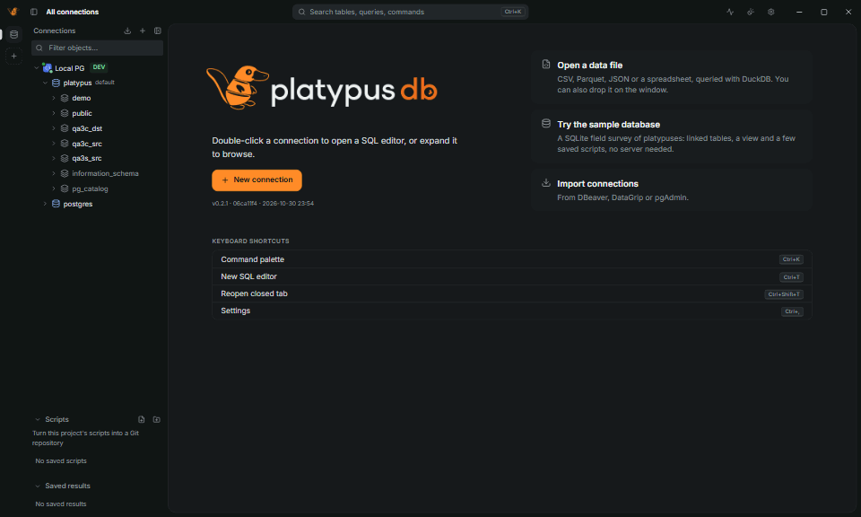
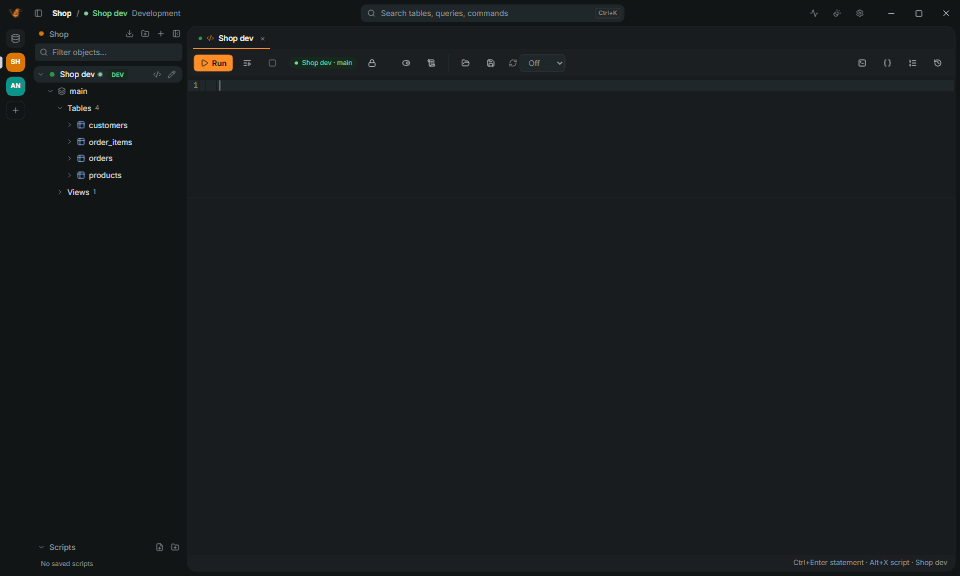
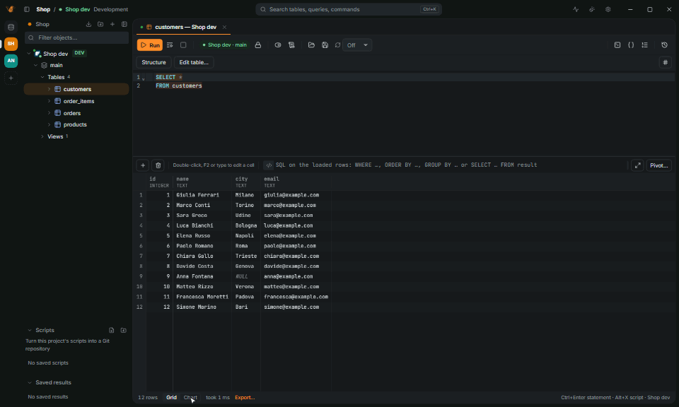
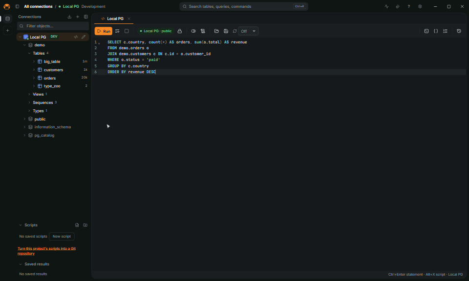
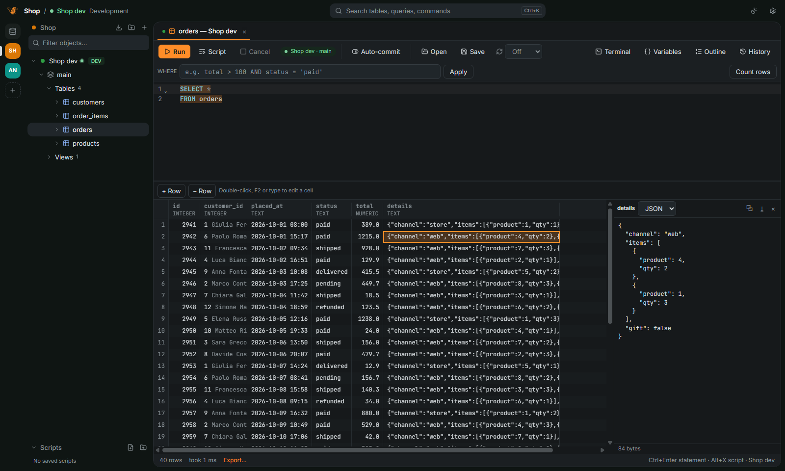
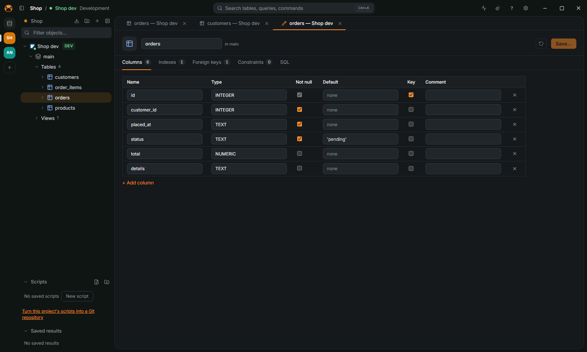
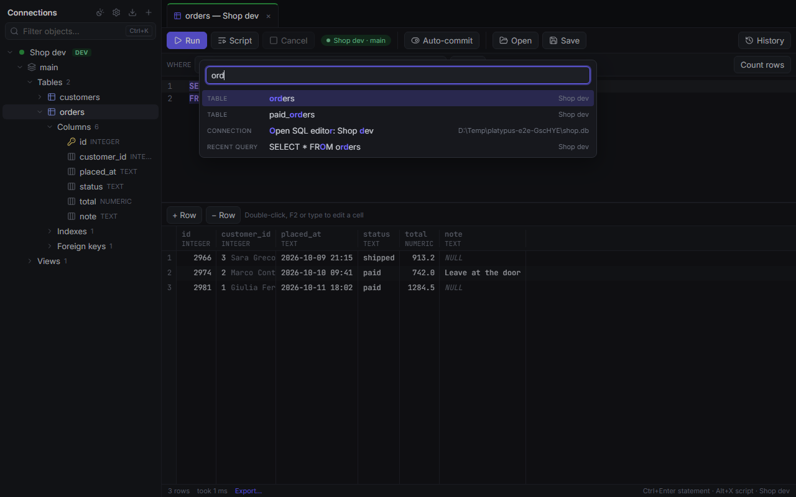

<h1 align="center">
  <picture>
    <source media="(prefers-color-scheme: dark)" srcset="docs/brand/platypus-db-on-dark.png" />
    
  </picture>
</h1>

  <strong>Un client SQL veloce e leggero per chi lavora con tanti database.</strong>

  
  
  
  

  <a href="README.md">English</a> · <b>Italiano</b>

PlatypusDB è un client SQL desktop per sviluppatori, DBA e analisti che in una giornata
lavorano con più database. Una sola app piccola esegue query, mostra e modifica i dati,
progetta tabelle, spiega le query lente e documenta gli schemi, e tiene le connessioni di
produzione ben distinte dalle altre. Un core in Rust con interfaccia Tauri 2 + React: un
installer di circa 5 MB, una finestra pronta in meno di mezzo secondo e una griglia che scorre
milioni di righe.

## Perché PlatypusDB

- **Leggero.** Circa 20 MB da scaricare su Linux, contro i 122 MB di DBeaver, i 346 MB di
  Beekeeper Studio e circa 1 GB di DataGrip; una finestra in meno di 500 ms e circa 130 MB di memoria con una
  connessione.
- **Sicuro in produzione.** Il tipo di connessione colora la cornice della finestra, le
  istruzioni rischiose chiedono conferma, la produzione si apre con il commit manuale e ogni
  salvataggio di righe modificate lascia uno script per annullarlo.
- **Tanti database, una sola app.** PostgreSQL, MySQL, MariaDB, SQL Server, Oracle,
  ClickHouse, SQLite, DuckDB, MongoDB, Redis, Elasticsearch, Cassandra, Snowflake, BigQuery e altri, con lo stesso editor e la
  stessa griglia.
- **Pronto per gli agenti.** Claude Code, Codex, Cursor e gli altri client MCP usano le tue
  connessioni salvate con l'accesso che dai a ognuno, e le loro modifiche aspettano il tuo OK.
- **Open source.** AGPL-3.0, nessun account, nessuna telemetria.

## Installazione

Scarica l'installer per il tuo sistema dalla
[pagina delle release](https://github.com/PaoloCisly/platypus-db/releases/latest): `.exe`/`.msi`
per Windows, `.dmg` per macOS, `.AppImage`/`.deb`/`.rpm` per Linux. L'app si aggiorna da sola.

1. Apri PlatypusDB e fai clic su **New connection**, oppure incolla l'URL di una connessione
   (`postgres://…`, `mysql://…`, un URL JDBC o una stringa ADO.NET).
2. Nessun database a portata di mano? **Prova il database di esempio** dalla schermata
   iniziale: un censimento di ornitorinchi in SQLite, con tabelle collegate, una vista e script
   salvati.
3. Premi `Ctrl+K` per la palette dei comandi: ogni azione, connessione e tabella è a poche
   lettere di distanza.

L'interfaccia è disponibile anche in italiano: Settings › Appearance › Language.

**Copia portatile**: metti l'eseguibile in una cartella con accanto una cartella `data` vuota.
Connessioni, impostazioni, cronologia e script stanno allora in `data`, e la cartella si può
spostare su un altro computer o su una chiavetta USB ([dettagli](docs/FEATURES.md#portable-copy)).

La [guida utente](docs/guide/README.md) (in inglese) continua da qui, un compito alla volta:
[primi passi](docs/guide/getting-started.md), connessioni, query, sicurezza, problemi comuni.

## Database

PostgreSQL, MySQL, MariaDB, SQL Server, Oracle, ClickHouse, SQLite, DuckDB, libSQL, MongoDB,
Redis, Elasticsearch, Cassandra, Snowflake, BigQuery, Databricks, Trino, IBM Db2, ODBC e i
database che parlano il protocollo PostgreSQL. Come si collega ciascuno, la versione più
vecchia supportata e cosa funziona si trovano nella [guida ai database](docs/guide/databases/README.md) (in inglese).

## Funzionalità

| Scrivere SQL | Modificare i dati in sicurezza |
|---|---|
|  |  |
| **Trovare i passi lenti** | **Sfogliare i dati** |
|  |  |
| **Progettare tabelle** | **Trovare tutto** |
|  |  |

Connessioni via SSH, proxy e accesso cloud; un editor SQL con completamento; un visualizzatore
e un editor dei dati; grafici e notebook; progettazione di tabelle, diagrammi ER e confronto
tra schemi; piani di esecuzione; attività del server; importazione, esportazione e
trasferimento; progetti e sette lingue. Tutte le funzionalità, area per area:
**[docs/FEATURES.md](docs/FEATURES.md)** (in inglese). Passo per passo: la
[guida utente](docs/guide/README.md) (in inglese). Scorciatoie da tastiera:
[docs/SHORTCUTS.md](docs/SHORTCUTS.md).

## Agenti (MCP) e CLI

Claude Code, Codex, Cursor e gli altri client MCP possono usare le tue connessioni salvate, con
l'accesso che dai a ognuno: nessuno, sola lettura (il predefinito) oppure lettura e scrittura.
Una modifica che un agente vuole eseguire apre prima una finestra di conferma nell'app.
Configurazione, strumenti, limiti e la CLI `platypus`: [docs/AGENTS.md](docs/AGENTS.md)
(in inglese).

## Prestazioni

| | PlatypusDB 0.1.0 | Obiettivo |
|---|---|---|
| Dall'avvio alla finestra pronta | 430–500 ms | < 500 ms |
| Memoria a riposo, 1 connessione | circa 130 MB | < 150 MB |
| Scorrimento di 1M di righe | 178 fps | 60 fps |
| 5M di righe in Parquet | 3,2 s, picco di 31 MB | in streaming |
| Installer | 5,4 MB | < 20 MB |

| | PlatypusDB | DBeaver CE | DataGrip | TablePlus | Beekeeper Studio |
|---|---|---|---|---|---|
| Runtime | Rust e la web view del sistema | Java, JRE incluso | Java, JetBrains Runtime incluso | Nativo (GTK su Linux) | Electron |
| Download per Linux | 19,5 MiB | 122 MiB | 1.047 MiB | 60 MiB | 346 MiB |
| Su disco | 46 MiB | 206 MiB | non misurato | 180 MiB | 1.105 MiB |
| Licenza | AGPL-3.0 | Apache 2.0 | Proprietaria | Proprietaria | GPLv3 |

Windows 11, Ryzen 7 9700X. Dimensioni dei download ufficiali per Linux di PlatypusDB 0.2.0,
DBeaver CE 26.2.3, DataGrip 2026.2.6, TablePlus 2.2.0 e Beekeeper Studio 6.2.0; avvio e memoria a confronto sono ancora da misurare.
Metodo, test di scala e i primi numeri su Linux in [docs/BENCHMARKS.md](docs/BENCHMARKS.md).

## Sviluppo

Compilazione, test, struttura del progetto e database di sviluppo:
[docs/DEVELOPMENT.md](docs/DEVELOPMENT.md). I prossimi passi sono in
[docs/ROADMAP.md](docs/ROADMAP.md); tutti i documenti sono elencati in
[docs/README.md](docs/README.md), e le novità di ogni release in [CHANGELOG.md](CHANGELOG.md).

## Contribuire

Segnalazioni di bug, idee e pull request sono benvenute: per qualsiasi cosa più grande di una
piccola correzione apri prima una [issue](https://github.com/PaoloCisly/platypus-db/issues).
[CONTRIBUTING.md](CONTRIBUTING.md) spiega come compilare, testare e proporre una modifica. Chi
partecipa segue il [Codice di condotta](CODE_OF_CONDUCT.md).

## Sicurezza

Segnala le vulnerabilità in privato, non in una issue pubblica: vedi [SECURITY.md](SECURITY.md).

## Licenza

PlatypusDB è distribuito con la [GNU Affero General Public License v3.0 o successiva](LICENSE)
(AGPL-3.0-or-later). Puoi usarlo, studiarlo, modificarlo e condividerlo liberamente; se lo
distribuisci, o offri a terzi una versione modificata come servizio, devi rilasciare il tuo
codice sorgente con la stessa licenza. Il codice e le risorse di terzi mantengono le proprie
licenze: vedi [THIRD-PARTY-NOTICES.md](THIRD-PARTY-NOTICES.md).
