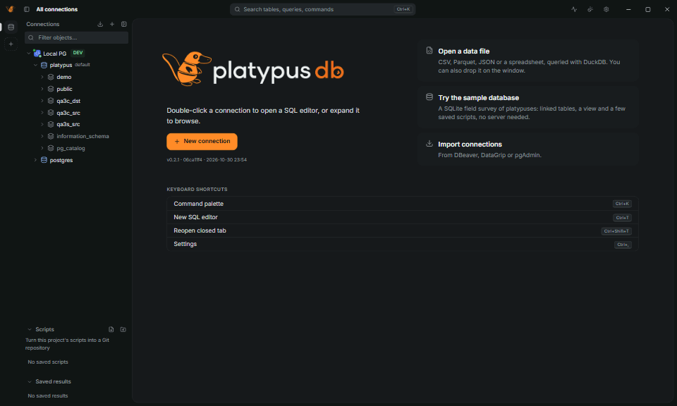
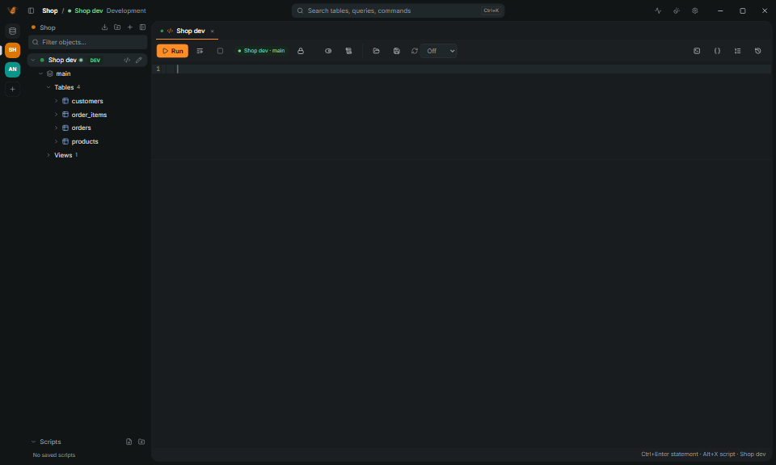
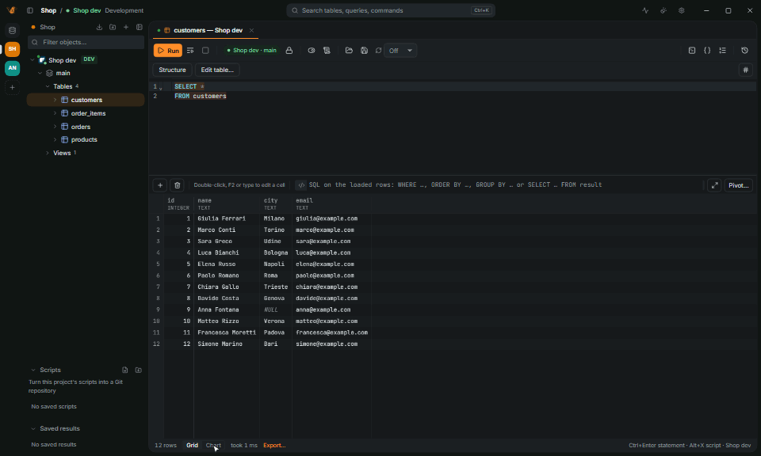
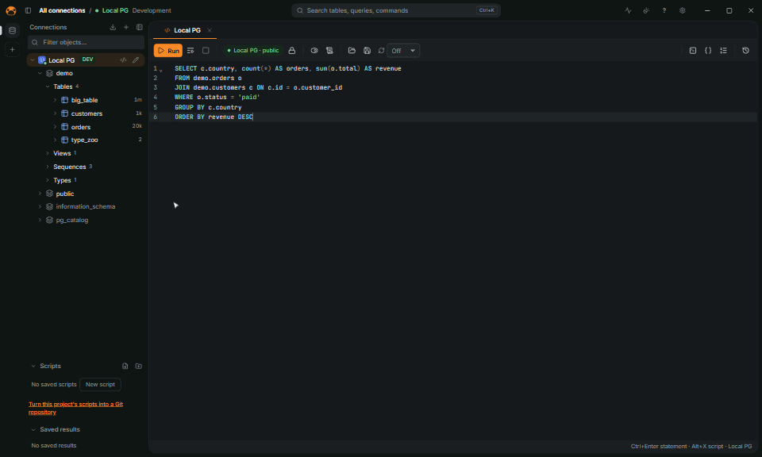

<h1 align="center">
  <picture>
    <source media="(prefers-color-scheme: dark)" srcset="docs/brand/platypus-db-on-dark.svg" />
    
  </picture>
</h1>

  <strong>A fast, small SQL client for people who work with many databases.</strong>

  
  
  
  

  <b>English</b> · <a href="README.it.md">Italiano</a>

PlatypusDB™ is a desktop SQL client for developers, DBAs and analysts who work with several
databases in a day. One small app runs queries, browses and edits data, designs tables,
explains slow statements and documents schemas, and keeps production connections clearly apart
from the others. A Rust core with a Tauri 2 + React interface: an installer of about 20 MB, a
window ready in about half a second, and a results grid that scrolls through millions of rows.

## Why PlatypusDB

- **Light.** A 20 MB installer on Windows and about 30 MB to download on Linux, against
  122 MB for DBeaver, 346 MB for Beekeeper Studio and about 1 GB for DataGrip; a window in
  about half a second.
- **Safe with production.** Connection types color the window frame, risky statements ask
  first, production opens in manual commit, and every save of edited rows leaves an undo script.
- **Many databases, one app.** PostgreSQL, MySQL, MariaDB, SQL Server, Oracle, ClickHouse,
  SQLite, DuckDB, MongoDB, Redis, Elasticsearch, Cassandra, Snowflake, BigQuery and more, with the same editor and grid.
- **Ready for agents.** Claude Code, Codex, Cursor and other MCP clients use your saved
  connections with the access you give each one, and their changes wait for your OK.
- **Open source.** AGPL-3.0, no account, no telemetry.

## Install

Download the installer for your system from the
[releases page](https://github.com/platypus-labs/platypus-db/releases/latest): `.exe`/`.msi` for
Windows, `.dmg` for macOS, `.AppImage`/`.deb`/`.rpm` for Linux. The app updates itself.

1. Open PlatypusDB and click **New connection**, or paste a connection URL
   (`postgres://…`, `mysql://…`, a JDBC URL or an ADO.NET string).
2. No database at hand? **Try the sample database** on the welcome screen: a SQLite field
   survey of platypuses, with linked tables, a view and saved scripts.
3. Press `Ctrl+K` for the command palette: every action, connection and table is a few letters
   away.

**Portable copy**: put the executable in a folder with an empty `data` folder beside it.
Connections, settings, history and scripts then live in `data`, and the folder can move to
another machine or a USB stick ([more](docs/user/FEATURES.md#portable-copy)).

The [user guide](docs/user/guide/README.md) goes on from here, task by task: [getting
started](docs/user/guide/getting-started.md), connecting, queries, safety, troubleshooting.

## Databases

PostgreSQL, MySQL, MariaDB, SQL Server, Oracle, ClickHouse, SQLite, DuckDB, libSQL, MongoDB,
Redis, Elasticsearch, Cassandra, Snowflake, BigQuery, Databricks, Trino, IBM Db2, ODBC and the
databases that speak the PostgreSQL protocol. How each one connects, its oldest supported
version and what works on it are in the [databases guide](docs/user/guide/databases/README.md).

## Features

| Write SQL | Edit data safely |
|---|---|
|  |  |
| **Find slow steps** | **Browse the data** |
|  |  |
| **Design tables** | **Find anything** |
|  |  |

Connections over SSH, proxies and cloud sign-in; a SQL editor with completion; a data viewer and
editor; charts and notebooks; table design, ER diagrams and schema comparison; query plans;
server activity; import, export and transfer; projects and seven languages. Every feature, area
by area: **[docs/user/FEATURES.md](docs/user/FEATURES.md)**. Task by task: the
[user guide](docs/user/guide/README.md). Keyboard shortcuts: [docs/user/SHORTCUTS.md](docs/user/SHORTCUTS.md).

## Agents (MCP) and the CLI

Claude Code, Codex, Cursor and other MCP clients can use your saved connections, with the access
you give each one: none, read only (the default) or read and write. A change an agent wants to
run opens a dialog in the app first. Setup, tools, limits and the `platypus` CLI:
[docs/user/AGENTS.md](docs/user/AGENTS.md).

## Performance

| | Measured | Target |
|---|---|---|
| Start to interactive window | 430–500 ms (0.1.0) | < 500 ms |
| Memory at rest, 1 connection | about 170 MB (0.3.0) | < 150 MB |
| Scrolling 1M rows | 178 fps (0.1.0) | 60 fps |
| 5M rows to Parquet | 3.2 s, 31 MB peak (0.1.0) | streaming |
| Windows installer | 20 MiB (0.6.0) | < 20 MB |

| | PlatypusDB 0.2.0 | DBeaver CE | DataGrip | TablePlus | Beekeeper Studio |
|---|---|---|---|---|---|
| Runtime | Rust and the system's web view | Java, JRE bundled | Java, JetBrains Runtime bundled | Native (GTK on Linux) | Electron |
| Linux download | 19.5 MiB | 122 MiB | 1,047 MiB | 60 MiB | 346 MiB |
| On disk | 46 MiB | 206 MiB | not measured | 180 MiB | 1,105 MiB |
| License | AGPL-3.0 | Apache 2.0 | Proprietary | Proprietary | GPLv3 |

Windows 11, Ryzen 7 9700X. Sizes of the official Linux downloads of PlatypusDB 0.2.0, DBeaver CE
26.2.3, DataGrip 2026.2.6, TablePlus 2.2.0 and Beekeeper Studio 6.2.0; start and memory side by side are still to be measured.
Method, scale tests and the first Linux numbers in [docs/dev/BENCHMARKS.md](docs/dev/BENCHMARKS.md).

## Development

Build, test, project layout and the dev databases: [docs/dev/DEVELOPMENT.md](docs/dev/DEVELOPMENT.md).
What comes next is in [docs/dev/ROADMAP.md](docs/dev/ROADMAP.md); every document is listed in
[docs/README.md](docs/README.md), and the changes of each release in
[CHANGELOG.md](CHANGELOG.md).

## Contributing

Bug reports, ideas and pull requests are welcome: open an
[issue](https://github.com/platypus-labs/platypus-db/issues) first for anything larger than a small
fix. [CONTRIBUTING.md](CONTRIBUTING.md) explains how to build, test and submit a change. Everyone
taking part follows the [Code of Conduct](CODE_OF_CONDUCT.md).

## Security

Please report vulnerabilities privately, not in a public issue: see [SECURITY.md](SECURITY.md).

## License

PlatypusDB is licensed under the [GNU Affero General Public License v3.0 or later](LICENSE)
(AGPL-3.0-or-later). You can use, study, change and share it freely; if you distribute it, or
run a changed version as a service for others, you must release your source code under the
same license. Third-party code and assets keep their own licenses:
see [THIRD-PARTY-NOTICES.md](THIRD-PARTY-NOTICES.md).

The name and the logo are not part of that license. PlatypusDB™ and the PlatypusDB logo are
trademarks of the PlatypusDB maintainers: as AGPL section 7(e) allows, no rights are granted
under trademark law, and the logo and icon files listed in [NOTICE](NOTICE) are © 2026
PlatypusDB maintainers, all rights reserved. You can name the project, link to it and
redistribute the official builds unchanged; a fork must ship under its own name and icons. The
details are in [TRADEMARKS.md](TRADEMARKS.md).
