# Revisione UX (gruppo T)

Primo giro della scheda di controllo del gruppo T ([ROADMAP.md](ROADMAP.md), "Gruppo T — Revisione UX")
su tutte le sezioni dell'app, il 1° novembre 2026. Le schermate vengono dall'inventario visivo
([INVENTORY.md](INVENTORY.md)), tema scuro, inglese, a 1280×720 e 2560×1440
(PLATYPUS_INVENTORY_SIZE); riscontro, attesa e tastiera, che una foto non mostra, sono stati
controllati anche sul codice. Qui sono copiate solo le schermate che mostrano un problema.

Gravità: **grave** = azione senza riscontro, caricamento invisibile, testo che sborda o si
sovrappone, stato vuoto senza azione, o qualcosa che blocca o inganna l'utente; **media** = si usa
ma con fatica; **minore** = rifinitura. Una correzione fatta lo dice accanto al problema (✅).

## Navigazione, editor, dati e dialog

### Pagina iniziale

Schermate 01, 30 (con "Recent"). A 2560×1440 il blocco è centrato bene: la correzione della centratura regge. A 1280×720 il contenuto supera di poco l'altezza e compare una barra di scorrimento verticale. Logo, azione principale e scorciatoie si capiscono.

- **minore** — A 1280×720 la pagina scorre per pochi pixel: si vede la barra a destra e l'ultima riga delle scorciatoie tocca il bordo (01-welcome) — ridurre lo spazio verticale tra logo e testo, oppure le schede di destra, sotto una certa altezza.
- **minore** — "Import connections" ed "Export connections" hanno la stessa icona di download (01-welcome) — per l'esportazione usare l'icona di upload/condivisione.

Va bene: centratura a 2560, gerarchia (pulsante primario unico), stato vuoto "Recent" assente finché non serve, scorciatoie leggibili.

### Rail dei progetti e navigator (menu contestuali compresi)

Schermate 02, 30, 31, 102–104. Albero chiaro, con i conteggi per gruppo. I sottomenu del menu delle tabelle ci sono e accorciano il menu, ma il sottomenu "Data" esce dalla finestra.

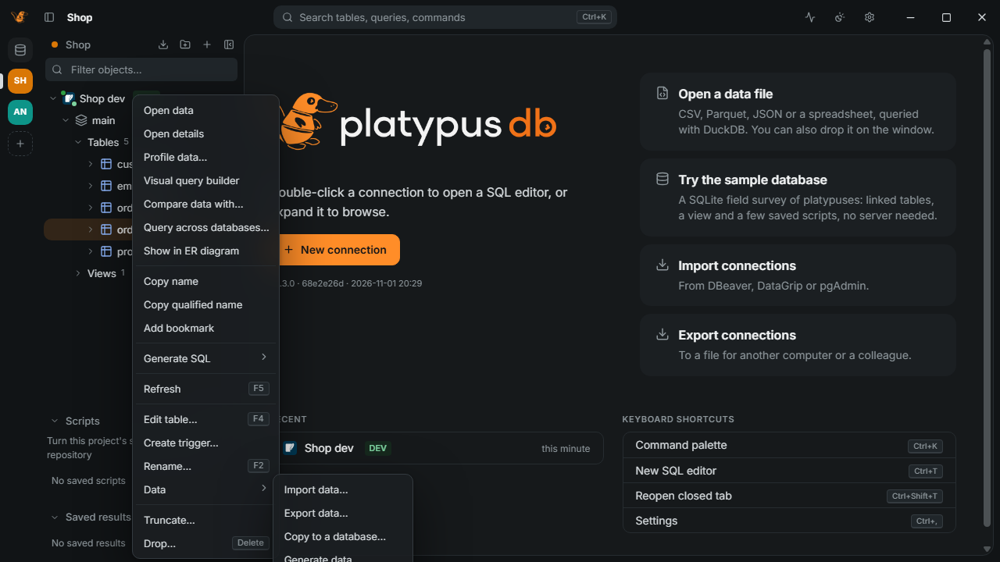

- **grave** — Il sottomenu "Data" a 1280×720 esce dal fondo della finestra: "Generate data…" è tagliato e "Dump to SQL file…" non si vede (104-table-menu-submenu-data; a 2560 si vedono tutte e 5 le voci). Il menu principale si tiene dentro la finestra (`components/ContextMenu.tsx:75-88`), il sottomenu no (`ContextMenu.tsx:188-191`, posizionato solo dal CSS `.context-menu.submenu`, `styles/dialogs.css:67`) — misurare il sottomenu all'apertura e spostarlo in alto (o a sinistra) quando non entra, come il menu principale.
- **media** — Con un menu più alto della finestra si attiva `overflow-y: auto` (`ContextMenu.tsx:86`), che, come dice il commento, taglia i sottomenu — in quel caso aprire il sottomenu come pannello fisso fuori dal menu che scorre, non dentro.
- **media** — Il menu delle tabelle ha ancora 17 voci al primo livello e a 1280×720 arriva al bordo inferiore (102) — portare nel sottomenu le azioni di analisi ("Compare data with…", "Query across databases…", "Visual query builder") e lasciare in alto solo apertura, profilo e diagramma.
- **minore** — "Add bookmark" non dà riscontro: aggiunge il segnalibro (`components/Navigator.tsx:1591-1597`) senza toast — usare lo stesso toast delle copie ("Added to bookmarks").
- **minore** — Nel dialog "New project" (31) manca la X di chiusura che hanno gli altri dialog (Export, Import, Test connections). Esc funziona (`projects/ProjectDialog.tsx:81`) — aggiungere `DialogHeader` con la X per coerenza.
- **minore** — Nella sezione "Scripts", vuota, la riga "Turn this project's scripts into a Git repository" compare prima di "No saved scripts" (01, 02) e sembra l'azione principale — nello stato vuoto mettere prima "No saved scripts" con un pulsante "New script" e spostare la proposta Git in fondo o nel menu della sezione.

Va bene: copia con toast (non visibile nelle foto, ma presente nel codice), voci distruttive in fondo (Truncate, Drop), scorciatoie accanto alle voci, sottomenu "Generate SQL" che resta dentro la finestra, niente menu del browser.

### Tab e barra dei tab

Schermate 105–107. Il tab fissato si riconosce (icona con la puntina) e il menu ha "Pin tab" / "Unpin tab".

- **minore** — Il menu del tab si apre sopra la barra dei tab e copre il tab cliccato e quello vicino (105, 107) — aprirlo sotto il tab, all'altezza del suo bordo inferiore.
- **minore** — Il tab fissato mostra solo l'icona con una puntina di pochi pixel (106): senza passare il mouse non si sa quale tabella sia — se il tooltip c'è già va bene; altrimenti aggiungere il titolo come tooltip.

Va bene: menu breve e raggruppato (apertura / fissaggio / chiusura).

### Editor SQL e risultati

Schermate 03, 04, 05, 06, 111. Esecuzione, errore e stato vuoto sono chiari. L'errore ha "Copy error"; il risultato vuoto dice "No rows".

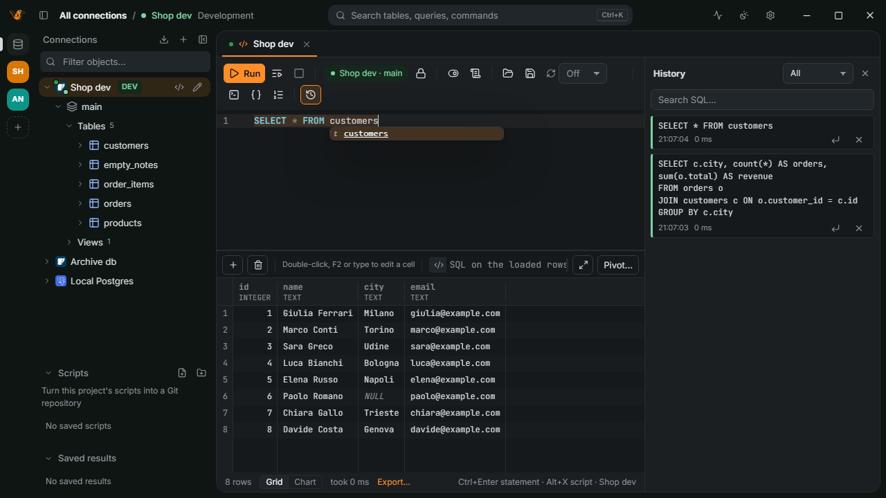

- **media** — Con il pannello History aperto, la barra degli strumenti dell'editor va su due righe e il campo "SQL on the loaded rows" resta troncato (04-query-history) — sotto una certa larghezza raggruppare le icone secondarie in un menu "…", oppure ridurre il campo a un'icona che lo apre.
- **minore** — Il selettore "Off" nella barra non ha etichetta: non si capisce che è l'aggiornamento automatico (03) — scrivere "Auto-refresh: off" come nella dashboard, o mettere un'icona con un tooltip.
- **minore** — Nello stato "No rows" le linee verticali delle colonne attraversano il messaggio vuoto (06) — non disegnarle sotto l'intestazione quando non ci sono righe.
- **minore** — L'errore inizia con "1:" senza spiegazione (05): è la riga — scrivere "Line 1:" o metterlo come nota a parte.

Va bene: suggerimento di completamento, statistiche della colonna al passaggio del mouse (111) con titolo e "of all 24 rows", stato di errore con azione, conteggio righe e tempo nella barra di stato.

### Griglia e modifica dei dati

Schermate 07, 108, 109, 110, 106. Il riscontro c'è ("1 row changed", Save in evidenza, cella cambiata colorata, anteprima SQL con transazione spiegata).

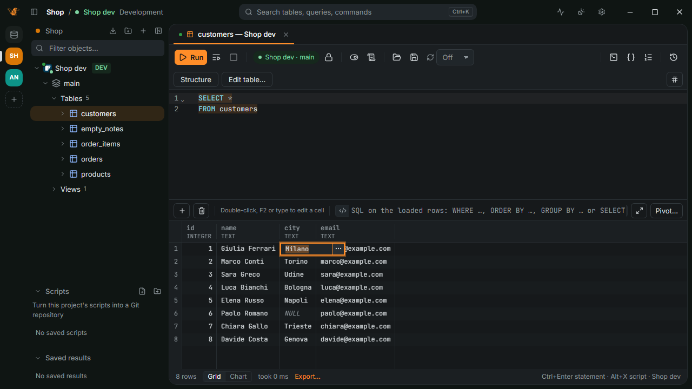

- **media** — Il pulsante "…" dell'editor della cella si sovrappone alla colonna successiva e copre parte dell'email (108-grid-editing-cell-editor) — metterlo dentro la larghezza della cella, o allargare l'editor e coprire tutta la colonna vicina con lo sfondo.
- **minore** — Le etichette delle chiavi esterne ("1 Giulia Fer…") sono tagliate senza puntini (106) — `text-overflow: ellipsis` sulla cella.
- **minore** — Con una riga nuova la barra di stato dice ancora "8 rows" mentre la barra in alto dice "2 rows changed" (110) — accettabile; eventualmente "8 rows + 1 new".

Va bene: anteprima delle modifiche con focus su Close e Save primario (109), riga nuova con DEFAULT visibile, annulla/scarta a portata di mano.

### Pagine degli oggetti

Schermate 08–15. Schede chiare, con i conteggi; azioni principali in alto.

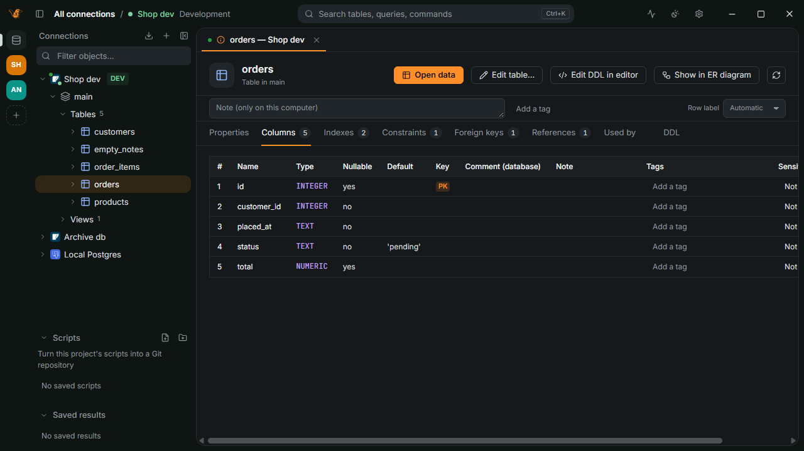

- **grave** — Il pulsante Refresh della pagina (icona in alto a destra) ricarica senza alcun segno: i dati vecchi restano visibili e non c'è caricamento (`objects/ObjectTab.tsx:164-182` non tocca `data` né mostra uno stato; il pulsante è a `ObjectTab.tsx:306`) — mentre ricarica, rendere il pulsante "occupato" (icona che gira, disabilitato), e a fine ricarica un riscontro breve se non cambia nulla.
- **media** — A 1280×720 la tabella Columns è più larga della pagina: la colonna "Sensitivity" è tagliata ("Sensi", "Not") e serve lo scorrimento orizzontale (09-object-page-columns) — dare a "Tags" e "Note" una larghezza minore, o ridurre la colonna "Add a tag" ripetuta su ogni riga a un'azione al passaggio del mouse.
- **minore** — Nell'icona del tab delle pagine oggetto c'è un cerchio con la "i" arancione, che sembra un avviso (08–15) — usare l'icona del tipo di oggetto (tabella), come nel navigator.
- **minore** — "Used by" è l'unica scheda senza conteggio (08) — aggiungerlo, o lasciarlo vuoto solo finché non è calcolato.
- **minore** — In Indexes "Unique" mostra "yes" in viola e una cella vuota per "no", mentre Columns scrive "yes/no" (09, 10) — stesso formato in tutte le schede.
- **minore** — La scheda DDL non ha un pulsante di copia (15) — aggiungere "Copy" con il toast.

Va bene: intestazione con tipo e schema, azioni "Open data" / "Edit table…" / "Show in ER diagram", tabelle collegate cliccabili, "Used by" con la riga che spiega quali colonne non sono usate.

### Editor grafico della tabella

Schermata 16. Chiaro: nome modificabile, schede con conteggi, "Save…" disabilitato finché non cambia nulla, "+ Add column".

Nessun problema rilevato nelle schermate.

Va bene: colonne allineate, segnaposto "none" per i default, X di rimozione per riga.

### Diagramma ER

Schermata 17. Correzioni già fatte presenti: "Add tables…" è la nuova etichetta, barra con zoom/auto layout/esportazioni.

- **minore** — L'asterisco dopo i nomi delle colonne (NOT NULL) e il colore arancione delle chiavi di order_items non hanno una legenda (17) — una riga di legenda nella barra dello zoom, o un tooltip sull'asterisco.
- **minore** — In order_items `order_id` e `product_id` mostrano solo "PK", ma sono anche chiavi esterne (17) — mostrare "PK FK" come fa `customer_id` con "FK".

Va bene: trascinamento e zoom presenti, linee delle relazioni leggibili, sottotitolo "all tables".

### Explain

Schermate 18, 19. Il dialog spiega cosa incollare; "Open" resta spento finché il campo è vuoto.

- **minore** — Nel piano SQLite la riga di intestazione "QUERY PLAN" diventa il nodo radice ed è selezionata: il pannello di destra mostra "Operation: QUERY PLAN", che non dice niente (19) — non trattare l'intestazione come nodo; all'apertura selezionare il primo nodo vero, oppure scrivere nel pannello "Choose a step to see its details".

Va bene: schede Tree/Graph/Text/Table, Compare…, copia.

### Profilo dei dati

Schermata 20. Le correzioni già fatte reggono: l'istogramma ha titolo ("Distribution"), una riga di spiegazione e gli assi (0/2, min/max). Il caricamento c'è ("Reading the rows…", Refresh disabilitato mentre legge, `analysis/TableProfileTab.tsx:179-206`).

- **minore** — I valori delle statistiche non sono allineati tra colonne numeriche (x≈638) e testuali (x≈668) (20) — una sola colonna di griglia per le etichette.
- **minore** — L'istogramma è piccolo (circa 150 px) con molto spazio vuoto a destra (20) — farlo occupare la larghezza disponibile della colonna.

Va bene: riquadri di sintesi (Rows, Columns, Null values, Duplicates), "First 100,000 rows" esplicito, "Most frequent" per i testi.

### Dashboard

Schermata 21. Lo stato vuoto c'è e porta all'azione.

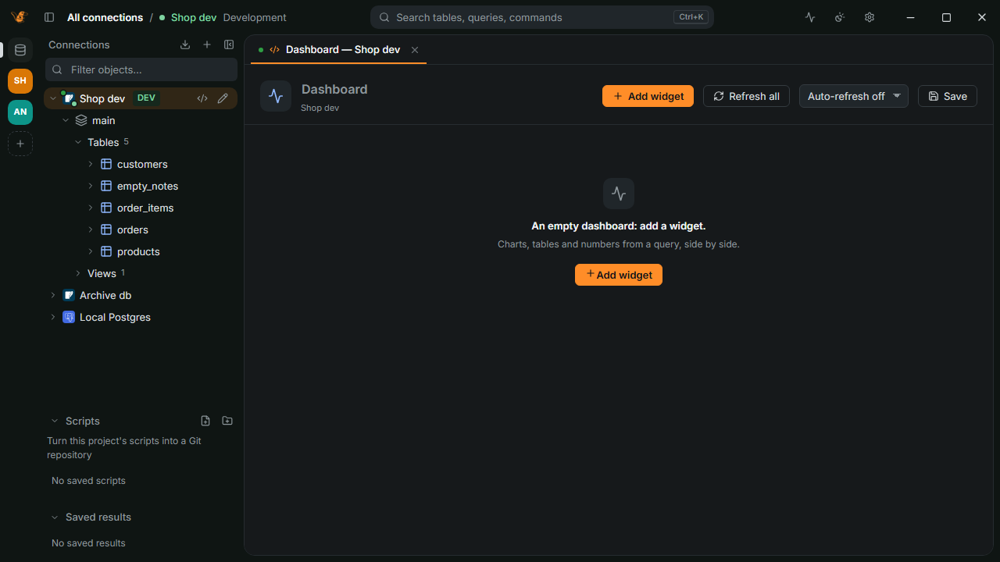

- **media** — "Save" della dashboard non dà riscontro: quando la dashboard è già salvata o il nome non cambia, salva senza segni visibili (`dashboard/DashboardTab.tsx:150-167`, l'unico segnale è il pallino "non salvato" del tab che sparisce) — toast "Dashboard saved".
- **minore** — Nel pulsante "+ Add widget" dello stato vuoto il "+" è un carattere attaccato al testo e più in alto, diverso dal pulsante della barra, che usa l'icona (21-dashboard) — usare la stessa `Icon name="plus"`.
- **minore** — Il titolo "Dashboard" è grigio come un segnaposto (21): non si capisce che si può rinominare — testo pieno con una matita al passaggio del mouse.

Va bene: "Executing…" per widget mentre girano (`dashboard/WidgetView.tsx:40,74`), "Refresh all", "Auto-refresh off" esplicito.

### Import, export, copia e profili di trasferimento

Schermate 22, 23, 24. I lavori hanno avanzamento, "Stop" e chiusura (`transfer/job.tsx:84-89`).

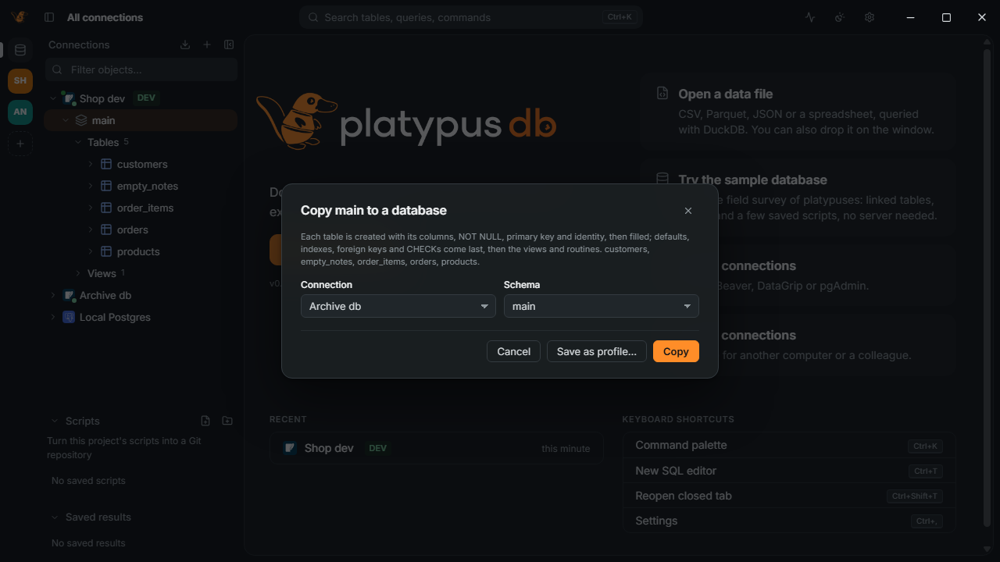

- **media** — Nel dialog "Copy main to a database" l'elenco delle tabelle è attaccato alla fine della frase descrittiva ("…then the views and routines. customers, empty_notes, …") e sembra parte del testo (24-transfer) — metterlo in una riga a parte con un'etichetta ("Tables: 5 — customers, …") o come elenco con caselle.
- **minore** — Nei dialog di import (23) e di import delle connessioni (113) il focus iniziale va sulla X di chiusura, che appare evidenziata in arancione, invece che sul primo controllo utile: `ui/modalA11y.ts` dà il focus al primo elemento focalizzabile, che è la X — saltare il pulsante di chiusura dell'intestazione nella scelta del primo elemento (es. `:not(.dialog-close)`).
- **minore** — "Save as profile…" nel dialog di import è attivo anche senza file (23) — disabilitarlo come "Import".

Va bene: titoli che dicono cosa succede ("Export 1 table", "Import data into customers"), formati e opzioni chiari, "Formulas as text, for spreadsheets" spiegato nel testo.

### Dialog di connessione e import delle connessioni

Schermate 25–29, 63, 112, 113. Correzioni già fatte presenti: titolo della sezione in alto ("General", "Network", …) e voci del menu laterale allineate. Il pallino accanto a "Network" però c'è ancora, con l'SSH attivo.

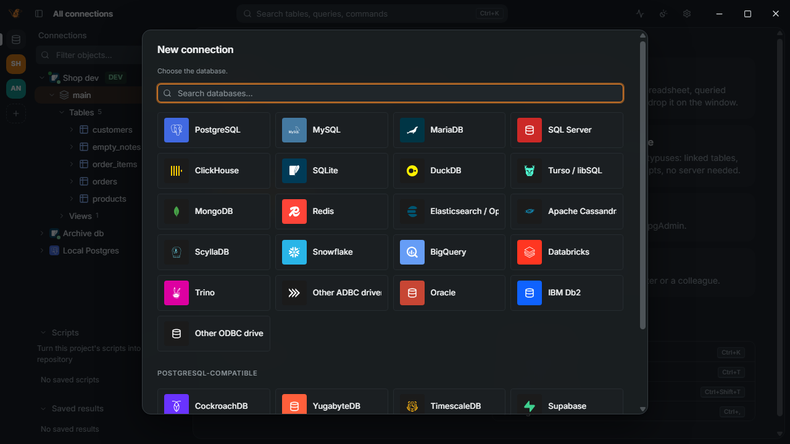

- **grave** — Nella scelta del database i nomi lunghi sono tagliati a metà, senza puntini: "Elasticsearch / Op", "Apache Cassandr", "Other ADBC drive", "Other ODBC drive" (25-driver-picker, anche a 2560×1440). Il CSS vuole due righe (`styles/dialogs.css:1878-1886`, `line-clamp: 2`) ma `button { white-space: nowrap }` (`styles/base.css:148`) le annulla — `white-space: normal` su `.driver-tile > span:last-child`.
- **grave** — "Test connection" non mostra nessun caricamento: durante la prova il pulsante è solo disabilitato, con la stessa etichetta, e non si può annullare (`components/ConnectionDialog.tsx:436-447`, pulsante a `:1338`). Verso un host che non risponde si aspetta fino al timeout (e prima magari lo scaricamento del driver, `withDriver`) senza capire se sta succedendo qualcosa — etichetta "Testing…" con spinner al posto del testo e, se possibile, "Cancel".
- **media** — Il pallino accanto a "Network" (112) è spiegato solo con il tooltip ("Has settings", `ConnectionDialog.tsx:579-594`) e non è coerente: in 28 Network ha certificato, proxy e comandi compilati ma nessun pallino, e in 29 Init ha schema, fuso orario e statement ma nessun pallino — calcolarlo su tutti i campi della pagina, oppure toglierlo come previsto dalla correzione già nota.

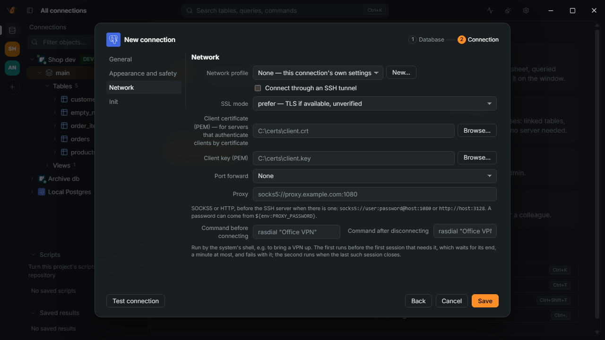
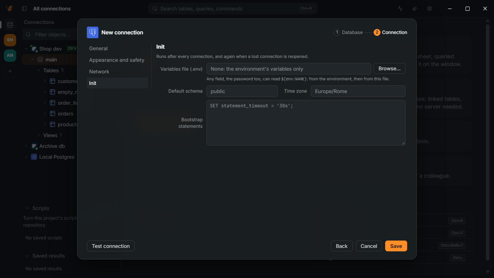
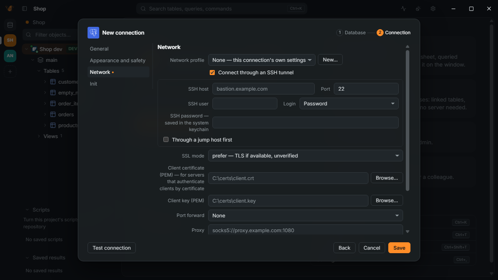

- **media** — "Command after disconnecting" è un campo stretto e il valore è tagliato ("rasdial "Office VPI"), mentre l'etichetta occupa metà riga (28-connection-form-3) — i due comandi uno sotto l'altro, a tutta larghezza.
- **minore** — Etichette molto lunghe a sinistra: "Client certificate (PEM) — for servers that authenticate clients by certificate" va su 4 righe, "SSH password — saved in the system keychain" su 3 (28, 112) — etichetta corta ("Client certificate") e spiegazione come testo d'aiuto sotto il campo.
- **minore** — A 1280×720 la scelta del database non ha la X e il suo unico "Cancel" è in fondo alla lista, fuori dalla vista (25; a 2560 si vede). Esc funziona (`components/DriverPicker.tsx:238`) — X nell'intestazione o "Cancel" fisso in basso.
- **minore** — In "Projects" (27) le pillole "Shop" e "Analytics" non mostrano se sono scelte o no — stato selezionato visibile (riempimento o spunta).
- **minore** — In "Test connections" (63) la versione di Local Postgres è troncata con "…" — tooltip con il testo intero.

Va bene: passi "1 Database — 2 Connection", Back/Cancel/Save sempre visibili, segnaposti utili, spiegazioni sotto proxy e comandi, import delle connessioni con le sorgenti trovate ("Found: DBeaver") e il percorso del file spiegato (113), Test connections con esito per riga e "Test again".

### Palette dei comandi e ricerca

Schermata 32. La correzione già fatta del campo regge: il campo ha un'altezza normale. Risultati raggruppati (Table / Action), corrispondenze evidenziate, voce disabilitata con il motivo ("No result with rows in the tab shown"), legenda dei tasti e conteggio.

Nessun problema rilevato.

### Dialog di conferma

Schermata 64. Chiaro: titolo con l'oggetto, conseguenza spiegata, SQL mostrato, "Open in editor", pulsante distruttivo rosso. Esc chiude e il focus parte dalla scelta che non perde nulla (`ui/ask.tsx:27,49`).

Nessun problema rilevato.

## Analisi, schema e amministrazione

### Costruttore visuale di query

Schermate 65–66 (1280×720 e 2560×1440), `apps/desktop/src/builder/QueryBuilder.tsx`. La schermata si capisce: lista delle tabelle a sinistra, canvas, WHERE, SQL generato e i due pulsanti. Le correzioni del gruppo T funzionano: la sidebar si ridimensiona (`PanelResizer`, misura ricordata) e i riquadri hanno la maniglia in basso a destra. I problemi sono nell'unione delle tabelle e nella tastiera.

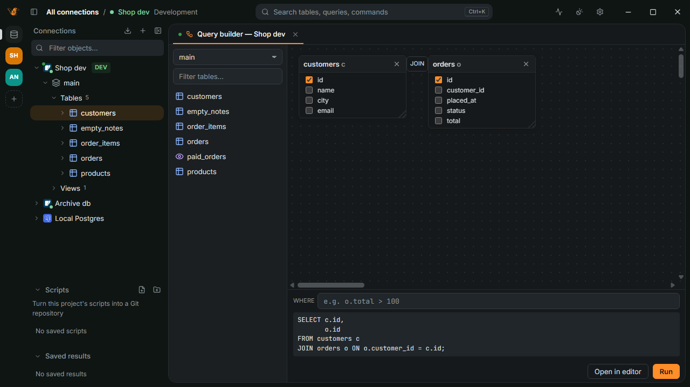

- **media** — Il join si vede solo come una pastiglia "JOIN" schiacciata tra i due riquadri (66): la seconda tabella viene messa attaccata alla prima, la linea del join (centro-centro, `QueryBuilder.tsx:313-318`) finisce sotto i riquadri e non si vede su quali colonne avviene l'unione. Le colonne si leggono solo nel tooltip — Lasciare spazio quando si aggiunge una tabella (almeno 60–80 px), disegnare la linea tra le colonne collegate e scrivere `customer_id = id` sotto la pastiglia.
- **media** — Cliccare la pastiglia passa da JOIN a LEFT JOIN, ma non c'è niente che lo dica (la pastiglia sembra un'etichetta) e il cambio non dà altro segnale che la parola nuova (`QueryBuilder.tsx:322-333`) — Dare alla pastiglia l'aspetto di un pulsante o di un menu a tendina (JOIN / LEFT JOIN), con un'icona a freccia.
- **media** — Tastiera: le tabelle della lista si aggiungono solo trascinando o con il doppio clic; le righe `<li>` non ricevono il focus e non c'è Invio né un pulsante "Aggiungi" (`QueryBuilder.tsx:281-293`). Anche lo spostamento dei riquadri è solo con il mouse — Rendere le righe focalizzabili (`tabIndex=0`, Invio = aggiungi) e mettere un "+" visibile al passaggio del mouse.
- **minore** — A 2560×1440 i riquadri restano piccoli in alto a sinistra in un canvas enorme e vuoto; le scrollbar orizzontali compaiono anche quando non c'è niente da scorrere (65, 66) — Mostrare le scrollbar solo quando il contenuto sborda.
- **minore** — "Run" apre una nuova scheda dell'editor e la esegue: il pulsante non lo dice — Etichetta "Esegui nell'editor" o tooltip.

Va bene: titolo della scheda, stato vuoto con istruzione ("Drag tables here…"), SQL aggiornato subito, pulsanti disattivati senza tabelle, sidebar e riquadri ridimensionabili.

### Notebook

Schermate 67–68, `apps/desktop/src/notebook/NotebookTab.tsx`, `NotebookCell.tsx`. Le celle sono leggibili e ognuna ha i suoi pulsanti. Mancano il riscontro su salvataggio ed esportazione e la possibilità di fermare una cella che gira.

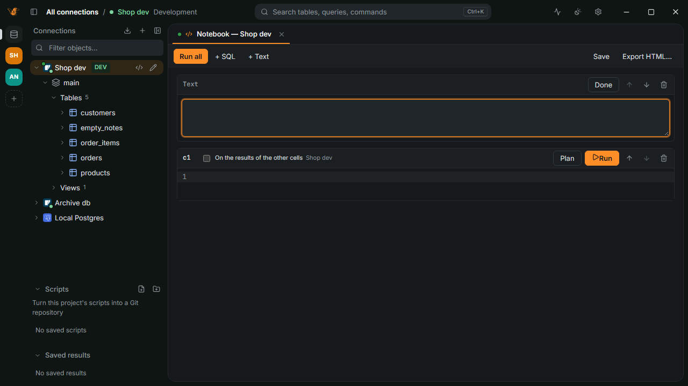

- **grave** — "Export HTML…" scrive il file e non dice niente: nessun toast, nessun link per aprirlo (`NotebookTab.tsx:398-408`). Anche "Save" dà come unico segnale il cambio del titolo della scheda (`NotebookTab.tsx:346-359`) — Toast "Esportato in <file>" con "Apri la cartella", e toast "Salvato" come per gli script.
- **grave** — Una cella o "Run all" in esecuzione non si può fermare: c'è solo il bordo arancione e il pulsante Run disattivato (`NotebookCell.tsx:146,162`, `notebook.css:52`), nessun "Stop", nessun indicatore di caricamento nella cella. Una query lunga blocca il notebook — Mettere al posto di Run un pulsante "Stop" (stessa cancellazione dell'editor SQL) e lo spinner nella riga di stato della cella; "Run all" diventa "Ferma" mentre gira.
- **media** — Il notebook nuovo (67) si apre con una cella di testo vuota in modifica, senza segnaposto, e una cella SQL vuota: non dice a cosa serve né come si scrive (Markdown, Ctrl+Invio) — Segnaposto nella textarea ("Scrivi in Markdown… Esc per finire") e nella cella SQL ("SELECT … — Ctrl+Invio per eseguire").
- **media** — "On the results of the other cells" è un'etichetta lunga e oscura: si capisce solo dal tooltip che interroga c1, c2… (`NotebookCell.tsx:150-153`) — Etichetta breve ("Sui risultati di c1, c2…") o un selettore "Esegui su: Shop dev / risultati delle celle".
- **media** — "Elimina cella" cancella subito, testo e risultato compresi, senza conferma né annulla (`NotebookTab.tsx:337-344`) — Toast "Cella eliminata · Annulla".
- **minore** — Nel pulsante Run l'icona tocca il testo ("▷Run", 67–68), a differenza del Run dell'editor — Stesso spazio icona/testo del resto.

Va bene: Esc e Ctrl+Invio chiudono la modifica del testo (`NotebookCell.tsx:80`), il testo vuoto non in modifica dice "double-click to write", righe e tempo del risultato, Grid/Chart per cella, spostamento celle disattivato ai bordi.

### Grafici, pivot e dashboard

Schermate 69–72, `apps/desktop/src/analysis/Chart.tsx`, `ChartView.tsx`, `PivotDialog.tsx`. Il pannello di configurazione è chiaro e il pivot spiega cosa fa; il grafico invece non dice cosa mostra.

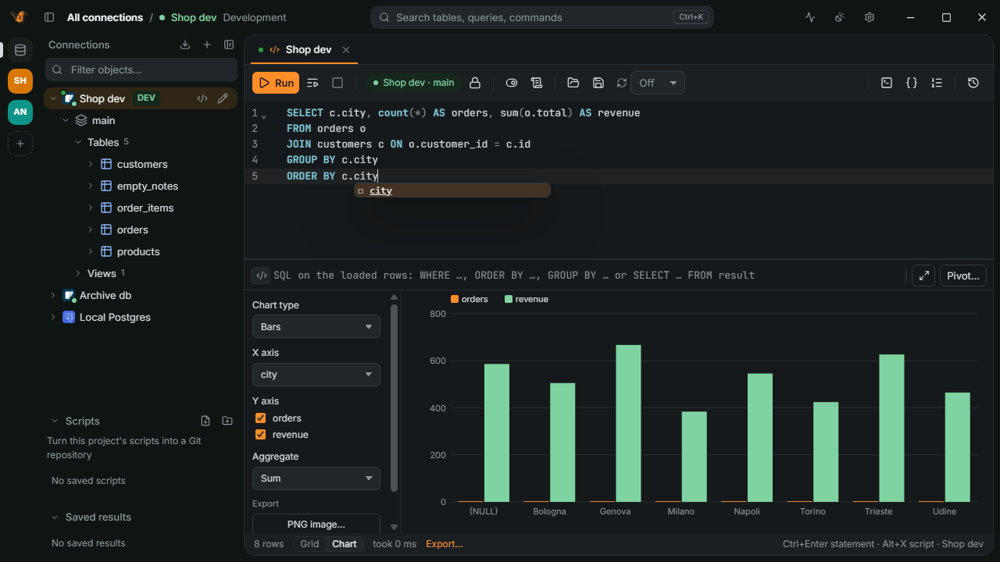

- **grave** — Il grafico a barre non ha titolo né titoli degli assi: c'è solo la legenda "orders / revenue" (`Chart.tsx:60-130`, nessun testo per gli assi). Chi guarda il PNG esportato non sa cosa misura l'asse Y — Titolo automatico ("revenue e orders per city", modificabile) e nomi degli assi (X = colonna scelta, Y = serie o aggregato "Somma di …").
- **grave** — Due serie di scala molto diversa sullo stesso asse: "orders" (4–8) diventa una riga piatta a zero sotto "revenue" (≈600) e sembra assente (69, anche a 2560×1440) — Quando le scale differiscono di più di 10×, secondo asse Y a destra, oppure un avviso "orders è fuori scala: mostrala da sola" con un clic.
- **media** — Torta (70): nessuna percentuale o valore sulle fette, e colori quasi uguali per fette vicine (Genova/Trieste arancioni, Napoli/Torino viola): con 8 categorie la legenda non basta — Percentuale sulle fette grandi, colori distinti della palette senza ripetere tonalità vicine.
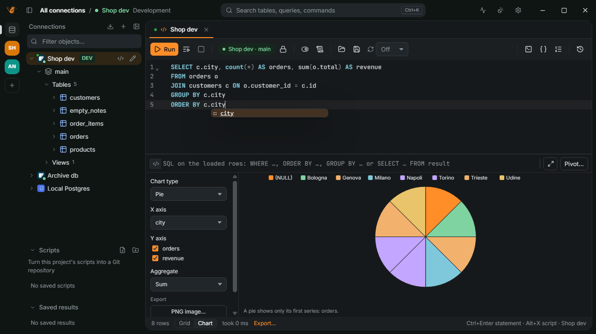

- **minore** — A 1280×720 il pannello delle opzioni scorre e "Export" (PNG/SVG) è tagliato in fondo (69) — Esportazione in alto o nel menu "Export…" della barra di stato, che c'è già.
- **minore** — Pivot (71): "Value: (count the rows)" e "Aggregate: Count" dicono la stessa cosa due volte — Con "(count the rows)" nascondere o disattivare "Aggregate".

Va bene: il dialog del pivot ha una riga che spiega cosa fa, si chiude con Esc (`PivotDialog.tsx:60`), il risultato scrive la query nel campo SQL con "SQL view · 8 rows" e la X per toglierla (72); la torta dice che mostra solo la prima serie; a 2560×1440 le barre usano tutto lo spazio.

### Confronto schemi e altri strumenti di schema

Schermate 73–75, `apps/desktop/src/schema/CompareDialog.tsx`, `LintDialog.tsx`. Entrambi i dialog hanno una riga di spiegazione, si chiudono con Esc e clic fuori, e il confronto mostra "Comparing…" mentre lavora.

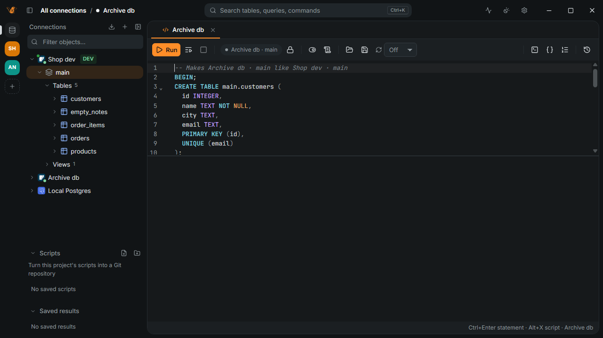

- **grave** — Controllo dello schema senza problemi: "No problems found." è mostrato con `LoadingState` (`LintDialog.tsx:66-67`), cioè con l'icona di caricamento e `aria-busy`: sembra che stia ancora lavorando — Usare uno stato vuoto/riuscito (icona di spunta, "Nessun problema in main").
- **media** — Il confronto chiude il dialog e apre lo script nell'editor della destinazione (74) senza un riassunto: non dice quante tabelle crea, modifica o elimina, e i `DROP` non sono evidenziati prima di eseguire — Riepilogo nel commento in testa e in un toast ("2 create, 1 modificata, 1 eliminata"), con un avviso se ci sono DROP.
- **minore** — Il confronto non si può annullare mentre gira (tutto disattivato, `CompareDialog.tsx:108-162`) — Pulsante "Annulla" attivo durante "Comparing…".
- **minore** — Il titolo "Compare main with..." non dice di quale connessione è `main` (73); il pulsante è "Close" invece di "Cancel" come negli altri dialog con un'azione — "Confronta Shop dev · main con…" e "Annulla".

Va bene: spiegazione di cosa fa lo script (73), elenco dei problemi con correzione SQL e "Open in editor", "Open 1 fix in editor" (75), stato di caricamento durante la lettura delle tabelle, "The schemas have the same tables" quando non c'è niente da fare.

### Amministrazione del server

Schermate 76–82, `apps/desktop/src/admin/`. L'impianto è buono: titolo, ora dell'ultima lettura, intervallo di aggiornamento, schede con contatori, filtri e pannello dei dettagli con istruzione. I problemi sono uno di layout grave nei parametri, il pannello dei dettagli fisso che taglia le tabelle e il dashboard che mostra numeri senza contesto.

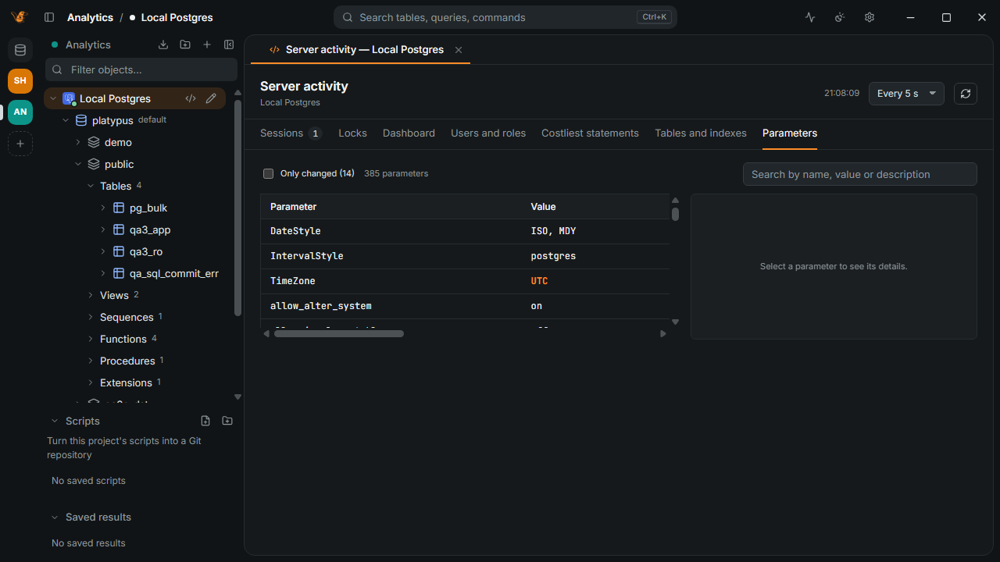

- **grave** — Scheda Parameters: la tabella occupa solo metà dell'altezza (4 righe visibili su 385 a 1280×720, circa 15 a 2560×1440) e sotto resta un vuoto. Causa: `ON_DEMAND` comprende "parameters" (`AdminTab.tsx:31`), quindi oltre al blocco dei parametri (`AdminTab.tsx:344`) viene montato anche il blocco delle statistiche (`AdminTab.tsx:398`), un secondo `object-body` vuoto che si prende metà dello spazio — Escludere "parameters" dalla condizione di riga 398 (`view === "statements" || view === "objects"`).
- **grave** — Dashboard (78): Connections dice "0 · running" mentre Sessions mostra 1 sessione in esecuzione (76); Transactions/Statements per second mostrano "—" e il motivo è solo nel tooltip (`Dashboard.tsx:59-60`); le sparkline non hanno scala né arco di tempo. Le cifre ingannano o non si spiegano — Dire sotto la cifra perché manca ("serve una seconda lettura, tra 5 s"), dire se Connections esclude questa app ("esclusa questa app"), e mettere sotto la sparkline "ultimi N min · max X".
- **media** — Il pannello dei dettagli ha larghezza fissa (`admin.css:171-173`, `min(380px, 40%)`) e non si ridimensiona: a 1280×720 taglia la colonna Statement delle sessioni ("SELECT pi", 76) e gli attributi degli utenti ("Inherit privil", 79), anche quando è vuoto — `PanelResizer` con misura ricordata, e pannello stretto o chiuso quando non c'è niente di selezionato.
- **media** — Tables and indexes (81): "Rows 0" per `demo.big_table` di 111 MB (stima delle statistiche non ancora analizzate); il numero in viola monospazio sembra un dato certo — Mostrare "—" con tooltip "statistiche non aggiornate: ANALYZE" quando la stima è 0 e la tabella non è vuota.
- **media** — Terminare una sessione o annullare la sua istruzione: dopo la conferma non c'è un toast né uno stato del pulsante, la riga sparisce solo al refresh; un errore va in un avviso in alto (`AdminTab.tsx:245-265`) — Toast "Sessione 42162 terminata" e pulsante "Terminazione…" disattivato durante la chiamata.
- **minore** — Costliest statements (80): la scrollbar orizzontale copre metà dell'ultima riga visibile — Spazio in fondo alla lista pari alla scrollbar.
- **minore** — Locks (77): l'intestazione "Session" è allineata a destra mentre le altre sono a sinistra, e "No locks." sta sotto l'intestazione di una tabella vuota — Allineare l'intestazione, e nascondere la tabella quando è vuota.
- **minore** — A 2560×1440 le cinque tessere del dashboard restano a sinistra a larghezza fissa e lasciano metà dello schermo vuota (78) — Griglia che riempie la larghezza.

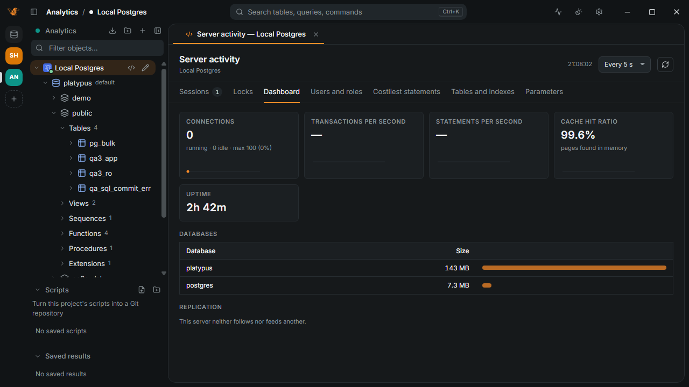
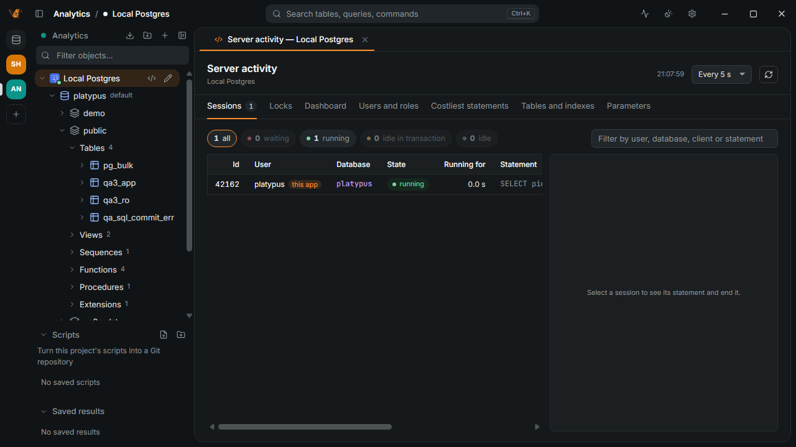
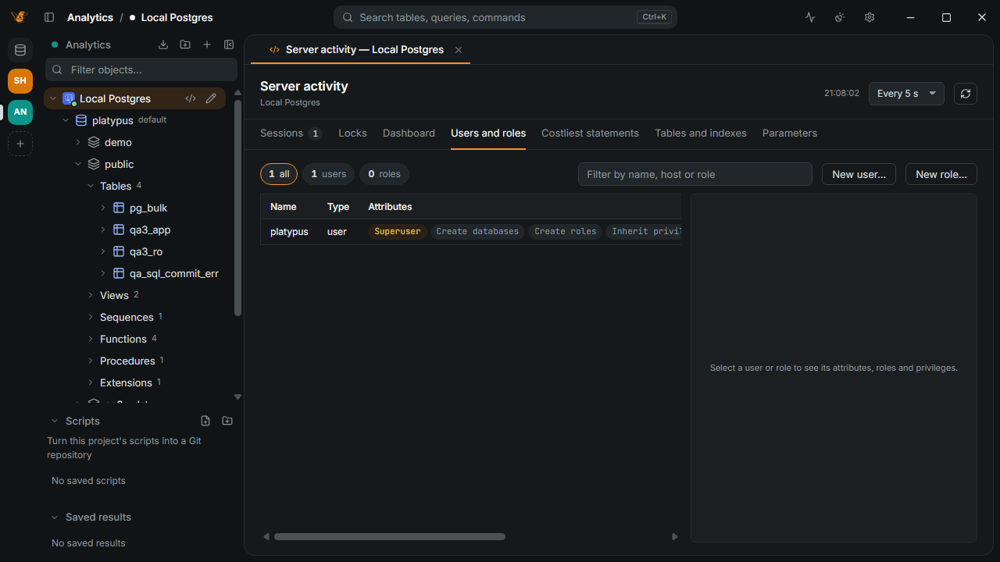
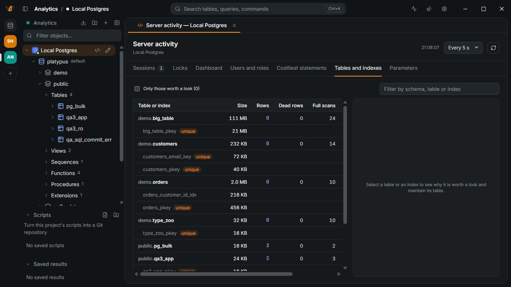

Va bene: titolo e connessione, ora della lettura e intervallo, filtri per stato con contatori e pallini colorati, "this app" sulla propria sessione, conferma prima di terminare una sessione, stati di caricamento ("Reading the parameters…", "Reading the statistics…"), istruzione nei pannelli dei dettagli vuoti, "Only changed (14)" e "Only those worth a look (0)".

## Impostazioni, sicurezza, agenti e sync

### Impostazioni

Il dialog è ordinato e coerente: titolo e descrizione per ogni pagina, sottoschede dove servono, pallino arancione e "Reset" sulle voci cambiate, Esc che prima svuota la ricerca e poi chiude, scorciatoie registrabili con Esc che annulla la registrazione. I problemi sono di spazio (misura fissa, campi troppo stretti, gruppo "Tools" nascosto) e di riscontro sui campi numerici e di testo.

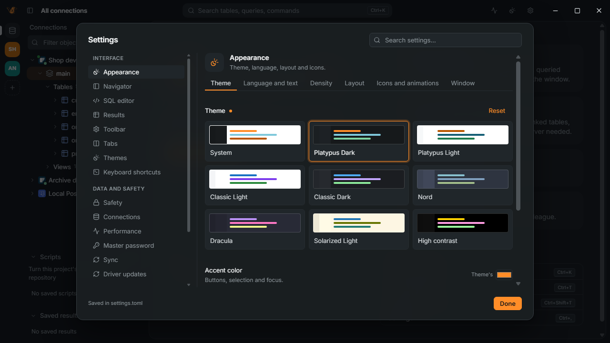
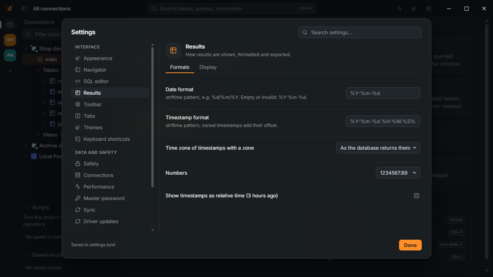
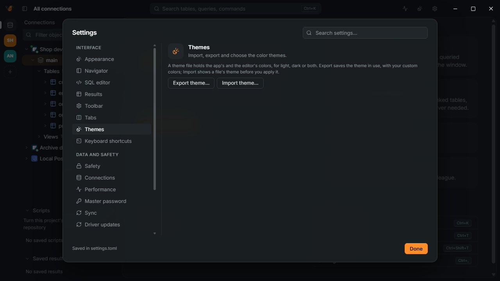
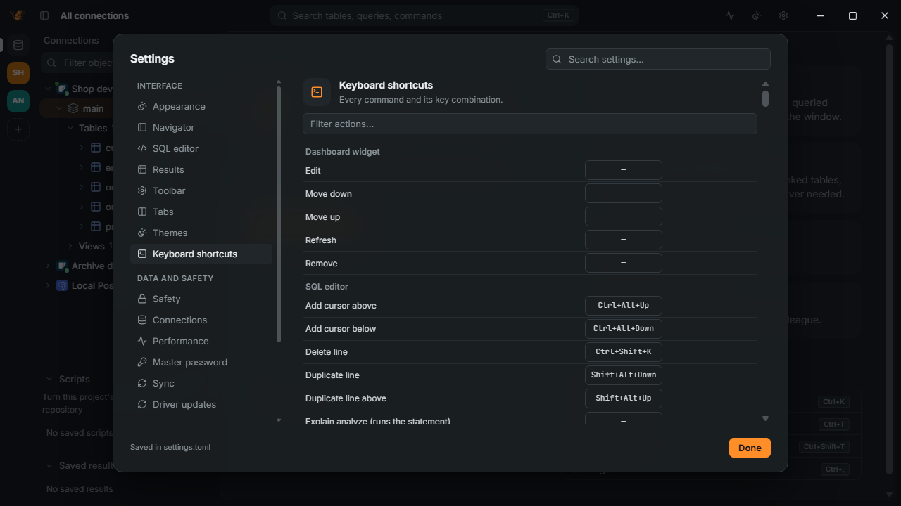

- **media** — La misura del dialog è fissa (`styles/dialogs.css:994`, `min(960px, …)` × `min(720px, …)`): a 2560×1440 occupa un quarto dello schermo, e a entrambe le misure la barra laterale scorre, quindi il gruppo "Tools" (Agents, Drivers, Plugins, Diagnostics) resta sotto la piega e non si vede (33, 89 a 2560×1440) — dialog più grande sugli schermi grandi (es. `min(1200px, 90vw)` × `min(900px, 90vh)`), barra laterale più compatta o gruppi richiudibili, così che tutte le pagine si vedano senza scorrere.
- **media** — Un numero non valido o fuori dai limiti torna al valore di prima senza un messaggio (`components/SettingsDialog.tsx:614-618`, `NumberInput.commit`): l'utente crede di aver salvato — bordo rosso e una riga "Tra {min} e {max}" sotto il campo, oppure un toast.
- **media** — I campi di testo e numerici salvano solo al blur (`SettingsDialog.tsx:457`, `:627`). Esc chiude il dialog (`:257`) smontandolo, e il valore appena scritto può andare perso senza avviso (non verificato a runtime) — salvare anche su Enter per il testo e fare il commit del campo con il focus prima di `onClose`.
- **media** — Campi a una riga troppo stretti per il loro contenuto: "Timestamp format" tagliato (`%Y-%m-%d %H:%M:%S%.`, 43), "Sensitive columns, by name" tagliato dopo tre pattern (50), il filtro dell'attività degli agenti ("Filter by tool, agent,", 58) — campi più larghi; per l'elenco delle colonne sensibili una textarea o dei chip.
- **minore** — La pagina "Themes" ha come sottotitolo "Import, export and choose the color themes" ma la scelta del tema è in Appearance › Theme; la pagina ha solo due pulsanti (47) — togliere "choose" dal testo o spostare importa/esporta sotto Appearance › Theme ed eliminare la pagina.
- **minore** — "Drivers" e "Driver updates" sono due pagine separate per la stessa cosa ("Check for updates" in una, gli aggiornamenti automatici nell'altra), e "Sync" e "Driver updates" usano la stessa icona, come "Connections" e "Drivers" (60, 56) — unire gli aggiornamenti in Drivers; icone distinte.
- **minore** — Pagine con una sola voce in una sottoscheda o in una pagina intera: Results › Display (44), Tabs (46), Connections (52), Performance (53) — unirle (es. Tabs e Toolbar sotto "Editor", Connections e Performance insieme).
- **minore** — Navigator: "LIMIT of Generate SELECT" non ha descrizione e riguarda la generazione dell'SQL più che il navigator (39) — descrizione ("Righe del SELECT generato dal menu della tabella") o spostarlo in SQL editor.
- **minore** — Scorciatoie: il modo di assegnare un tasto è solo nel tooltip ("Click, then press the keys…", `shell/ShortcutsPanel.tsx:134`), la colonna dei tasti sta a metà riga con molto vuoto a destra, e l'errore di registrazione compare in cima alla lista (`:109`), fuori vista se la riga è più in basso (48) — una riga di istruzioni sotto il filtro, i tasti allineati a destra, l'errore accanto alla riga.
- **minore** — Il pallino arancione "cambiato" accanto al titolo di una voce non è spiegato da nessuna parte — un tooltip ("Diverso dal predefinito") o una legenda nel piè di pagina accanto a "Saved in settings.toml".
- **minore** — Le pagine senza sottoschede (Navigator, Toolbar, Tabs, Connections, Performance) mettono la prima voce attaccata all'intestazione, mentre quelle con le sottoschede hanno uno spazio (39, 45) — stesso margine sotto l'intestazione.

Va bene: titolo e descrizione di ogni pagina, ricerca, Reset per voce, scelta del tema e del layout con le anteprime, radio delle anteprime navigabili con le frecce, Esc in due tempi, registrazione delle scorciatoie con il rilevamento dei conflitti, "Saved in settings.toml" come riscontro generale.

### Sicurezza (blocco, mascheramento, snapshot)

La schermata di blocco è chiara (logo, titolo, perché le connessioni di produzione sono chiuse) e tiene il focus; il mascheramento ha un segnale fisso nella barra del titolo ("Masked"); il ripristino apre lo script in un editor da rivedere prima di eseguirlo. Il problema serio è lo stato vuoto della lista degli snapshot, che sembra un caricamento infinito.

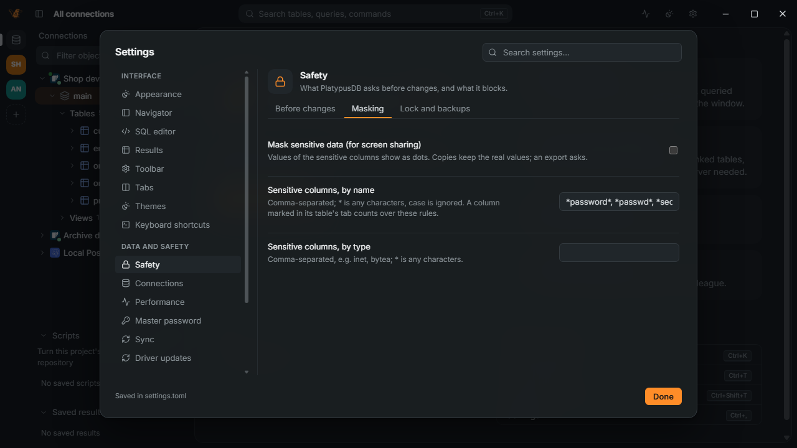

- **grave** — Lista degli snapshot vuota: lo stato vuoto usa `LoadingState` (`guards/SnapshotsDialog.tsx:73`), quindi "No snapshot yet." compare con l'icona che gira all'infinito (`styles/states.css:32`) e `aria-busy`: sembra che stia ancora caricando, e non c'è nessuna azione — `EmptyState` con una frase ("Gli UPDATE e DELETE eseguiti dall'editor tengono qui le righe di prima") e un link a Settings › Safety › Lock and backups se l'impostazione è spenta.
- **media** — "Delete" su uno snapshot lo cancella subito, senza conferma e senza riscontro (`SnapshotsDialog.tsx:53-60`, `:89`): è l'unico modo di rimettere a posto le righe — `ask(...)` con `danger: true`, come per i task e i profili.
- **media** — "Open restore script" e "Restore…" chiudono il dialog e poi aspettano `api.snapshotRestore` senza mostrare niente (`SnapshotsDialog.tsx:30-37`, `:96-97`); con molte righe (fino a 10.000) c'è un vuoto prima che la scheda compaia — aprire subito la scheda con un caricamento, o tenere il dialog aperto con il pulsante in stato "Apertura…".
- **media** — "Lock the app after this many idle minutes" accetta un valore anche senza la master password e poi non fa niente: il blocco automatico salta in silenzio (`App.tsx:904-909`, il toast c'è solo per il blocco chiesto a mano) (51) — senza vault disattivare il campo con un link "Imposta una master password", o un avviso sotto la voce.
- **minore** — Lo script di ripristino si apre in una scheda chiamata "Shop dev (2)" (86) e il commento cita un id illeggibile (`1793563693170-f25b17dc`) — nome della scheda "Ripristino di products" e nel commento tabella, verbo e ora dello snapshot.
- **minore** — Lock screen: lo sblocco (Argon2) mostra solo il pulsante disattivato (`guards/AppLock.tsx:95`), e non dice cosa fare se la password è dimenticata — testo "Sblocco…" nel pulsante; una riga su cosa succede se la si perde.
- **minore** — Transaction log: "Clear" svuota la lista senza conferma (`guards/TransactionLogDialog.tsx:76`) e l'etichetta "Committed on its own" è poco chiara (85) — "Auto-commit" o "Eseguito fuori da una transazione".
- **minore** — Con il mascheramento acceso, le colonne mascherate non hanno un segno nell'intestazione (84): solo i puntini nelle celle — un'icona (occhio barrato) accanto al nome della colonna.

Va bene: titolo e testo del lock screen, focus sul campo e Esc bloccato, resto della finestra `inert`; pill "Masked" nella barra del titolo; lo script di ripristino da rivedere invece di un ripristino cieco; nel Transaction log nessun "Restore…" sulle modifiche annullate.

### Agenti e MCP

La pagina Agents spiega bene cos'è il server MCP e mostra i client in schede leggibili, con lo stato di ciascuno e Install. Due difetti però ingannano: la scheda Security disegna dei radio che non si possono cliccare, e quando si sceglie un client il dettaglio compare sotto la piega.

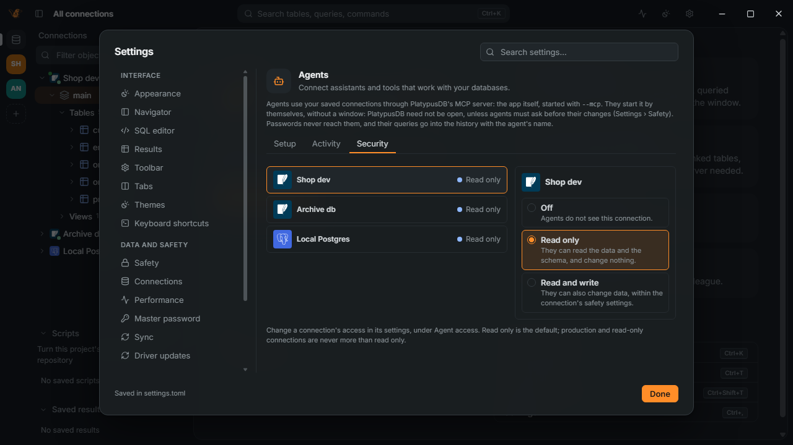
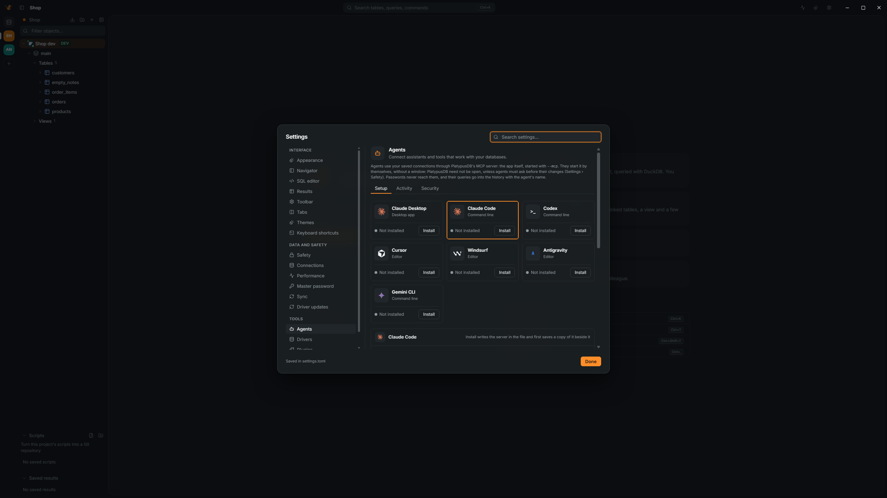

- **grave** — Security: "Off / Read only / Read and write" sono disegnati come radio con hover e selezione (59), ma sono `div` senza `onClick` (`agents/AgentsPanel.tsx:60-73`); la riga sotto dice che si cambia "nelle impostazioni della connessione, sotto Agent access". L'utente clicca e non succede niente — rendere i livelli veri radio che salvano l'accesso della connessione (con il limite di produzione/sola lettura come voci disattivate e il motivo), oppure, se il salvataggio da qui non è voluto, mostrare il livello come testo e un pulsante "Cambia nelle impostazioni della connessione" che apre il dialog.
- **media** — Scegliere un client (Claude Desktop, Codex…) cambia solo il bordo della scheda: il dettaglio con il file di configurazione, i passi e il blocco "By hand" è sotto la griglia (`agents/AgentClients.tsx:151`), fuori vista a 1280×720 e appena visibile in fondo a 2560×1440 (88-94) — portare in vista il dettaglio alla selezione (`scrollIntoView`), oppure metterlo accanto alla griglia.
- **media** — Il messaggio di "Install" riuscito o fallito compare sopra la griglia (`AgentClients.tsx:100-105`): installando Gemini CLI (in fondo) l'avviso è fuori vista, e durante l'installazione il pulsante non ha uno stato di attesa (`:71-94`) — stato "Installazione…" sul pulsante e messaggio nella scheda o come toast.
- **media** — Security: le righe delle connessioni sono `tr` con `onClick` ma senza `tabIndex` né gestione dei tasti (`AgentsPanel.tsx:103-108`): da tastiera non si scelgono — `tabIndex={0}`, Invio/Spazio e frecce come nelle schede dei client.
- **minore** — Activity vuota: "No agent calls yet." in una riga della tabella, senza azione (58) — `EmptyState` con "Collega un agente" che porta alla scheda Setup.
- **minore** — Il testo introduttivo (tre righe) occupa la parte alta di tutte e tre le schede e spinge giù il contenuto (57-59) — accorciarlo a una riga con "Come funziona" che lo apre.

Va bene: le schede dei client con il logo, il tipo e lo stato a pallino; la conferma prima di scrivere nel file con il backup; schede navigabili da tastiera (Invio/Spazio); Export CSV e Clear disattivati con la lista vuota, Clear con la conferma.

### Sync e progetti condivisi

La sync spiega bene la passphrase e il suo rischio e disattiva "Sync now"/"Turn off" finché la sync non è attiva. Ma è l'unica pagina delle impostazioni impaginata come un modulo stretto, e l'operazione più lunga (la sync su un disco di rete) non mostra un caricamento. "Open shared project…" è nascosto nel dialog "New project".

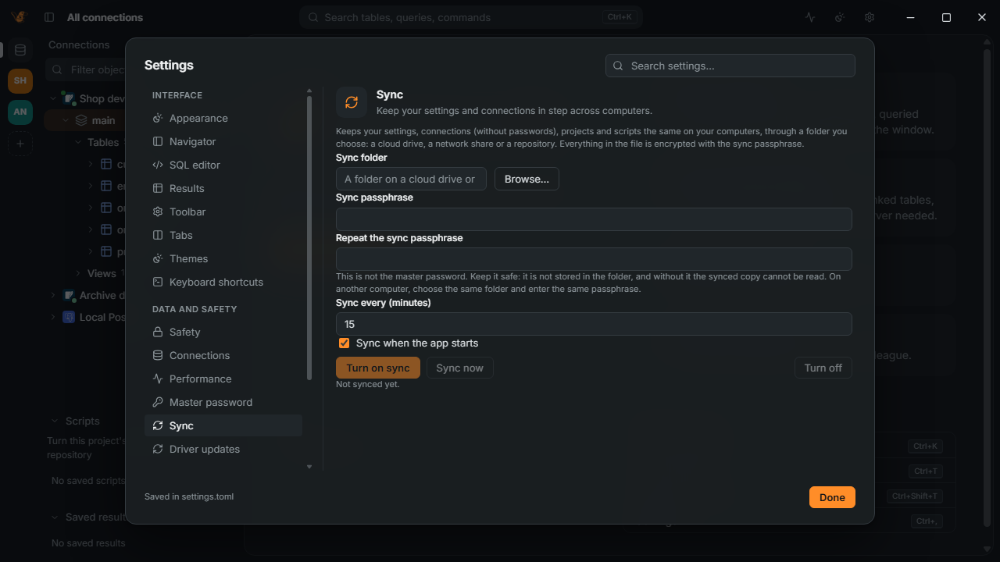
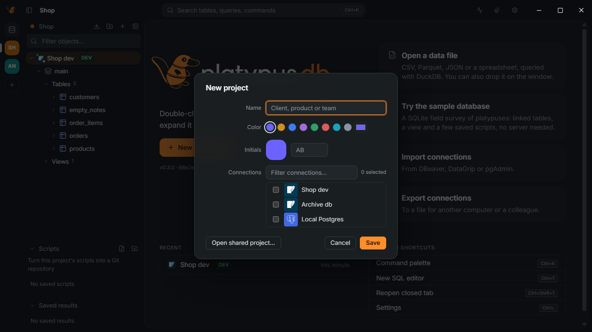

- **grave** — "Sync now" (e "Turn on sync") durante l'operazione disattiva solo i pulsanti (`sync/SyncPanel.tsx:86-98`, `:164-173`): niente testo, spinner o "Sincronizzazione…", e il messaggio di prima viene cancellato. Su un disco cloud o di rete può durare secondi, e sembra che il clic non sia servito — testo "Sincronizzazione…" con il componente di caricamento comune accanto ai pulsanti, il pulsante in stato busy.
- **media** — Impaginazione della pagina Sync diversa dalle altre (55): etichette attaccate ai campi senza spazio, il campo "Sync folder" stretto con il segnaposto tagliato ("A folder on a cloud drive or"), mentre gli altri campi prendono tutta la larghezza, anche a 2560×1440 — il campo della cartella a tutta larghezza come gli altri, spaziatura tra i gruppi; "Sync every (minutes)" e "Sync when the app starts" come righe `setting` come nel resto del dialog.
- **media** — "Open shared project…" sta solo nel piede del dialog "New project" (`projects/ProjectDialog.tsx:160`) e nella palette, non nel menu del progetto né nel rail (96, 98): chi riceve una cartella condivisa non lo trova — voce nel menu "+" del rail dei progetti e nella pagina iniziale accanto a "Import connections".
- **minore** — Share project: il campo "Folder" è stretto in un dialog largo (97) e durante la scrittura il pulsante "Share" è solo disattivato (`projects/shared.tsx:49-60`, `:93`) — campo a tutta larghezza; testo "Condivisione…" sul pulsante.
- **minore** — Il menu del progetto (96) mette "Test connections", "Share project…" ed "Export connections…" sullo stesso piano di "Rename…" e "Color…" — separatore tra le voci di aspetto e quelle di condivisione/esportazione.

Va bene: testo sulla passphrase (non è la master password, non è nel file), conferma della passphrase con l'avviso di differenza, "Sync now"/"Turn off" disattivati finché non serve, "Last sync"/"Not synced yet", conflitti spiegati in una riga ciascuno; notifica dopo la condivisione con il passo successivo (commit della cartella).

### Task pianificati

Dialog chiaro, con la riga che spiega quando girano i task e un modulo ben ordinato. Mancano un caricamento iniziale e un riscontro immediato su "Run now".

- **media** — "Run now" lancia `api.runScheduleNow` senza riscontro immediato (`admin/SchedulesDialog.tsx:181`): il badge "running" arriva solo con l'evento `schedules-changed`, e un task lanciato non si può fermare — passare subito la riga a "running" (stato locale) e offrire "Annulla" mentre gira, se il backend lo permette.
- **minore** — Lo stato vuoto ha solo il testo "No scheduled tasks yet." (99, `SchedulesDialog.tsx:159`); "New task…" c'è ma è il pulsante secondario in basso a sinistra, mentre il primario è "Close" — `EmptyState` con "New task…" come azione primaria nello stato vuoto.
- **minore** — Finché la lista carica (`schedules === null`) il dialog non mostra niente fra il testo e i pulsanti (`SchedulesDialog.tsx:159-160`) — `LoadingState compact`.
- **minore** — Il badge di un'esecuzione riuscita usa la classe `running` (`SchedulesDialog.tsx:71`): "done" e "running" hanno lo stesso colore — una classe a sé per l'esito riuscito.
- **minore** — Nel modulo, "Minutes between tries" resta attivo con "Tries again if it fails" a 0 (100) — disattivarlo quando i tentativi sono 0.

Va bene: titolo e frase che spiega quando girano; modulo a griglia leggibile con il fuso orario; la nota sulla password salvata; conferma prima di eliminare; Esc che torna dalla modifica alla lista.

### Profili di trasferimento

Lo stato vuoto (già corretto dal gruppo T) dice dove si crea un profilo e ha un'azione. Restano un'azione debole e due pulsanti primari.

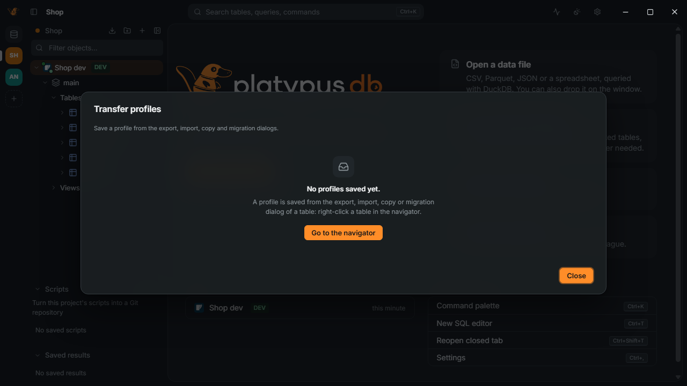

- **media** — "Go to the navigator" chiude il dialog e, al massimo, apre la sidebar (`transfer/ProfilesDialog.tsx:93-102`): l'utente deve ancora trovare una tabella, fare clic destro e cercare l'export — aprire direttamente il dialog di export della tabella selezionata (o di una a scelta), oppure evidenziare il navigator.
- **minore** — Due pulsanti primari arancioni nella stessa schermata ("Go to the navigator" e "Close", 101), e il testo sotto il titolo ripete quello dello stato vuoto — "Close" secondario; togliere la frase sotto il titolo quando la lista è vuota.
- **minore** — Nessun caricamento mentre la lista si carica (`ProfilesDialog.tsx:88`, `shown === null`) — `LoadingState compact`.

Va bene: stato vuoto con icona, titolo, spiegazione e azione; conferma prima di eseguire su produzione e prima di eliminare; esecuzione tracciata con `runTracked`; Esc chiude.
