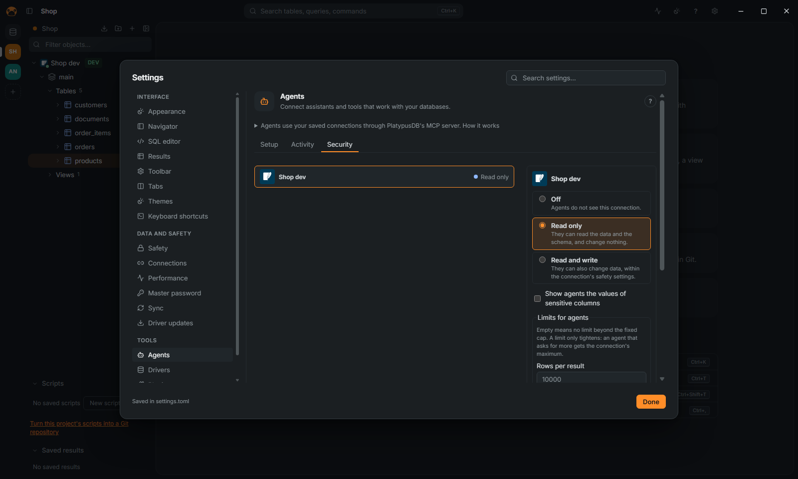

[← User guide](README.md)

# Use PlatypusDB from an agent

Claude Code, Codex, Cursor and other MCP clients can use your saved connections through
PlatypusDB's MCP server. This page is the short path; every tool, limit and setting is in the
reference, [AGENTS.md](../AGENTS.md).

## Connect an agent

1. Open Settings (`Ctrl+,`) › **Agents** › **Setup**.
2. Find your client in the list (Claude Desktop, Claude Code, Codex, Cursor, Windsurf,
   Antigravity, Gemini CLI). Click **Install**: the app asks, saves a copy of the client's file
   beside it, and writes the server in it. For a client not listed, copy the entry by hand from the
   same page.
3. Restart the client. It starts PlatypusDB itself with `--mcp`; no window opens, and the app need
   not be open for reading.

## Choose what each connection allows

1. Settings › **Agents** › **Security** lists your connections. A connection's own form has the
   same choice, under **Agents** on its **Appearance and safety** page.
2. Choose **Off**, **Read only** (the default) or **Read and write**.

Production and read-only connections are never more than read only: the panel says "Not available:
production and read-only connections stay read only." A connection that is new from a shared
project starts with **Off** on your computer.

## Limits and masking

- In **Security**, **Limits for agents** caps, per connection, the rows, bytes and seconds of a
  result or statement, the calls per minute, and the estimated rows or plan cost of a read, above
  which the read is refused with its plan. Empty means no limit beyond the fixed caps.
- Sensitive columns read as `••••••` for agents, as in the grid while masking. Tick **Show agents
  the values of sensitive columns** on a connection to show them. See [Safety](safety.md).

## Changes wait for you

On a **Read and write** connection, each change an agent wants to run opens a dialog in the app
with the statement, the rows the database expects it to change and its plan. Click **Refuse** (the
agent reads your reason), **Allow once**, or **Allow for this session**. After five minutes
without an answer it is refused, and with the app closed the changes are refused.
Settings › **Safety** › **Ask before agents change data** turns the questions off.

An agent can also propose, without running anything:

- SQL with `propose_sql`: it opens in a new editor tab, for you to read and run.
- Rows to insert, update or delete with `propose_edits`: the table opens in its data viewer with
  them as pending changes, for you to save or discard (see [Edit data](edit-data.md)).

## See what agents did

Settings › **Agents** › **Activity** lists every tool call by session, with a filter and **Export
CSV**. Their queries are in the history under the agent's name.

Above the list, **Summary per agent and session** (folded until you open it) adds up the calls the
filters select: one row per agent and, under it, one per session, with the period, the calls, the
tables read, the rows returned, the changes allowed, the changes refused and the errors.
**Export Markdown** and **Export HTML** save it as a document to share; the HTML is one file with
no script and nothing loaded from outside.

- A **session** is one start of the MCP server, as the log records it (a client that stays
  connected for days is one session).
- A **change** is a statement that changes data or the schema. It is *allowed* when it ran and
  *refused* when the connection's access, a safety setting or your answer in the app said no. A
  statement that failed for another reason counts as an error only.
- **Tables read** is exact for `sample_rows` and `profile_table` and for the sources of
  `query_across_databases`, and an estimate for a statement: the tables named after `FROM` and
  `JOIN`. A statement a database other than SQL speaks (MongoDB, Redis, Elasticsearch, Cassandra)
  names none.
- Nothing but names and counts is kept: no value, and statements stay masked as they are in the
  log.
- Calls made before this version recorded these figures show **–**, never a 0; the other figures
  count only the calls that have them, and the summary says so.

## When it does not work

See [Troubleshooting](troubleshooting.md#an-agent-does-not-see-a-connection).
