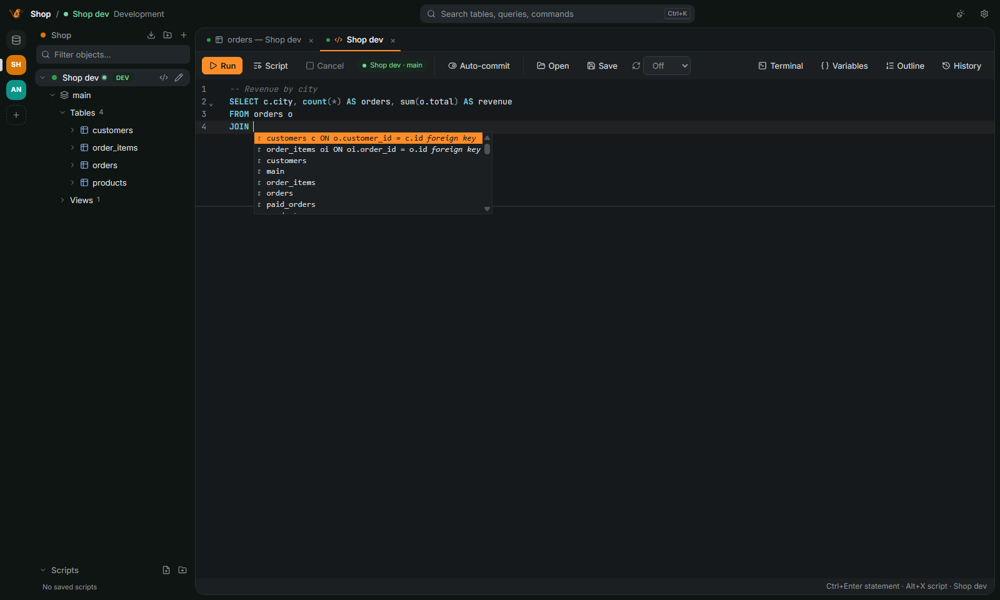
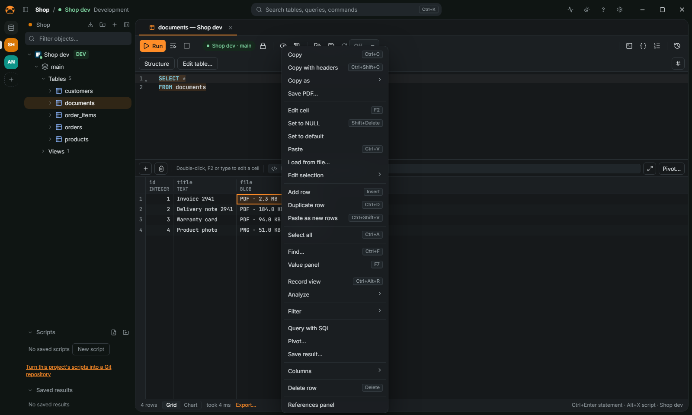

[← User guide](README.md)

# Run queries and read results

## Run a statement

1. Double-click a connection (or a table) to open a SQL editor.
2. Type a statement. `Ctrl+Space` completes keywords, tables and columns; `JOIN ` offers the
   related tables from the foreign keys.
3. Press `Ctrl+Enter` to run the statement under the cursor (or the selection), or `Alt+X` to run
   the whole script. `Ctrl+\` runs into a new result tab.
4. `Ctrl+.` cancels a statement that is running.

Statements end at a `;`, or at a blank line before a word that starts a new one. When a
statement fails, the error is pointed out in the text and the error panel offers **Go to the
error**. `Ctrl+Shift+F` formats the script; `Ctrl+S` saves it as a `.sql` file.

## Parameters and variables

`:id` and `?` in a statement, and `${name}` variables, are asked in a dialog before the run and
kept in a Variables panel. A `${name}` value goes into the SQL as it is, so a statement with
variables is checked again filled in (see [Safety](safety.md)).

## Read the results

- The grid reads rows a page at a time. Click a column header to sort: it writes the `ORDER BY`
  in the editor and runs again; a second click reverses it, a third puts back the query's own.
- Open a table from the navigator to browse it; a `WHERE` typed in the editor filters it.
- `F7` opens the value panel: long text, JSON and XML formatted, hex and images from binary
  columns.
- A cell that holds a file (a PDF, an image, a ZIP and others, recognized by its bytes) shows its
  type and size, such as `PDF · 2.3 MB`. The grid menu offers **Save PDF…** (or the file's type)
  and, on several cells of a column, **Save N files to a folder…**. The value panel has the same
  button.
  A text cell that holds a file (a `data:` URL, base64 or hex) has no label in the grid, which
  would mean reading every text cell to tell: the grid menu and the value panel show it, for the
  cells you select.
- `Ctrl+F` finds in the loaded rows; `Ctrl+Shift+C` copies the selection with headers.
- A result can switch from the grid to a chart from the status bar.

## Understand a slow query

Press `Ctrl+Shift+E` on a statement to see its plan. See
[FEATURES.md](../FEATURES.md#query-plans-and-performance).

## More

Saved scripts, snippets, history, vim mode, running a script on several connections, the query
builder and data analysis are in [FEATURES.md](../FEATURES.md#sql-editor). The result grid is in
[FEATURES.md](../FEATURES.md#results-and-the-data-viewer).
