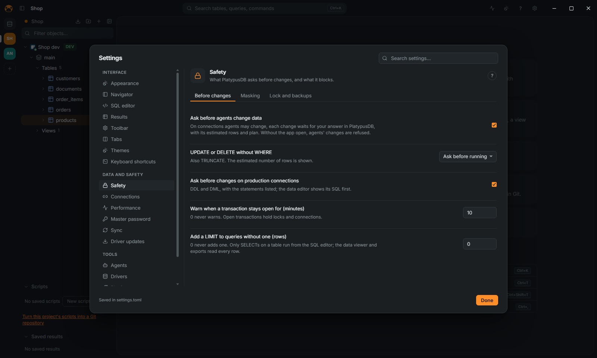

[← User guide](README.md)

# Work safely: production, read-only, confirmations, masking

Everything here is also in [FEATURES.md](../FEATURES.md#transactions-and-safety).

## Mark a connection as production

1. Edit the connection, open the **Appearance and safety** page.
2. Set the environment to **Production** (the other choices are Development and Test). Production
   asks before changes and starts in manual commit.
3. Optionally pick a color, so the connection is easy to tell apart.

From then on every change on that connection is listed in a dialog titled
"Changes on `<name>` (production)", with the statements, and runs only after you confirm.
Settings (`Ctrl+,`) › **Safety** › **Ask before changes on production connections** turns this
off for the app. Agents are never more than read only on a production connection.

## Make a connection read-only

1. On the same page, tick **Read-only (warn before modifying data)**. Despite its label, the
   connection refuses; it does not only warn.
2. A statement that may modify data does not run. The editor shows "`<name>` is read-only and this
   may modify data." with no way past it. The same holds for Explain with analyze ("this
   statement may modify data."), a file included with `@include`, a notebook cell ("this cell may
   change data."), the command-line client, and a run on several connections, which lists the
   connection as skipped ("Read-only connection").
3. Not offered at all: **Import data…**, **Import data into a new table…**, **Paste CSV as a new
   table…**, **Generate data…**, **Run SQL file…**, creating objects, saving in the table
   designer, and editing rows in the grid. Agents stay read only.

The lock button of an editor tab makes just that tab read-only, without changing the saved
connection. This is the one case that asks: the editor shows the same message with a
**Run anyway** button, and the command-line client asks "Run anyway?".

The same page has two more boxes: **No exports** (its data goes to no file, other database or
agent) and **No data editing** (rows change only by SQL, not in the grid, imports or generated
data).

## Confirmations

Settings › **Safety** › **Before changes**:

- **UPDATE or DELETE without WHERE** (also `TRUNCATE`): **Ask before running** (the default),
  **Never run** or **Run without asking**. The dialog asks "Change every row?" and says about how
  many rows.
- **Warn when a transaction stays open for (minutes)**: 10 by default, 0 never warns.
- **Add a LIMIT to queries without one (rows)**: 0 (the default) never adds one.
- **Ask before agents change data**: see [Agents](agents.md).

## Undo a change

On by default, **Keep the rows an UPDATE or DELETE changes, to put them back** (Settings ›
Safety › **Lock and backups**) keeps the rows of an `UPDATE` or `DELETE` of one table, up to
10,000, run from the editor. Open the **Transaction log** in the editor's toolbar and click **Restore…**, or
run **Snapshots before changes…** from the command palette, to get the script that puts them back.

## Mask sensitive data

1. Press `Ctrl+Alt+M` (or run **Mask sensitive data** from the command palette): the values of
   sensitive columns show as dots while the screen is shared. Copies keep the real values.
2. Settings › **Safety** › **Masking** sets which columns are sensitive, by name (`*password*`,
   `*token*`, `*email*` and others by default; `*` is any characters) and by type. You can also mark a column in its table's tab.

Agents read the sensitive columns masked too, unless you tick **Show agents the values of
sensitive columns** for that connection in Settings › Agents › **Security**. A sensitive field
inside a MongoDB document (`user.password`) is masked too. When an agent asks what you are
working on, a column read under another name (`SELECT email AS contact`) is masked as well; if
the statement hides it behind a subquery, the whole shared result is masked.

A rule or a mark removed outside the app (an agent with file tools editing `settings.toml` or
`catalog.db`) does not reach agents until you accept it: the app asks, and Settings › Agents ›
**Security** lists it, with a way to accept or undo it. One added outside the app applies at once.
This covers edits of those files and nothing more. An agent that can run commands as your user can
read the database by other routes, or the system keychain the seal lives in: to keep values from
such an agent, run it as another user and give the connection a database user without access to
those columns.

An answer holds for what the question listed: if the files change again while it is open, **Accept**
accepts nothing and the list is shown again.

## Lock the app

With a master password set (see [Connect](connect.md#master-password)), Settings › **Safety** ›
**Lock the app after this many idle minutes** (0, the default, never locks) locks PlatypusDB and closes the production
connections. **Lock PlatypusDB** in the command palette locks it at once. Enter the master
password to unlock: production connections reconnect when used.
