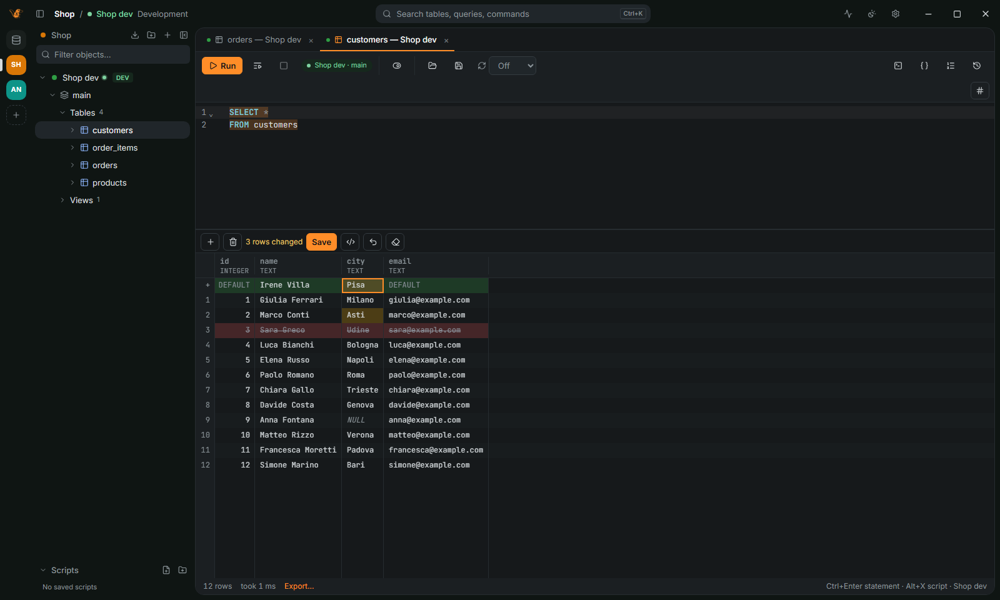

[← User guide](README.md)

# Edit data

## Change rows in the grid

1. Open a table from the navigator, or run a query that reads one table.
2. Double-click a cell, press `F2`, or just type, to change it. `Shift+Delete` sets the selected
   cells to NULL.
3. `Insert` adds a row, `Ctrl+D` duplicates the selected one, `Delete` deletes it.
4. The changes stay highlighted until you save. Use **Preview SQL** to read the statements.
5. Press `Ctrl+S` (or **Save changes**) to save all of them, or nothing if one fails.
   `Ctrl+Z` undoes the changes not saved yet.

Every save leaves an undo script that puts the rows back. In manual-commit mode the changes join
the open transaction.

## When the grid is read-only

A table needs a primary key, or a unique key on non-null columns, or a virtual key you pick;
otherwise the grid says why it cannot be edited. A connection can also forbid data editing
(**Appearance and safety** page of its settings): rows then change only by SQL.

## Edit documents, keys and rows without SQL

Redis, Elasticsearch, Cassandra and MongoDB results are edited too, with their own commands instead
of SQL: **Preview SQL** shows them. On MongoDB the result of a plain `find` on one collection is
editable by `_id`. Each change is one `updateOne`, `insertOne` or `deleteOne`, written with the
BSON type of the column; a changed number keeps the numeric type the document stores when that
type holds it exactly. Editing `_id`, columns of mixed types and fields with a `.` in their name
are refused, with the reason. On a replica set a save is all or nothing; on a standalone server the
commands run one after the other and the error says how many were saved. See
[MongoDB](databases/mongodb.md#edit-documents-in-the-grid).

## Edit many cells at once

Select the cells and use **Edit selection** in the grid menu: one value, NULL or DEFAULT in every
cell, find and replace in the text cells, or a number sequence. `Ctrl+Alt+D` fills down from the
first row (`⌃⇧D` on macOS). Only the rows loaded in the grid change, and the result is pending
changes you preview, save or undo together.

Paste from a spreadsheet with `Ctrl+V` over the cells, or `Ctrl+Shift+V` as new rows.

## Load a file into a cell

From the grid menu, or the `…` button of the cell editor: bytes go into binary columns and UTF-8
text into text columns. Files over 50 MB ask first; files over 200 MB are refused.

## Rows proposed by an agent

When an agent calls `propose_edits`, the table opens in its data viewer with the proposed rows as
pending changes, colored like yours. Nothing is written until you save them; discard them to
refuse. See [Agents](agents.md).

## More

Foreign keys, arrays, the table editor (columns, keys, indexes) and fake data are in
[FEATURES.md](../FEATURES.md#data-editor). Production connections confirm every change first: see
[Safety](safety.md).
