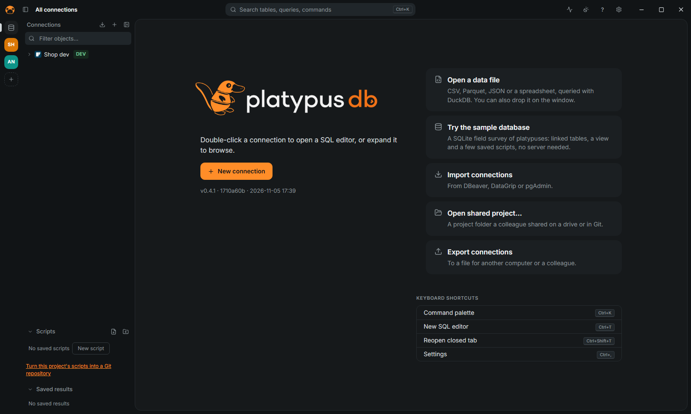

[← User guide](README.md)

# Getting started

Install PlatypusDB, open a connection and learn the few keys that do most of the work. Every
feature, area by area, is in [FEATURES.md](../FEATURES.md).

## Install

Download the installer for your system from the
[releases page](https://github.com/platypus-labs/platypus-db/releases/latest): `.exe` or `.msi`
for Windows, `.dmg` for macOS, `.AppImage`, `.deb` or `.rpm` for Linux. The app updates itself
(see [Updates](troubleshooting.md#updates)).

**Portable copy**: put the executable in a folder with an empty `data` folder beside it.
Connections, settings, history and scripts then live in `data`, and the folder can move to
another machine or a USB stick.

## First connection

1. Open PlatypusDB and click **New connection**, or paste a connection URL (`postgres://…`,
   `mysql://…`, a JDBC URL or an ADO.NET string).
2. Choose the database from the grid of logos. If it needs a driver that is not installed yet
   (Snowflake, BigQuery, Databricks and Trino, DuckDB, Oracle, IBM Db2), the app offers to
   download it at once; **Cancel** leaves the form as it is.
3. Fill in the form and click **Test connection**, then **Save**.
4. Double-click the connection to open a SQL editor, or expand it to browse.

The form is explained in [Connect](connect.md); each database has its own page in
[Databases](databases/README.md).

No database at hand? Click **Try the sample database** on the welcome screen: a SQLite field
survey of platypuses, with linked tables, a view and a few saved scripts.

## Keys to learn first

Every action, connection and table is a few letters away in the command palette.

| Keys | Action |
|---|---|
| `Ctrl+K` | Command palette |
| `Ctrl+Enter` | Run the statement under the cursor (or the selection) |
| `Alt+X` | Run the script |
| `Ctrl+Space` | Autocomplete |
| `Ctrl+Shift+F` | Format the script (or the selection) |
| `Ctrl+Shift+E` | Explain the statement under the cursor |
| `Ctrl+T` | New tab |

On macOS use `Cmd` instead of `Ctrl`. Every shortcut can be changed in Settings › Keyboard
shortcuts; the full list is in [SHORTCUTS.md](../SHORTCUTS.md).

## Next

[Run queries](queries.md), [edit data](edit-data.md), or read [Safety](safety.md) before
connecting to production.
