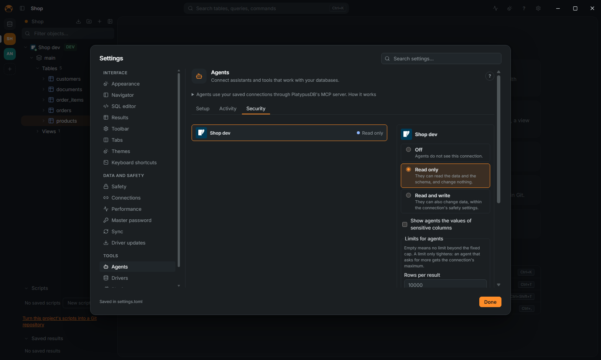

<!-- source: cce13c1c788d -->
[← Benutzerhandbuch](README.md)

# PlatypusDB von einem Agenten aus nutzen

Claude Code, Codex, Cursor und andere MCP-Clients können deine gespeicherten Verbindungen über den
MCP-Server von PlatypusDB nutzen. Diese Seite ist der kurze Weg; jedes Tool, jedes Limit und jede
Einstellung steht in der Referenz, [AGENTS.md](../../../AGENTS.md).

## Einen Agenten verbinden

1. Öffne die Einstellungen (`Ctrl+,`) › **Agenten** › **Einrichtung**.
2. Suche deinen Client in der Liste (Claude Desktop, Claude Code, Codex, Cursor, Windsurf,
   Antigravity, Gemini CLI). Klicke auf **Installieren**: Die App fragt nach, speichert eine Kopie
   der Datei des Clients daneben und trägt den Server darin ein. Für einen Client, der nicht in der
   Liste steht, kopierst du den Eintrag von Hand von derselben Seite.
3. Starte den Client neu. Er startet PlatypusDB selbst mit `--mcp`; es öffnet sich kein Fenster, und
   zum Lesen muss die App nicht geöffnet sein.

## Festlegen, was jede Verbindung erlaubt

1. Einstellungen › **Agenten** › **Sicherheit** listet deine Verbindungen auf. Auch das Formular
   einer Verbindung hat dieselbe Auswahl, unter **Agenten** auf der Seite **Darstellung und
   Sicherheit**.
2. Wähle **Aus**, **Nur lesen** (der Standard) oder **Lesen und schreiben**.

Produktions- und schreibgeschützte Verbindungen sind nie mehr als „Nur lesen“: Das Panel sagt „Nicht
verfügbar: Produktions- und schreibgeschützte Verbindungen bleiben schreibgeschützt.“ Eine Verbindung,
die neu aus einem geteilten Projekt kommt, startet auf deinem Computer mit **Aus**.

## Limits und Maskierung

- Unter **Sicherheit** begrenzt **Grenzen für Agenten** pro Verbindung die Zeilen, Bytes und Sekunden
  eines Ergebnisses oder einer Anweisung, die Aufrufe pro Minute und die geschätzten Zeilen oder
  Plankosten eines Lesezugriffs; darüber wird der Lesezugriff mit seinem Plan abgelehnt. Leer heißt
  kein Limit über die festen Obergrenzen hinaus.
- Sensible Spalten erscheinen für Agenten als `••••••`, wie im Raster bei aktiver Maskierung. Hake bei
  einer Verbindung **Agenten die Werte sensibler Spalten zeigen** an, um sie zu zeigen. Siehe
  [Sicherheit](safety.md).

## Änderungen warten auf dich

Bei einer Verbindung mit **Lesen und schreiben** öffnet jede Änderung, die ein Agent ausführen will,
einen Dialog in der App mit der Anweisung, in den Farben des Editors und bei SQL-Datenbanken
formatiert (**So anzeigen, wie der Agent es gesendet hat** zeigt den Text, der läuft, auf den
Buchstaben genau), den Zeilen, die die Datenbank voraussichtlich ändert, und ihrem Plan. Klicke auf
**Ablehnen** (der Agent liest deinen Grund), **Einmal erlauben** oder **Für diese Sitzung erlauben**.
Nach fünf Minuten ohne Antwort wird sie abgelehnt, und bei geschlossener App werden die Änderungen
abgelehnt. Einstellungen › **Sicherheit** › **Fragen, bevor Agenten Daten ändern** schaltet die
Fragen aus.

Ein Agent kann auch etwas vorschlagen, ohne etwas auszuführen:

- SQL mit `propose_sql`: Es öffnet sich in einem neuen Editor-Tab, damit du es liest und ausführst.
- Zeilen zum Einfügen, Aktualisieren oder Löschen mit `propose_edits`: Die Tabelle öffnet sich in
  ihrem Datenviewer mit ihnen als ausstehenden Änderungen, die du speicherst oder verwirfst (siehe
  [Daten bearbeiten](edit-data.md)).

## Sehen, was Agenten getan haben

Einstellungen › **Agenten** › **Aktivität** listet jeden Tool-Aufruf nach Sitzung auf, mit einem
Filter und **CSV exportieren**. Ihre Abfragen stehen im Verlauf unter dem Namen des Agenten.

Über der Liste addiert **Zusammenfassung pro Agent und Sitzung** (eingeklappt, bis du sie öffnest) die
Aufrufe, die die Filter auswählen: eine Zeile pro Agent und darunter eine pro Sitzung, mit dem
Zeitraum, den Aufrufen, den gelesenen Tabellen, den gelieferten Zeilen, den erlaubten Änderungen, den
abgelehnten Änderungen und den Fehlern. **Markdown exportieren** und **HTML exportieren** speichern
sie als Dokument zum Teilen; das HTML ist eine einzige Datei ohne Skript und ohne etwas, das von außen
geladen wird.

- Eine **Sitzung** ist ein Start des MCP-Servers, wie das Log ihn aufzeichnet (ein Client, der tagelang
  verbunden bleibt, ist eine Sitzung).
- Eine **Änderung** ist eine Anweisung, die Daten oder das Schema ändert. Sie ist *erlaubt*, wenn sie
  lief, und *abgelehnt*, wenn der Zugriff der Verbindung, eine Sicherheitseinstellung oder deine
  Antwort in der App nein gesagt hat. Eine Anweisung, die aus einem anderen Grund fehlschlug, zählt
  nur als Fehler.
- **Gelesene Tabellen** ist exakt bei `sample_rows` und `profile_table` und bei den Quellen von
  `query_across_databases`, und bei einer Anweisung eine Schätzung: die Tabellen, die nach `FROM` und
  `JOIN` genannt werden. Eine Anweisung in der Sprache einer anderen Datenbank als SQL (MongoDB,
  Redis, Elasticsearch, Cassandra) nennt keine.
- Es werden nur Namen und Zahlen gespeichert: kein Wert, und Anweisungen bleiben maskiert, wie sie im
  Log stehen.
- Aufrufe, die vor dieser Version gemacht wurden und diese Zahlen nicht aufgezeichnet haben, zeigen
  **–**, nie eine 0; die übrigen Zahlen zählen nur die Aufrufe, die sie haben, und die
  Zusammenfassung sagt das.

## Wenn es nicht funktioniert

Siehe [Fehlerbehebung](troubleshooting.md#ein-agent-sieht-eine-verbindung-nicht).
