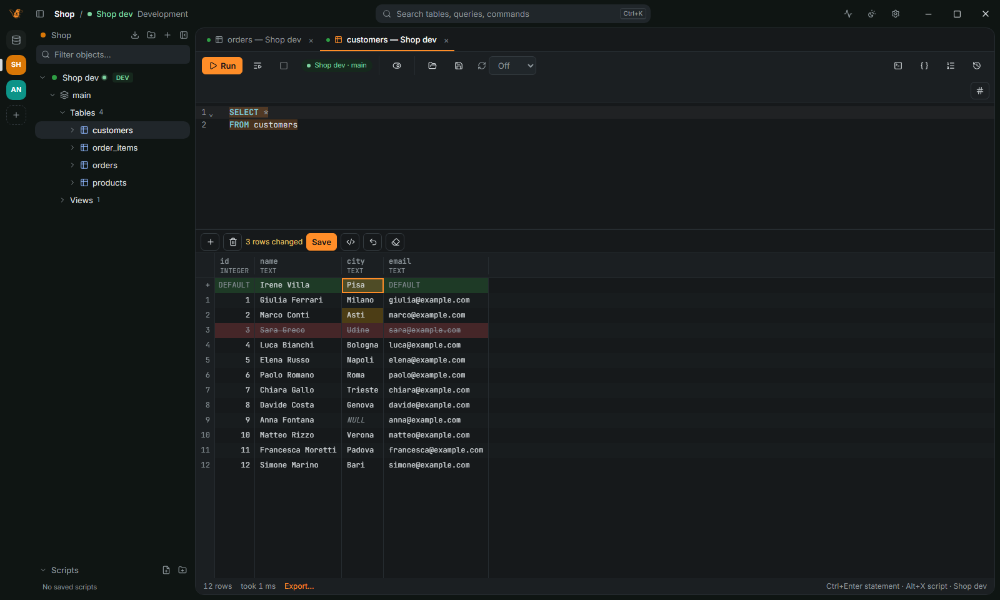

<!-- source: 19e81b2b8673 -->
[← Benutzerhandbuch](README.md)

# Daten bearbeiten

## Zeilen im Raster ändern

1. Öffne eine Tabelle im Navigator oder führe eine Abfrage aus, die eine Tabelle liest.
2. Doppelklicke auf eine Zelle, drücke `F2` oder tippe einfach los, um sie zu ändern. `Shift+Delete`
   setzt die ausgewählten Zellen auf NULL.
3. `Insert` fügt eine Zeile hinzu, `Ctrl+D` dupliziert die ausgewählte, `Delete` löscht sie.
4. Die Änderungen bleiben hervorgehoben, bis du speicherst. Mit **SQL-Vorschau** liest du die
   Anweisungen.
5. Drücke `Ctrl+S` (oder **Änderungen speichern**), um alle zu speichern, oder keine, wenn eine
   fehlschlägt. `Ctrl+Z` macht die noch nicht gespeicherten Änderungen rückgängig.

Jedes Speichern hinterlässt ein Undo-Skript, das die Zeilen zurückholt. Im Modus mit manuellem Commit
gehören die Änderungen zur offenen Transaktion.

## Wenn das Raster schreibgeschützt ist

Eine Tabelle braucht einen Primärschlüssel oder einen eindeutigen Schlüssel auf Spalten ohne NULL oder
einen virtuellen Schlüssel, den du wählst; sonst sagt das Raster, warum es sich nicht bearbeiten lässt.
Eine Verbindung kann auch die Datenbearbeitung verbieten (Seite **Darstellung und Sicherheit** ihrer
Einstellungen): Dann ändern sich Zeilen nur per SQL.

## Dokumente, Schlüssel und Zeilen ohne SQL bearbeiten

Auch Ergebnisse von Redis, Elasticsearch, Cassandra und MongoDB werden bearbeitet, mit ihren eigenen
Befehlen statt SQL: **SQL-Vorschau** zeigt sie. Bei MongoDB ist das Ergebnis eines einfachen `find`
auf eine Collection über `_id` bearbeitbar. Jede Änderung ist ein `updateOne`, `insertOne` oder
`deleteOne`, geschrieben mit dem BSON-Typ der Spalte; eine geänderte Zahl behält den numerischen
Typ, den das Dokument speichert, wenn dieser Typ sie genau fasst. Das Bearbeiten von `_id`, von Spalten
mit gemischten Typen und von Feldern mit einem `.` im Namen wird mit Begründung abgelehnt. Bei einem
Replica Set ist ein Speichern alles oder nichts; bei einem Standalone-Server laufen die Befehle
nacheinander, und der Fehler sagt, wie viele gespeichert wurden. Siehe
[MongoDB](databases/mongodb.md#dokumente-im-raster-bearbeiten).

## Viele Zellen auf einmal bearbeiten

Wähle die Zellen aus und nimm **Auswahl bearbeiten** im Rastermenü: einen Wert, NULL oder DEFAULT in
jeder Zelle, Suchen und Ersetzen in den Textzellen oder eine Zahlenfolge. `Ctrl+Alt+D` füllt ab der
ersten Zeile nach unten aus (`⌃⇧D` auf macOS). Es ändern sich nur die im Raster geladenen Zeilen, und
das Ergebnis sind ausstehende Änderungen, die du gemeinsam ansiehst, speicherst oder rückgängig machst.

Füge aus einer Tabellenkalkulation mit `Ctrl+V` über die Zellen ein, oder mit `Ctrl+Shift+V` als neue
Zeilen.

## Eine Datei in eine Zelle laden

Über das Rastermenü oder die Schaltfläche `…` des Zelleneditors: Bytes gehen in Binärspalten und
UTF-8-Text in Textspalten. Bei Dateien über 50 MB wird zuerst nachgefragt; Dateien über 200 MB werden
abgelehnt.

## Von einem Agenten vorgeschlagene Zeilen

Wenn ein Agent `propose_edits` aufruft, öffnet sich die Tabelle in ihrem Datenviewer mit den
vorgeschlagenen Zeilen als ausstehenden Änderungen, gefärbt wie deine. Nichts wird geschrieben, bis du
sie speicherst; verwirf sie, um abzulehnen. Siehe [Agenten](agents.md).

## Mehr

Fremdschlüssel, Arrays, der Tabelleneditor (Spalten, Schlüssel, Indizes) und Testdaten stehen in
[FEATURES.md](../../../FEATURES.md#data-editor). Produktionsverbindungen lassen jede Änderung zuerst
bestätigen: siehe [Sicherheit](safety.md).
