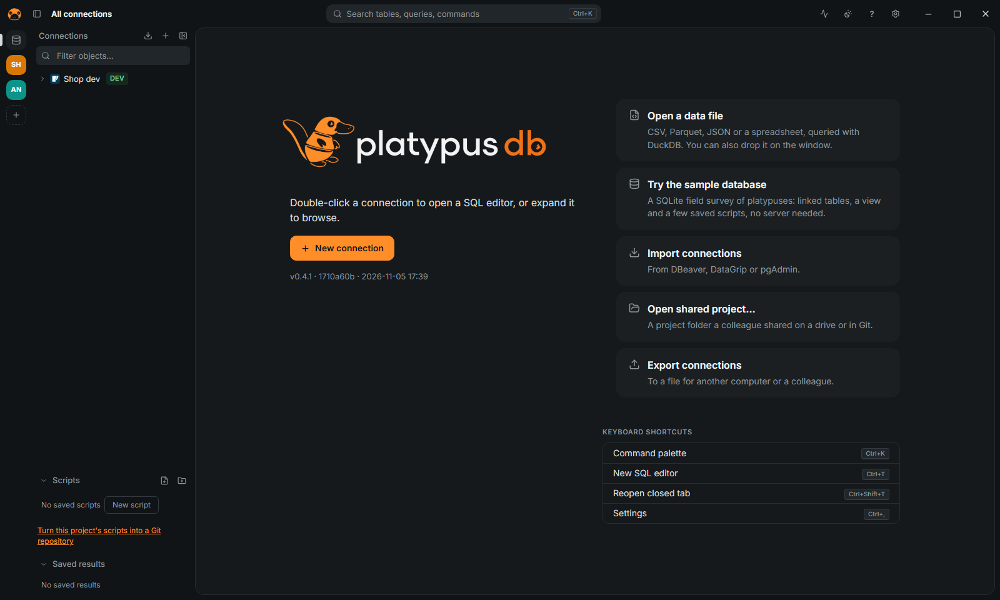

<!-- source: fd6d4b4d7dd6 -->
[← Benutzerhandbuch](README.md)

# Erste Schritte

Installiere PlatypusDB, öffne eine Verbindung und lerne die wenigen Tasten, die den Großteil der Arbeit
erledigen. Alle Funktionen, Bereich für Bereich, stehen in [FEATURES.md](../../../FEATURES.md).

## Installation

Lade den Installer für dein System von der
[Release-Seite](https://github.com/platypus-labs/platypus-db/releases/latest) herunter: `.exe` oder
`.msi` für Windows, `.dmg` für macOS, `.AppImage`, `.deb` oder `.rpm` für Linux. Die App aktualisiert
sich selbst (siehe [Updates](troubleshooting.md#updates)).

**Portable Kopie**: Lege die ausführbare Datei in einen Ordner, neben dem ein leerer Ordner `data`
liegt. Verbindungen, Einstellungen, Verlauf und Skripte liegen dann in `data`, und der Ordner lässt
sich auf einen anderen Computer oder einen USB-Stick mitnehmen.

## Erste Verbindung

1. Öffne PlatypusDB und klicke auf **Neue Verbindung**, oder füge eine Verbindungs-URL ein
   (`postgres://…`, `mysql://…`, eine JDBC-URL oder eine ADO.NET-Zeichenfolge).
2. Wähle die Datenbank im Raster der Logos. Braucht sie einen Treiber, der noch nicht installiert ist
   (Snowflake, BigQuery, Databricks und Trino, DuckDB, Oracle, IBM Db2), bietet die App an, ihn sofort
   herunterzuladen; **Abbrechen** lässt das Formular, wie es ist.
3. Fülle das Formular aus und klicke auf **Verbindung testen**, dann auf **Speichern**.
4. Doppelklicke auf die Verbindung, um einen SQL-Editor zu öffnen, oder klappe sie auf, um zu
   stöbern.

Das Formular wird unter [Verbinden](connect.md) erklärt; jede Datenbank hat ihre eigene Seite unter
[Datenbanken](databases/README.md).

Keine Datenbank zur Hand? Klicke auf dem Willkommensbildschirm auf **Beispieldatenbank ausprobieren**:
eine SQLite-Datenbank mit einer Schnabeltier-Feldstudie, mit verknüpften Tabellen, einer View und
einigen gespeicherten Skripten.

## Die ersten Tasten

Jede Aktion, Verbindung und Tabelle ist in der Befehlspalette nur ein paar Buchstaben entfernt.

| Tasten | Aktion |
|---|---|
| `Ctrl+K` | Befehlspalette |
| `Ctrl+Enter` | Führt die Anweisung unter dem Cursor (oder die Auswahl) aus |
| `Alt+X` | Führt das Skript aus |
| `Ctrl+Space` | Autovervollständigung |
| `Ctrl+Shift+F` | Formatiert das Skript (oder die Auswahl) |
| `Ctrl+Shift+E` | Erklärt die Anweisung unter dem Cursor |
| `Ctrl+T` | Neuer Tab |

Auf macOS nimmst du `Cmd` statt `Ctrl`. Jedes Tastenkürzel lässt sich unter Einstellungen ›
Tastenkürzel ändern; die vollständige Liste steht in [SHORTCUTS.md](../../../SHORTCUTS.md).

## Wie es weitergeht

[Führe Abfragen aus](queries.md), [bearbeite Daten](edit-data.md) oder lies [Sicherheit](safety.md),
bevor du dich mit der Produktion verbindest.
