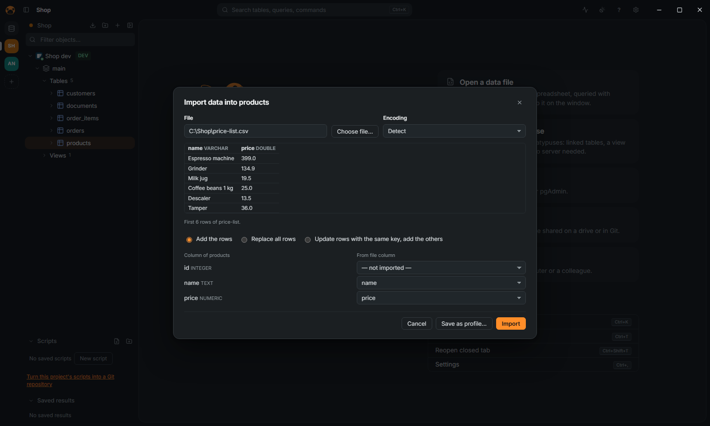

<!-- source: 925ae39e7303 -->
[← Guía del usuario](README.md)

# Importar y exportar

Las acciones de abajo están en el menú contextual del navegador y en la paleta de comandos
(`Ctrl+K`). La lista completa de formatos y opciones está en
[FEATURES.md](../../../FEATURES.md#import-export-and-transfer).

## Importar un archivo a una tabla

1. Haz clic derecho en la tabla del navegador y elige **Datos** › **Importar datos…**.
2. Elige el archivo: CSV, TSV, JSON, NDJSON, Parquet o Excel.
3. Revisa la vista previa y la correspondencia de las columnas.
4. Elige **Añadir las filas**, **Reemplazar todas las filas** o **Actualizar las filas con la misma
   clave, añadir las demás** y haz clic en **Importar**. La última necesita una clave primaria en la
   tabla, y no se ofrece en ClickHouse.

**Importar datos…** se ofrece en las tablas, no en las vistas. Para una tabla nueva, haz clic
derecho en el esquema y elige **Importar datos a una tabla nueva…**: los tipos son los que DuckDB
deduce del archivo, y no hay elección de modo. **Pegar un CSV como tabla nueva…** (en el mismo menú)
importa el portapapeles.

La importación no se ofrece en una conexión de solo lectura, en una que prohíba la edición de datos,
ni en las bases de datos NoSQL.

## Exportar tablas a un archivo

1. Haz clic derecho en una tabla, o selecciona varias, y elige **Datos** › **Exportar datos…**. Para
   todas las tablas de un esquema, haz clic derecho en el esquema y elige **Exportar todas las
   tablas…**.
2. Elige el **Formato** (CSV, JSON, NDJSON, Parquet, Excel, SQL `INSERT`, Markdown, HTML o XML) y
   haz clic en **Exportar a una carpeta…**: incluso para una sola tabla la app pide una carpeta, y
   escribe un archivo por tabla, con su nombre.
3. Si quieres, define la **Compresión** (gzip o zstd; no para Parquet ni Excel, que ya vienen
   comprimidos) y **Subir también a…** un bucket (S3, GCS, R2 o MinIO).

Cuando exportas el resultado de una consulta (la exportación de la cuadrícula de resultados), el
diálogo pide un solo archivo, y la subida también puede ir a una URL firmada (S3 o GCS).

Las celdas CSV que una hoja de cálculo ejecutaría como fórmula llevan un `'` delante, salvo que
desactives **Fórmulas como texto, para hojas de cálculo**. Una conexión puede prohibir las
exportaciones (página **Apariencia y seguridad**); entonces la acción no se ofrece. Consulta
[Seguridad](safety.md).

Para sacar el resultado de una consulta, cópialo desde la cuadrícula como CSV, JSON, Markdown, HTML,
SQL `INSERT` o una lista `IN`.

## Copiar una tabla o un esquema a otra base de datos

Haz clic derecho en una tabla y elige **Datos** › **Copiar a una base de datos…** (te deja
correlacionar las columnas), selecciona varias tablas de un esquema y elige **Datos** › **Copiar las
tablas a una base de datos…**, o haz clic derecho en el esquema y elige **Copiar el esquema a una
base de datos…**. Los tipos se convierten. El destino es una conexión SQL que no es de solo lectura
y permite editar datos. Copiar varias tablas o un esquema es para orígenes SQL; una colección de
MongoDB o un tipo de clave de Redis se puede copiar a una base de datos SQL. Ninguna de estas
acciones se ofrece cuando la conexión prohíbe las exportaciones.

## Ejecutar un archivo SQL, o volcar a uno

Haz clic derecho en una conexión o en una base de datos y elige **Ejecutar archivo SQL…**: ejecuta un archivo `.sql` (o `.sql.gz`, `.sql.zst`) de cualquier tamaño sentencia a sentencia,
con progreso y Detener, por defecto en una sola transacción que un fallo revierte. **Volcar a un archivo SQL…**
(en un esquema, o en las tablas, en **Datos**) escribe el DDL de un esquema o de los objetos elegidos, y si quieres sus filas, en un solo archivo.

## Guardar una transferencia para más tarde

Cada diálogo de exportación, importación y copia tiene **Guardar como perfil…**. **Perfiles de
transferencia…** (paleta de comandos) los ejecuta, renombra, borra y programa. La clave secreta de un
bucket nunca se guarda en el archivo del perfil.

## Consultar un archivo de datos sin importarlo

Suelta un archivo CSV, JSON, Parquet o Excel en la ventana, o haz clic en **Abrir un archivo de
datos** en la pantalla de bienvenida: se abre como una base de datos (cada hoja de Excel es una
tabla). La primera vez, la app ofrece descargar la biblioteca de DuckDB.

## Importar conexiones

En la pantalla de bienvenida, **Importar conexiones** lee DBeaver, DataGrip y pgAdmin (y
`pg_service.conf`); también lee las conexiones de Db2 de DBeaver y DataGrip, y las URL `jdbc:db2:`.
**Exportar conexiones** escribe un archivo `.platypusconn` para otro ordenador: consulta
[Proyectos y uso compartido](projects-sharing.md).
