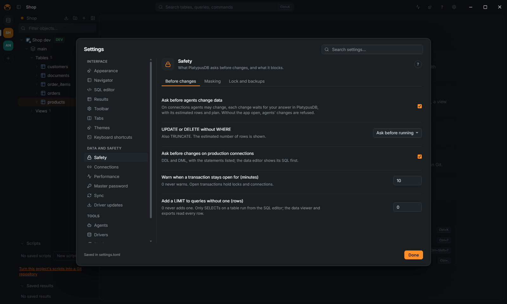

<!-- source: db93b8bc91b0 -->
[← Guía del usuario](README.md)

# Trabajar con seguridad: producción, solo lectura, confirmaciones, enmascarado

Todo esto también está en [FEATURES.md](../../../FEATURES.md#transactions-and-safety).

## Marcar una conexión como de producción

1. Edita la conexión y abre la página **Apariencia y seguridad**.
2. Pon el entorno en **Producción** (las otras opciones son Desarrollo y Pruebas). Producción
   pregunta antes de los cambios y empieza en confirmación manual.
3. Si quieres, elige un color, para distinguir la conexión con facilidad.

A partir de entonces, cada cambio en esa conexión aparece en un diálogo titulado
"Cambios en `<name>` (producción)", con las sentencias, y solo se ejecuta después de que confirmes.
Ajustes (`Ctrl+,`) › **Seguridad** › **Preguntar antes de cambios en conexiones de producción**
lo desactiva para toda la app. Los agentes nunca pasan de solo lectura en una conexión de producción.

## Hacer que una conexión sea de solo lectura

1. En la misma página, marca **Solo lectura (rechaza cambios en los datos)**.
2. Una sentencia que pueda modificar datos no se ejecuta. El editor muestra "`<name>` es de solo
   lectura y esto puede modificar datos." sin forma de saltárselo. Lo mismo vale para Explain con
   analyze ("esta sentencia puede modificar datos."), un archivo incluido con `@include`, una celda
   de notebook ("esta celda puede cambiar datos."), el cliente de línea de comandos y una ejecución
   en varias conexiones, que muestra la conexión como omitida ("Conexión de solo lectura").
3. No se ofrecen en absoluto: **Importar datos…**, **Importar datos a una tabla nueva…**, **Pegar un
   CSV como tabla nueva…**, **Generar datos…**, **Ejecutar archivo SQL…**, crear objetos, guardar en
   el diseñador de tablas y editar filas en la cuadrícula. Los agentes siguen en solo lectura.

El botón de candado de una pestaña del editor hace de solo lectura solo esa pestaña, sin cambiar la
conexión guardada. Es el único caso que pregunta: el editor muestra el mismo mensaje con un botón
**Ejecutar de todos modos**, y el cliente de línea de comandos pregunta "¿Ejecutar de todos modos?".

La misma página tiene dos casillas más: **Sin exportaciones** (sus datos no van a ningún archivo,
otra base de datos o agente) y **Sin edición de datos** (las filas cambian solo con SQL, no en la
cuadrícula, ni con importaciones o datos generados).

## Confirmaciones

Ajustes › **Seguridad** › **Antes de los cambios**:

- **UPDATE o DELETE sin WHERE** (también `TRUNCATE`): **Preguntar antes de ejecutar** (el valor por
  defecto), **No ejecutar nunca** o **Ejecutar sin preguntar**. El diálogo pregunta "¿Modificar todas
  las filas?" y dice aproximadamente cuántas.
- **Avisar cuando una transacción sigue abierta durante (minutos)**: 10 por defecto, con 0 no avisa
  nunca.
- **Añadir un LIMIT a las consultas que no lo tienen (filas)**: con 0 (el valor por defecto) no lo
  añade nunca.
- **Preguntar antes de que los agentes cambien datos**: consulta [Agentes](agents.md).

## Deshacer un cambio

Activado por defecto, **Guardar las filas que cambia un UPDATE o DELETE, para restaurarlas**
(Ajustes › Seguridad › **Bloqueo y copias**) guarda las filas de un `UPDATE` o `DELETE` de una
tabla, hasta 10.000, ejecutado desde el editor. Abre el **Registro de transacciones** en la barra de
herramientas del editor y haz clic en **Restaurar…**, o
ejecuta **Instantáneas antes de cambios…** desde la paleta de comandos, para obtener el script que
las devuelve.

## Enmascarar datos sensibles

1. Pulsa `Ctrl+Alt+M` (o ejecuta **Enmascarar datos sensibles** desde la paleta de comandos): los
   valores de las columnas sensibles se muestran como puntos mientras se comparte la pantalla. Las
   copias conservan los valores reales.
2. Ajustes › **Seguridad** › **Enmascarado** define qué columnas son sensibles, por nombre
   (`*password*`, `*token*`, `*email*` y otros por defecto; `*` es cualquier cantidad de caracteres)
   y por tipo. También puedes marcar una columna en la pestaña de su tabla.

Los agentes también leen enmascaradas las columnas sensibles, salvo que marques **Mostrar a los
agentes los valores de las columnas sensibles** para esa conexión en Ajustes › Agentes ›
**Seguridad**. Un campo sensible dentro de un documento de MongoDB (`user.password`) también se
enmascara. Cuando un agente pregunta en qué estás trabajando, una columna leída con otro nombre
(`SELECT email AS contact`) también se enmascara; si la sentencia la oculta tras una subconsulta, se
enmascara todo el resultado compartido.

Una regla o una marca eliminada fuera de la app (un agente con herramientas de archivos que edita
`settings.toml` o `catalog.db`) no llega a los agentes hasta que la aceptes: la app pregunta, y
Ajustes › Agentes › **Seguridad** la lista, con una forma de aceptarla o deshacerla. Una añadida
fuera de la app se aplica al instante. Esto cubre las ediciones de esos archivos y nada más. Un
agente que puede ejecutar comandos como tu usuario puede leer la base de datos por otras vías, o el
llavero del sistema donde vive el sello: para que esos valores no lleguen a un agente así, ejecútalo
como otro usuario y dale a la conexión un usuario de base de datos sin acceso a esas columnas.

Una respuesta vale para lo que enumeraba la pregunta: si los archivos vuelven a cambiar mientras
está abierta, **Accept** no acepta nada y se muestra la lista otra vez.

## Bloquear la app

Con una contraseña maestra definida (consulta [Conectar](connect.md#contraseña-maestra)), Ajustes ›
**Seguridad** › **Bloquear la app tras estos minutos de inactividad** (0, el valor por defecto, no
bloquea nunca) bloquea PlatypusDB y cierra las conexiones de producción. **Bloquear PlatypusDB** en
la paleta de comandos lo bloquea al instante. Introduce la contraseña maestra para desbloquearlo: las
conexiones de producción se reconectan al usarlas.
