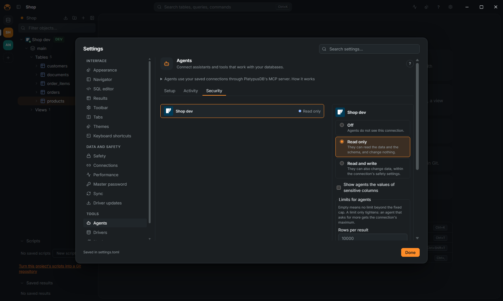

<!-- source: cce13c1c788d -->
[← Guide utilisateur](README.md)

# Utiliser PlatypusDB depuis un agent

Claude Code, Codex, Cursor et d'autres clients MCP peuvent utiliser vos connexions enregistrées grâce au
serveur MCP de PlatypusDB. Cette page est le chemin court ; chaque outil, limite et réglage est dans la
référence, [AGENTS.md](../../../AGENTS.md).

## Connecter un agent

1. Ouvrez Paramètres (`Ctrl+,`) › **Agents** › **Configuration**.
2. Trouvez votre client dans la liste (Claude Desktop, Claude Code, Codex, Cursor, Windsurf,
   Antigravity, Gemini CLI). Cliquez sur **Installer** : l'application demande, enregistre une copie du
   fichier du client à côté de lui, et y écrit le serveur. Pour un client absent de la liste, copiez
   l'entrée à la main depuis la même page.
3. Redémarrez le client. Il démarre lui-même PlatypusDB avec `--mcp` ; aucune fenêtre ne s'ouvre, et
   l'application n'a pas besoin d'être ouverte pour la lecture.

## Choisir ce que chaque connexion autorise

1. Paramètres › **Agents** › **Sécurité** liste vos connexions. Le formulaire d'une connexion offre le
   même choix, sous **Agents** dans sa page **Apparence et sécurité**.
2. Choisissez **Désactivé**, **Lecture seule** (par défaut) ou **Lecture et écriture**.

Les connexions de production et en lecture seule ne dépassent jamais la lecture seule : le panneau dit
« Indisponible : les connexions de production et en lecture seule restent en lecture seule. » Une
connexion nouvelle venue d'un projet partagé démarre sur **Désactivé** sur votre ordinateur.

## Limites et masquage

- Dans **Sécurité**, **Limites pour les agents** plafonne, par connexion, les lignes, les octets et les
  secondes d'un résultat ou d'une instruction, les appels par minute, et les lignes estimées ou le coût du
  plan d'une lecture, au-delà desquels la lecture est refusée avec son plan. Vide veut dire aucune limite
  au-delà des plafonds fixes.
- Les colonnes sensibles apparaissent sous la forme `••••••` pour les agents, comme dans la grille pendant
  le masquage. Cochez **Montrer aux agents les valeurs des colonnes sensibles** sur une connexion pour les
  afficher. Voir [Sécurité](safety.md).

## Les modifications attendent votre accord

Sur une connexion en **Lecture et écriture**, chaque modification qu'un agent veut exécuter ouvre une boîte
de dialogue dans l'application avec l'instruction, aux couleurs de l'éditeur et mise en forme sur les bases
de données SQL (**Afficher tel que l'agent l'a envoyé** montre le texte qui s'exécute, à la lettre), les
lignes que la base de données prévoit de modifier et son plan. Cliquez sur **Refuser** (l'agent lit votre
raison), **Autoriser une fois** ou **Autoriser pour cette session**. Sans réponse après cinq minutes,
la modification est refusée, et si l'application est fermée, les modifications sont refusées.
Paramètres › **Sécurité** › **Demander avant que les agents modifient des données** désactive ces questions.

Un agent peut aussi proposer, sans rien exécuter :

- du SQL avec `propose_sql` : il s'ouvre dans un nouvel onglet d'éditeur, pour que vous le lisiez et
  l'exécutiez.
- des lignes à insérer, modifier ou supprimer avec `propose_edits` : la table s'ouvre dans sa visionneuse de
  données avec ces lignes comme modifications en attente, à enregistrer ou à abandonner (voir
  [Modifier les données](edit-data.md)).

## Voir ce que les agents ont fait

Paramètres › **Agents** › **Activité** liste chaque appel d'outil par session, avec un filtre et **Exporter
en CSV**. Leurs requêtes sont dans l'historique, sous le nom de l'agent.

Au-dessus de la liste, **Résumé par agent et par session** (replié jusqu'à ce que vous l'ouvriez) additionne
les appels que les filtres sélectionnent : une ligne par agent et, en dessous, une par session, avec la
période, les appels, les tables lues, les lignes renvoyées, les modifications autorisées, les modifications
refusées et les erreurs. **Exporter en Markdown** et **Exporter en HTML** l'enregistrent comme un document à
partager ; le HTML est un seul fichier sans script et sans rien de chargé de l'extérieur.

- Une **session** est un démarrage du serveur MCP, tel que le journal l'enregistre (un client qui reste
  connecté des jours est une seule session).
- Une **modification** est une instruction qui change des données ou le schéma. Elle est *autorisée*
  quand elle s'est exécutée et *refusée* quand l'accès de la connexion, un réglage de sécurité ou votre
  réponse dans l'application a dit non. Une instruction qui a échoué pour une autre raison compte
  seulement comme une erreur.
- **Tables lues** est exact pour `sample_rows` et `profile_table` et pour les sources de
  `query_across_databases`, et une estimation pour une instruction : les tables nommées après `FROM` et
  `JOIN`. Une instruction dans le langage d'une base autre que SQL (MongoDB, Redis, Elasticsearch,
  Cassandra) n'en nomme aucune.
- Seuls les noms et les nombres sont conservés : aucune valeur, et les instructions restent masquées comme
  dans le journal.
- Les appels faits avant que cette version enregistre ces chiffres affichent **–**, jamais 0 ; les autres
  chiffres ne comptent que les appels qui en ont, et le résumé le dit.

## Quand cela ne marche pas

Voir [Dépannage](troubleshooting.md#un-agent-ne-voit-pas-une-connexion).
