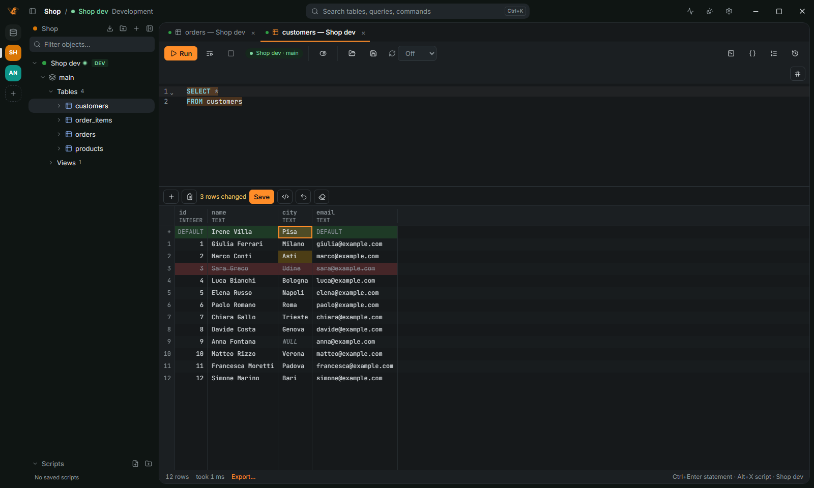

<!-- source: 19e81b2b8673 -->
[← Guide utilisateur](README.md)

# Modifier les données

## Modifier des lignes dans la grille

1. Ouvrez une table depuis le navigateur, ou exécutez une requête qui lit une seule table.
2. Double-cliquez sur une cellule, appuyez sur `F2`, ou tapez simplement, pour la modifier.
   `Shift+Delete` met les cellules sélectionnées à NULL.
3. `Insert` ajoute une ligne, `Ctrl+D` duplique celle qui est sélectionnée, `Delete` la supprime.
4. Les modifications restent en surbrillance jusqu'à l'enregistrement. Utilisez **Aperçu du SQL** pour lire
   les instructions.
5. Appuyez sur `Ctrl+S` (ou **Enregistrer les modifications**) pour toutes les enregistrer, ou aucune si
   l'une échoue. `Ctrl+Z` annule les modifications pas encore enregistrées.

Chaque enregistrement laisse un script d'annulation qui remet les lignes en place. En mode de commit manuel,
les modifications rejoignent la transaction ouverte.

## Quand la grille est en lecture seule

Une table a besoin d'une clé primaire, ou d'une clé unique sur des colonnes non nulles, ou d'une clé
virtuelle que vous choisissez ; sinon la grille dit pourquoi elle ne peut pas être modifiée. Une connexion
peut aussi interdire la modification des données (page **Apparence et sécurité** de ses réglages) : les
lignes ne changent alors que par SQL.

## Modifier des documents, des clés et des lignes sans SQL

Les résultats Redis, Elasticsearch, Cassandra et MongoDB se modifient aussi, avec leurs propres commandes à
la place du SQL : **Aperçu du SQL** les affiche. Sur MongoDB, le résultat d'un simple `find` sur une
collection se modifie par `_id`. Chaque modification est un `updateOne`, un `insertOne` ou un `deleteOne`,
écrit avec le type BSON de la colonne ; un nombre modifié garde le type numérique que le document stocke,
quand ce type le représente exactement. La modification de `_id`, des colonnes de types mélangés et des
champs dont le nom contient un `.` est refusée, avec la raison. Sur un replica set, un enregistrement est
tout ou rien ; sur un serveur autonome, les commandes s'exécutent l'une après l'autre et l'erreur dit
combien ont été enregistrées. Voir
[MongoDB](databases/mongodb.md#modifier-les-documents-dans-la-grille).

## Modifier beaucoup de cellules à la fois

Sélectionnez les cellules et utilisez **Modifier la sélection** dans le menu de la grille : une valeur, NULL
ou DEFAULT dans chaque cellule, rechercher et remplacer dans les cellules de texte, ou une suite de nombres.
`Ctrl+Alt+D` remplit vers le bas à partir de la première ligne (`⌃⇧D` sur macOS). Seules les lignes chargées
dans la grille changent, et le résultat est un ensemble de modifications en attente que vous prévisualisez,
enregistrez ou annulez ensemble.

Collez depuis un tableur avec `Ctrl+V` sur les cellules, ou avec `Ctrl+Shift+V` comme nouvelles lignes.

## Charger un fichier dans une cellule

Depuis le menu de la grille, ou le bouton `…` de l'éditeur de cellule : les octets vont dans les colonnes
binaires et le texte UTF-8 dans les colonnes de texte. Les fichiers de plus de 50 Mo demandent d'abord une
confirmation ; ceux de plus de 200 Mo sont refusés.

## Lignes proposées par un agent

Quand un agent appelle `propose_edits`, la table s'ouvre dans sa visionneuse de données avec les lignes
proposées comme modifications en attente, colorées comme les vôtres. Rien n'est écrit tant que vous ne les
enregistrez pas ; abandonnez-les pour refuser. Voir [Agents](agents.md).

## Pour aller plus loin

Les clés étrangères, les tableaux, l'éditeur de table (colonnes, clés, index) et les fausses données sont
dans [FEATURES.md](../../../FEATURES.md#data-editor). Les connexions de production confirment d'abord chaque
modification : voir [Sécurité](safety.md).
