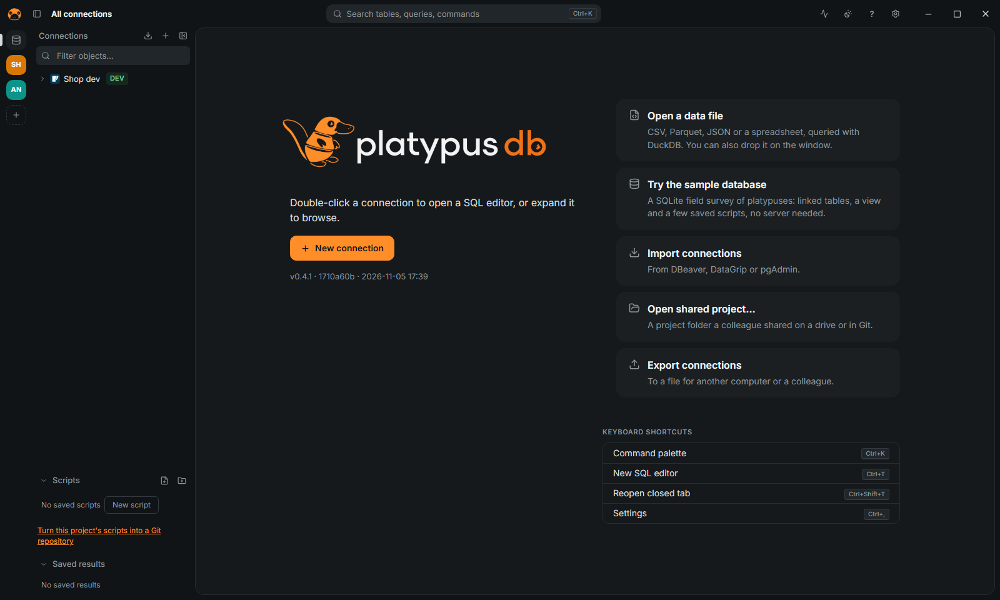

<!-- source: fd6d4b4d7dd6 -->
[← Guide utilisateur](README.md)

# Premiers pas

Installez PlatypusDB, ouvrez une connexion et apprenez les quelques touches qui font l'essentiel du
travail. Toutes les fonctionnalités, domaine par domaine, sont dans [FEATURES.md](../../../FEATURES.md).

## Installation

Téléchargez l'installateur pour votre système depuis la
[page des versions](https://github.com/platypus-labs/platypus-db/releases/latest) : `.exe` ou `.msi`
pour Windows, `.dmg` pour macOS, `.AppImage`, `.deb` ou `.rpm` pour Linux. L'application se met à
jour toute seule (voir [Mises à jour](troubleshooting.md#mises-à-jour)).

**Copie portable** : placez l'exécutable dans un dossier, à côté d'un dossier `data` vide.
Connexions, paramètres, historique et scripts sont alors dans `data`, et le dossier peut passer
sur un autre ordinateur ou sur une clé USB.

## Première connexion

1. Ouvrez PlatypusDB et cliquez sur **Nouvelle connexion**, ou collez une URL de connexion
   (`postgres://…`, `mysql://…`, une URL JDBC ou une chaîne ADO.NET).
2. Choisissez la base de données dans la grille de logos. Si elle demande un pilote pas encore
   installé (Snowflake, BigQuery, Databricks et Trino, DuckDB, Oracle, IBM Db2), l'application propose
   de le télécharger tout de suite ; **Annuler** laisse le formulaire tel quel.
3. Remplissez le formulaire et cliquez sur **Tester la connexion**, puis sur **Enregistrer**.
4. Double-cliquez sur la connexion pour ouvrir un éditeur SQL, ou dépliez-la pour parcourir son contenu.

Le formulaire est expliqué dans [Se connecter](connect.md) ; chaque base de données a sa propre page dans
[Bases de données](databases/README.md).

Pas de base de données sous la main ? Cliquez sur **Essayer la base de données d'exemple** sur l'écran
d'accueil : un relevé de terrain sur les ornithorynques, en SQLite, avec des tables liées, une vue et
quelques scripts enregistrés.

## Les touches à connaître d'abord

Chaque action, connexion et table est à quelques lettres de distance dans la palette de commandes.

| Touches | Action |
|---|---|
| `Ctrl+K` | Palette de commandes |
| `Ctrl+Enter` | Exécuter l'instruction sous le curseur (ou la sélection) |
| `Alt+X` | Exécuter le script |
| `Ctrl+Space` | Saisie semi-automatique |
| `Ctrl+Shift+F` | Formater le script (ou la sélection) |
| `Ctrl+Shift+E` | Expliquer l'instruction sous le curseur |
| `Ctrl+T` | Nouvel onglet |

Sur macOS, utilisez `Cmd` à la place de `Ctrl`. Chaque raccourci peut être modifié dans Paramètres ›
Raccourcis clavier ; la liste complète est dans [SHORTCUTS.md](../../../SHORTCUTS.md).

## Et ensuite

[Exécutez des requêtes](queries.md), [modifiez des données](edit-data.md), ou lisez [Sécurité](safety.md)
avant de vous connecter à la production.
