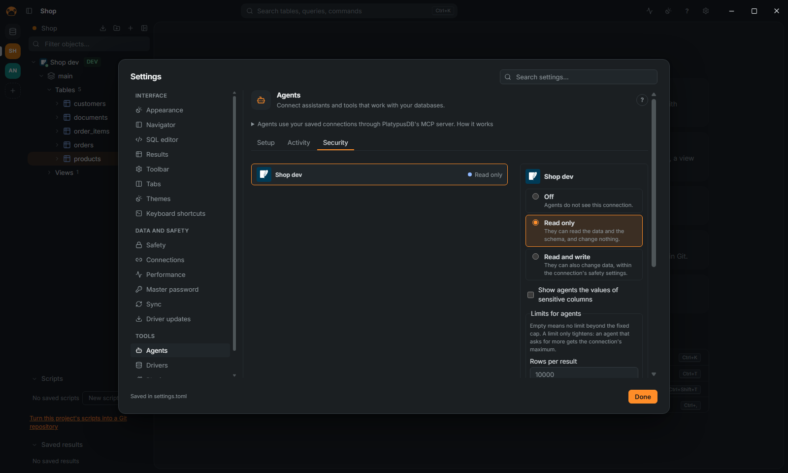

<!-- source: cce13c1c788d -->
[← Guida utente](README.md)

# Usare PlatypusDB da un agente

Claude Code, Codex, Cursor e altri client MCP possono usare le tue connessioni salvate tramite il
server MCP di PlatypusDB. Questa pagina è il percorso breve; ogni strumento, limite e impostazione
è nel riferimento, [AGENTS.md](../../../AGENTS.md).

## Collegare un agente

1. Apri Impostazioni (`Ctrl+,`) › **Agenti** › **Configurazione**.
2. Cerca il tuo client nell'elenco (Claude Desktop, Claude Code, Codex, Cursor, Windsurf,
   Antigravity, Gemini CLI). Fai clic su **Installa**: l'app chiede conferma, salva una copia del
   file del client accanto all'originale e ci scrive il server. Per un client che non è in elenco,
   copia la voce a mano dalla stessa pagina.
3. Riavvia il client. Avvia PlatypusDB da solo con `--mcp`; non si apre nessuna finestra, e per
   leggere non serve che l'app sia aperta.

## Scegliere cosa permette ogni connessione

1. Impostazioni › **Agenti** › **Sicurezza** elenca le tue connessioni. Anche il modulo della
   connessione ha la stessa scelta, sotto **Agenti** nella pagina **Aspetto e sicurezza**.
2. Scegli **Disattivato**, **Sola lettura** (il valore predefinito) o **Lettura e scrittura**.

Le connessioni di produzione e di sola lettura non vanno mai oltre la sola lettura: il pannello dice
"Non disponibile: le connessioni di produzione e di sola lettura restano in sola lettura." Una
connessione nuova che arriva da un progetto condiviso parte con **Disattivato** sul tuo computer.

## Limiti e mascheramento

- In **Sicurezza**, **Limiti per gli agenti** fissa, per ogni connessione, le righe, i byte e i
  secondi di un risultato o di un'istruzione, le chiamate al minuto, e le righe stimate o il costo
  del piano di una lettura: oltre questi valori la lettura viene rifiutata e ti viene mostrato il
  piano. Vuoto vuol dire nessun limite oltre a quelli fissi.
- Le colonne sensibili per gli agenti si leggono come `••••••`, come nella griglia quando il
  mascheramento è attivo. Spunta **Mostra agli agenti i valori delle colonne sensibili** su una
  connessione per mostrarle. Vedi [Sicurezza](safety.md).

## Le modifiche aspettano te

Su una connessione **Lettura e scrittura**, ogni modifica che un agente vuole eseguire apre una
finestra nell'app con l'istruzione, nei colori dell'editor e ben impaginata sui database SQL
(**Mostra come l'ha inviata l'agente** mostra il testo che viene eseguito, alla lettera), le righe
che il database prevede di modificare e il suo piano. Fai clic su **Rifiuta** (l'agente legge il tuo
motivo), **Consenti una volta** o **Consenti per questa sessione**. Dopo cinque minuti senza
risposta viene rifiutata, e con l'app chiusa le modifiche vengono rifiutate.
Impostazioni › **Sicurezza** › **Chiedi prima che gli agenti modifichino dati** disattiva le
domande.

Un agente può anche proporre, senza eseguire nulla:

- SQL con `propose_sql`: si apre in una nuova scheda dell'editor, perché tu lo legga e lo esegua.
- Righe da inserire, aggiornare o eliminare con `propose_edits`: la tabella si apre nel suo
  visualizzatore dati con queste righe come modifiche in sospeso, da salvare o scartare (vedi
  [Modificare i dati](edit-data.md)).

## Vedere cosa hanno fatto gli agenti

Impostazioni › **Agenti** › **Attività** elenca ogni chiamata a uno strumento per sessione, con un
filtro ed **Esporta CSV**. Le loro query sono nella cronologia con il nome dell'agente.

Sopra l'elenco, **Riepilogo per agente e sessione** (chiuso finché non lo apri) somma le chiamate
che i filtri selezionano: una riga per agente e, sotto, una per sessione, con il periodo, le
chiamate, le tabelle lette, le righe restituite, le modifiche consentite, le modifiche rifiutate e
gli errori. **Esporta Markdown** ed **Esporta HTML** lo salvano come documento da condividere; l'HTML
è un solo file, senza script e senza nulla caricato dall'esterno.

- Una **sessione** è un avvio del server MCP, come lo registra il log (un client che resta
  connesso per giorni è una sola sessione).
- Una **modifica** è un'istruzione che cambia i dati o lo schema. È *consentita* se è stata
  eseguita e *rifiutata* se l'accesso della connessione, un'impostazione di sicurezza o la tua
  risposta nell'app hanno detto di no. Un'istruzione fallita per un altro motivo conta solo come
  errore.
- Le **Tabelle lette** sono esatte per `sample_rows` e `profile_table` e per le sorgenti di
  `query_across_databases`, e una stima per un'istruzione: le tabelle nominate dopo `FROM` e
  `JOIN`. Un'istruzione in un linguaggio che non è SQL (MongoDB, Redis, Elasticsearch, Cassandra)
  non ne nomina nessuna.
- Si conservano solo nomi e conteggi: nessun valore, e le istruzioni restano mascherate come nel
  log.
- Le chiamate fatte prima che questa versione registrasse questi dati mostrano **–**, mai uno 0; gli
  altri numeri contano solo le chiamate che li hanno, e il riepilogo lo dice.

## Quando non funziona

Vedi [Risoluzione dei problemi](troubleshooting.md#un-agente-non-vede-una-connessione).
