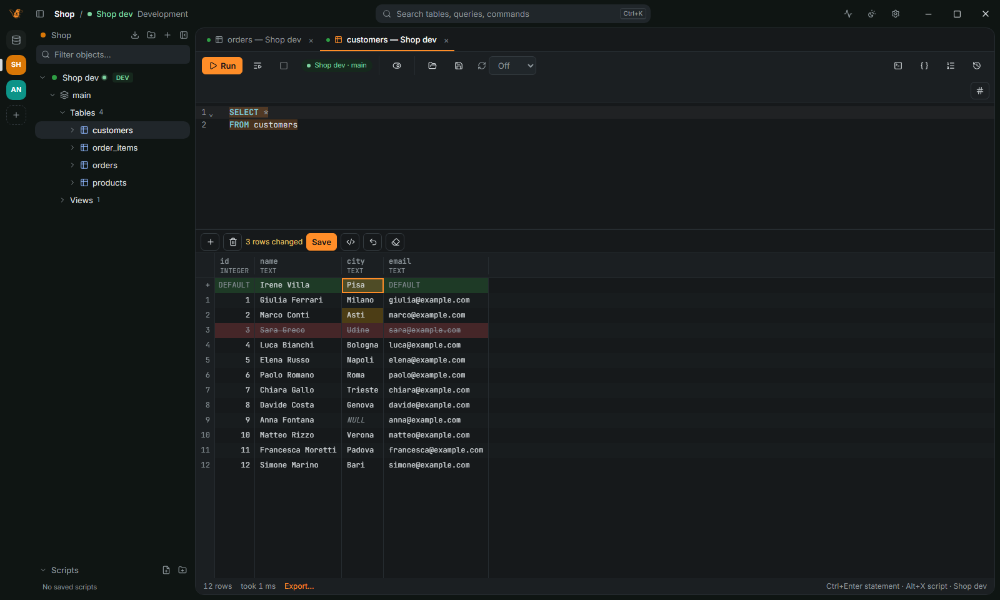

<!-- source: 19e81b2b8673 -->
[← Guida utente](README.md)

# Modificare i dati

## Modificare le righe nella griglia

1. Apri una tabella dal navigatore, oppure esegui una query che legge una sola tabella.
2. Fai doppio clic su una cella, premi `F2`, o semplicemente scrivi, per modificarla.
   `Shift+Delete` imposta a NULL le celle selezionate.
3. `Insert` aggiunge una riga, `Ctrl+D` duplica quella selezionata, `Delete` la elimina.
4. Le modifiche restano evidenziate finché non salvi. Usa **Anteprima dell'SQL** per leggere le
   istruzioni.
5. Premi `Ctrl+S` (o **Salva le modifiche**) per salvarle tutte, oppure nessuna se una fallisce.
   `Ctrl+Z` annulla le modifiche non ancora salvate.

Ogni salvataggio lascia uno script di annullamento che rimette a posto le righe. In modalità commit
manuale le modifiche entrano nella transazione aperta.

## Quando la griglia è in sola lettura

Una tabella ha bisogno di una chiave primaria, o di una chiave univoca su colonne non nulle, o di
una chiave virtuale che scegli tu; altrimenti la griglia dice perché non si può modificare. Una
connessione può anche vietare la modifica dei dati (pagina **Aspetto e sicurezza** delle sue
impostazioni): le righe allora cambiano solo con SQL.

## Modificare documenti, chiavi e righe senza SQL

Si modificano anche i risultati di Redis, Elasticsearch, Cassandra e MongoDB, con i loro comandi
invece dell'SQL: **Anteprima dell'SQL** li mostra. Su MongoDB il risultato di un semplice `find` su
una sola collezione si modifica per `_id`. Ogni modifica è una `updateOne`, `insertOne` o
`deleteOne`, scritta con il tipo BSON della colonna; un numero modificato mantiene il tipo
numerico che il documento memorizza, quando quel tipo lo contiene esattamente. La modifica di
`_id`, di colonne di tipi misti e di campi con un `.` nel nome viene rifiutata, con il motivo. Su
un replica set un salvataggio è tutto o niente; su un server standalone i comandi vengono eseguiti
uno dopo l'altro e l'errore dice quanti sono stati salvati. Vedi
[MongoDB](databases/mongodb.md#modifica-i-documenti-nella-griglia).

## Modificare molte celle insieme

Seleziona le celle e usa **Modifica la selezione** nel menu della griglia: un valore, NULL o
DEFAULT in ogni cella, trova e sostituisci nelle celle di testo, o una sequenza di numeri.
`Ctrl+Alt+D` riempie verso il basso a partire dalla prima riga (`⌃⇧D` su macOS). Cambiano solo le
righe caricate nella griglia, e il risultato sono modifiche in sospeso che vedi in anteprima,
salvi o annulli insieme.

Incolla da un foglio di calcolo con `Ctrl+V` sulle celle, oppure con `Ctrl+Shift+V` come nuove
righe.

## Caricare un file in una cella

Dal menu della griglia, o dal pulsante `…` dell'editor della cella: i byte vanno nelle colonne
binarie e il testo UTF-8 nelle colonne di testo. I file oltre 50 MB chiedono prima conferma; quelli
oltre 200 MB vengono rifiutati.

## Righe proposte da un agente

Quando un agente chiama `propose_edits`, la tabella si apre nel suo visualizzatore di dati con le
righe proposte come modifiche in sospeso, colorate come le tue. Non viene scritto nulla finché non
le salvi; scartale per rifiutarle. Vedi [Agenti](agents.md).

## Altro

Chiavi esterne, array, l'editor delle tabelle (colonne, chiavi, indici) e i dati finti sono in
[FEATURES.md](../../../FEATURES.md#data-editor). Le connessioni di produzione chiedono conferma per ogni
modifica: vedi [Sicurezza](safety.md).
