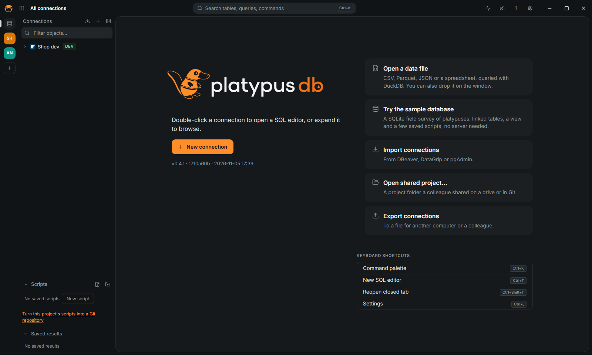

<!-- source: fd6d4b4d7dd6 -->
[← Guida utente](README.md)

# Per iniziare

Installa PlatypusDB, apri una connessione e impara i pochi tasti che fanno la maggior parte del
lavoro. Tutte le funzioni, area per area, sono in [FEATURES.md](../../../FEATURES.md).

## Installazione

Scarica l'installer per il tuo sistema dalla
[pagina delle release](https://github.com/platypus-labs/platypus-db/releases/latest): `.exe` o `.msi`
per Windows, `.dmg` per macOS, `.AppImage`, `.deb` o `.rpm` per Linux. L'app si aggiorna da sola
(vedi [Aggiornamenti](troubleshooting.md#aggiornamenti)).

**Copia portabile**: metti l'eseguibile in una cartella insieme a una cartella `data` vuota.
Connessioni, impostazioni, cronologia e script vivono allora in `data`, e la cartella si può
spostare su un altro computer o su una chiavetta USB.

## Prima connessione

1. Apri PlatypusDB e fai clic su **Nuova connessione**, oppure incolla un URL di connessione
   (`postgres://…`, `mysql://…`, un URL JDBC o una stringa ADO.NET).
2. Scegli il database dalla griglia dei loghi. Se serve un driver non ancora installato
   (Snowflake, BigQuery, Databricks e Trino, DuckDB, Oracle, IBM Db2), l'app propone di
   scaricarlo subito; **Annulla** lascia il modulo com'è.
3. Compila il modulo e fai clic su **Prova la connessione**, poi su **Salva**.
4. Fai doppio clic sulla connessione per aprire un editor SQL, oppure espandila per esplorarla.

Il modulo è spiegato in [Connettersi](connect.md); ogni database ha la sua pagina in
[Database](databases/README.md).

Non hai un database a portata di mano? Fai clic su **Prova il database di esempio** nella
schermata di benvenuto: un database SQLite con il censimento degli ornitorinchi, con tabelle
collegate, una vista e qualche script salvato.

## I tasti da imparare per primi

Ogni azione, connessione e tabella è a poche lettere di distanza nella palette dei comandi.

| Tasti | Azione |
|---|---|
| `Ctrl+K` | Palette dei comandi |
| `Ctrl+Enter` | Esegue l'istruzione sotto il cursore (o la selezione) |
| `Alt+X` | Esegue lo script |
| `Ctrl+Space` | Completamento automatico |
| `Ctrl+Shift+F` | Formatta lo script (o la selezione) |
| `Ctrl+Shift+E` | Spiega l'istruzione sotto il cursore |
| `Ctrl+T` | Nuova scheda |

Su macOS usa `Cmd` al posto di `Ctrl`. Ogni scorciatoia si può cambiare in Impostazioni ›
Scorciatoie da tastiera; l'elenco completo è in [SHORTCUTS.md](../../../SHORTCUTS.md).

## Passi successivi

[Esegui query](queries.md), [modifica i dati](edit-data.md), oppure leggi [Sicurezza](safety.md)
prima di collegarti alla produzione.
