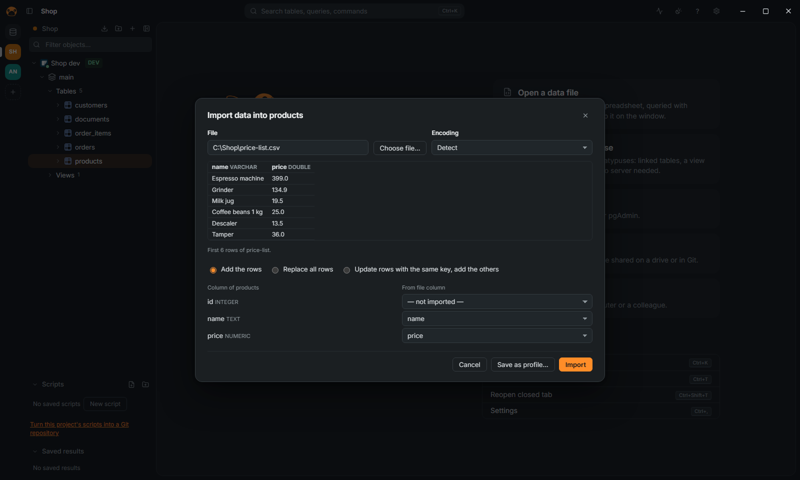

<!-- source: 925ae39e7303 -->
[← Guida utente](README.md)

# Importare ed esportare

Le azioni qui sotto sono nel menu del tasto destro del navigatore e nella palette dei comandi
(`Ctrl+K`). L'elenco completo di formati e opzioni è in
[FEATURES.md](../../../FEATURES.md#import-export-and-transfer).

## Importare un file in una tabella

1. Fai clic con il tasto destro sulla tabella nel navigatore, poi **Dati** › **Importa i dati…**.
2. Scegli il file: CSV, TSV, JSON, NDJSON, Parquet o Excel.
3. Controlla l'anteprima e la mappatura delle colonne.
4. Scegli **Aggiungi le righe**, **Sostituisci tutte le righe** oppure **Aggiorna le righe con la
   stessa chiave, aggiungi le altre**, poi fai clic su **Importa**. L'ultima richiede una chiave
   primaria sulla tabella e non è offerta su ClickHouse.

**Importa i dati…** è offerto sulle tabelle, non sulle viste. Per una nuova tabella, fai clic con
il tasto destro sullo schema e scegli **Importa i dati in una nuova tabella…**: i tipi sono quelli
che DuckDB ricava dal file, e non c'è scelta della modalità. **Incolla un CSV come nuova
tabella…** (stesso menu) importa gli appunti.

L'import non è offerto su una connessione in sola lettura, su una che vieta la modifica dei dati,
né sui database NoSQL.

## Esportare le tabelle in un file

1. Fai clic con il tasto destro su una tabella, o selezionane più di una, poi **Dati** ›
   **Esporta i dati…**. Per tutte le tabelle di uno schema, fai clic con il tasto destro sullo
   schema e scegli **Esporta tutte le tabelle…**.
2. Scegli il **Formato** (CSV, JSON, NDJSON, Parquet, Excel, SQL `INSERT`, Markdown, HTML o XML) e
   fai clic su **Esporta in una cartella…**: anche per una sola tabella l'app chiede una
   cartella, e scrive un file per tabella, con il nome della tabella.
3. Se vuoi, imposta **Compressione** (gzip o zstd; non per Parquet ed Excel, che sono già
   compressi) e **Carica anche su…** un bucket (S3, GCS, R2 o MinIO).

Quando esporti invece il risultato di una query (l'export della griglia dei risultati), la
finestra chiede un solo file, e il caricamento può andare anche a un URL firmato (S3 o GCS).

Le celle CSV che un foglio di calcolo eseguirebbe come formula ricevono un `'` iniziale, a meno che
tu non disattivi **Formule come testo, per i fogli di calcolo**. Una connessione può vietare gli
export (pagina **Aspetto e sicurezza**); l'azione allora non è offerta. Vedi
[Sicurezza](safety.md).

Per portare fuori il risultato di una query, copialo dalla griglia come CSV, JSON, Markdown, HTML,
SQL `INSERT` o un elenco `IN`.

## Copiare una tabella o uno schema in un altro database

Fai clic con il tasto destro su una tabella e scegli **Dati** › **Copia in un database…** (ti
permette di mappare le colonne), seleziona più tabelle di uno schema e scegli **Dati** › **Copia
le tabelle in un database…**, oppure fai clic con il tasto destro sullo schema e scegli **Copia lo
schema in un database…**. I tipi vengono mappati. La destinazione è una connessione SQL che non è
in sola lettura e permette la modifica dei dati. Copiare più tabelle o uno schema vale per le
sorgenti SQL; una collezione MongoDB o un tipo di chiave Redis si può copiare in un database SQL.
Nessuna di queste azioni è offerta quando la connessione vieta gli export.

## Eseguire un file SQL, o fare il dump in uno

Fai clic con il tasto destro su una connessione o un database e scegli **Esegui file SQL…**:
esegue un file `.sql` (o `.sql.gz`, `.sql.zst`) di qualsiasi dimensione istruzione per istruzione,
con avanzamento e Stop, per impostazione predefinita in una sola transazione di cui un errore fa il
rollback. **Dump in un file SQL…** (su uno schema, o sulle tabelle sotto **Dati**) scrive in un
solo file il DDL di uno schema o degli oggetti scelti, e se vuoi le loro righe.

## Salvare un trasferimento per dopo

Ogni finestra di export, import e copia ha **Salva come profilo…**. **Profili di
trasferimento…** (palette dei comandi) li esegue, rinomina, elimina e pianifica. La chiave segreta
di un bucket non viene mai salvata nel file del profilo.

## Interrogare un file di dati senza importarlo

Trascina un file CSV, JSON, Parquet o Excel sulla finestra, oppure fai clic su **Apri un file di
dati** nella schermata di benvenuto: si apre come un database (ogni foglio Excel è una tabella). La
prima volta, l'app propone di scaricare la libreria di DuckDB.

## Importare le connessioni

Nella schermata di benvenuto, **Importa le connessioni** legge DBeaver, DataGrip e pgAdmin (e
`pg_service.conf`); vengono lette anche le connessioni Db2 di DBeaver e DataGrip e gli URL
`jdbc:db2:`. **Esporta le connessioni** scrive un file `.platypusconn` per un altro computer: vedi
[Progetti e condivisione](projects-sharing.md).
