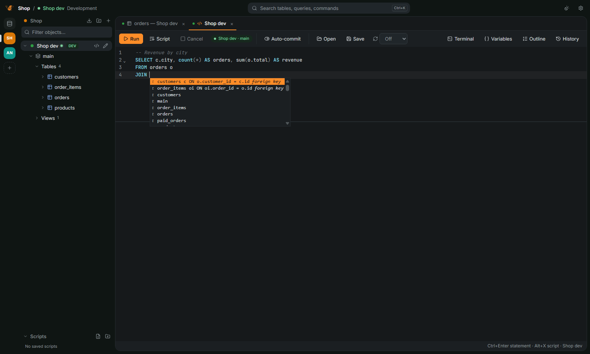
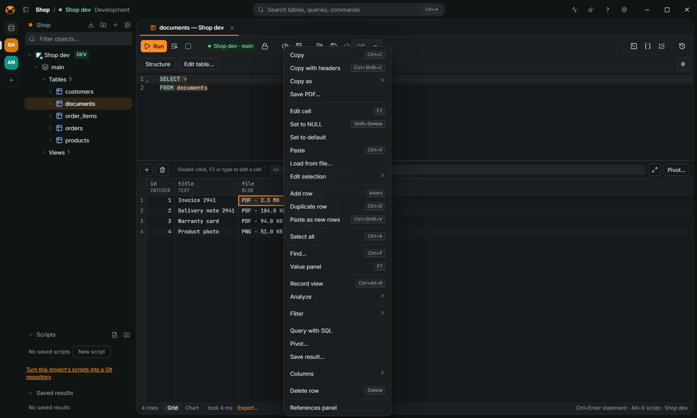

<!-- source: d4ffd9bf1ac2 -->
[← Guida utente](README.md)

# Eseguire query e leggere i risultati

## Eseguire un'istruzione

1. Fai doppio clic su una connessione (o su una tabella) per aprire un editor SQL.
2. Scrivi un'istruzione. `Ctrl+Space` completa parole chiave, tabelle e colonne; dopo `JOIN ` ti
   propone le tabelle collegate tramite le chiavi esterne.
3. Premi `Ctrl+Enter` per eseguire l'istruzione sotto il cursore (o la selezione), oppure `Alt+X`
   per eseguire tutto lo script. `Ctrl+\` esegue in una nuova scheda di risultati.
4. `Ctrl+.` annulla un'istruzione in esecuzione.

Le istruzioni finiscono con un `;`, o con una riga vuota prima di una parola che ne inizia una
nuova. Quando un'istruzione fallisce, l'errore è segnalato nel testo e il pannello degli errori
offre **Vai all'errore**. `Ctrl+Shift+F` formatta lo script; `Ctrl+S` lo salva come file `.sql`.

## Parametri e variabili

`:id` e `?` in un'istruzione, e le variabili `${name}`, vengono chiesti in una finestra prima
dell'esecuzione e conservati in un pannello Variabili. Il valore di una `${name}` entra nell'SQL
così com'è, quindi un'istruzione con variabili viene controllata di nuovo una volta compilata
(vedi [Sicurezza](safety.md)).

## Leggere i risultati

- La griglia legge le righe una pagina alla volta. Fai clic sull'intestazione di una colonna per
  ordinare: scrive l'`ORDER BY` nell'editor ed esegue di nuovo; un secondo clic lo inverte, un
  terzo rimette quello della query.
- Apri una tabella dal navigatore per sfogliarla; un `WHERE` scritto nell'editor la filtra.
- `F7` apre il pannello dei valori: testo lungo, JSON e XML formattati, esadecimale e immagini
  dalle colonne binarie.
- Una cella che contiene un file (un PDF, un'immagine, uno ZIP e altri, riconosciuti dai loro
  byte) mostra tipo e dimensione, come `PDF · 2.3 MB`. Il menu della griglia offre **Salva PDF…**
  (o il tipo del file) e, su più celle di una colonna, **Salva N file in una cartella…**. Il
  pannello dei valori ha lo stesso pulsante.
  Una cella di testo che contiene un file (un URL `data:`, base64 o esadecimale) non ha
  etichetta nella griglia, perché servirebbe leggere ogni cella di testo per riconoscerla: il
  menu della griglia e il pannello dei valori la mostrano, per le celle che selezioni.
- `Ctrl+F` cerca nelle righe caricate; `Ctrl+Shift+C` copia la selezione con le intestazioni.
- Un risultato può passare dalla griglia a un grafico dalla barra di stato.

## Capire una query lenta

Premi `Ctrl+Shift+E` su un'istruzione per vederne il piano. Vedi
[FEATURES.md](../../../FEATURES.md#query-plans-and-performance).

## Altro

Script salvati, snippet, cronologia, modalità vim, esecuzione di uno script su più connessioni,
query builder e analisi dei dati sono in [FEATURES.md](../../../FEATURES.md#sql-editor). La griglia dei
risultati è in [FEATURES.md](../../../FEATURES.md#results-and-the-data-viewer).
