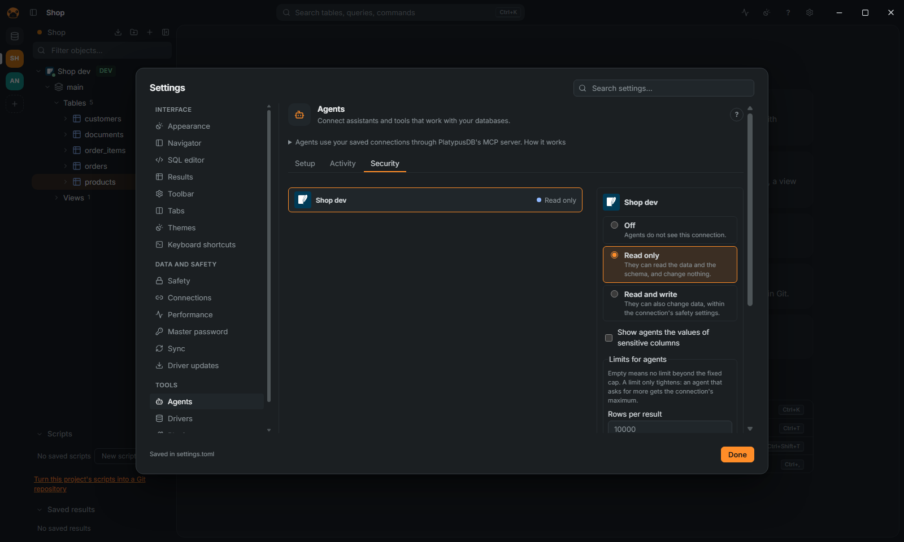

<!-- source: cce13c1c788d -->
[← Guia do usuário](README.md)

# Usar o PlatypusDB a partir de um agente

O Claude Code, o Codex, o Cursor e outros clientes MCP podem usar suas conexões salvas pelo
servidor MCP do PlatypusDB. Esta página é o caminho curto; cada ferramenta, limite e configuração
está na referência, [AGENTS.md](../../../AGENTS.md).

## Conectar um agente

1. Abra as Configurações (`Ctrl+,`) › **Agentes** › **Configuração**.
2. Encontre o seu cliente na lista (Claude Desktop, Claude Code, Codex, Cursor, Windsurf,
   Antigravity, Gemini CLI). Clique em **Instalar**: o app pergunta, salva uma cópia do arquivo do
   cliente ao lado dele e escreve o servidor nele. Para um cliente que não está na lista, copie a
   entrada à mão da mesma página.
3. Reinicie o cliente. Ele inicia o próprio PlatypusDB com `--mcp`; nenhuma janela se abre, e o app
   não precisa estar aberto para leitura.

## Escolher o que cada conexão permite

1. Configurações › **Agentes** › **Segurança** lista as suas conexões. O formulário de cada
   conexão tem a mesma escolha, em **Agentes**, na página **Aparência e segurança**.
2. Escolha **Desativado**, **Somente leitura** (o padrão) ou **Leitura e gravação**.

As conexões de produção e as somente leitura nunca passam de somente leitura: o painel diz
"Indisponível: as ligações de produção e só de leitura permanecem só de leitura." Uma conexão nova
vinda de um projeto compartilhado começa em **Desativado** no seu computador.

## Limites e mascaramento

- Em **Segurança**, **Limites para agentes** define, por conexão, um teto para as linhas, os bytes e
  os segundos de um resultado ou de uma instrução, as chamadas por minuto, e as linhas estimadas ou o
  custo do plano de uma leitura; acima disso, a leitura é recusada junto com o seu plano. Vazio
  significa sem limite além dos tetos fixos.
- As colunas sensíveis aparecem como `••••••` para os agentes, como na grade durante o mascaramento.
  Marque **Mostrar aos agentes os valores das colunas sensíveis** em uma conexão para mostrá-los.
  Veja [Segurança](safety.md).

## As alterações esperam por você

Em uma conexão **Leitura e gravação**, cada alteração que um agente quer executar abre uma caixa de
diálogo no app com a instrução, nas cores do editor e formatada nos bancos de dados SQL (**Mostrar
como o agente enviou** mostra o texto que é executado, ao pé da letra), as linhas que o banco de
dados espera alterar e o plano dela. Clique em **Recusar** (o agente lê o seu motivo), **Permitir
uma vez** ou **Permitir nesta sessão**. Depois de cinco minutos sem resposta, ela é recusada, e com o
app fechado as alterações são recusadas.
Configurações › **Segurança** › **Perguntar antes que os agentes alterem dados** desativa as
perguntas.

Um agente também pode propor, sem executar nada:

- SQL com `propose_sql`: ele abre em uma nova aba do editor, para você ler e executar.
- Linhas para inserir, atualizar ou excluir com `propose_edits`: a tabela abre no seu visualizador
  de dados com elas como alterações pendentes, para você salvar ou descartar (veja
  [Editar dados](edit-data.md)).

## Ver o que os agentes fizeram

Configurações › **Agentes** › **Atividade** lista cada chamada de ferramenta por sessão, com um
filtro e **Exportar CSV**. As consultas deles estão no histórico, com o nome do agente.

Acima da lista, **Resumo por agente e sessão** (recolhido até você abri-lo) soma as chamadas que os
filtros selecionam: uma linha por agente e, abaixo dela, uma por sessão, com o período, as chamadas,
as tabelas lidas, as linhas devolvidas, as alterações permitidas, as alterações recusadas e os erros.
**Exportar Markdown** e **Exportar HTML** o salvam como um documento para compartilhar; o HTML é um
só arquivo, sem script e sem nada carregado de fora.

- Uma **sessão** é uma inicialização do servidor MCP, como o log registra (um cliente que fica
  conectado por dias é uma sessão).
- Uma **alteração** é uma instrução que muda dados ou o schema. Ela é *permitida* quando foi
  executada e *recusada* quando o acesso da conexão, uma configuração de segurança ou a sua resposta
  no app disse não. Uma instrução que falhou por outro motivo conta apenas como erro.
- **Tabelas lidas** é exato para `sample_rows` e `profile_table` e para as fontes de
  `query_across_databases`, e uma estimativa para uma instrução: as tabelas citadas depois de `FROM`
  e `JOIN`. Uma instrução em uma linguagem que não é SQL (MongoDB, Redis, Elasticsearch, Cassandra)
  não cita nenhuma.
- Só nomes e contagens são guardados: nenhum valor, e as instruções continuam mascaradas como estão
  no log.
- As chamadas feitas antes de esta versão registrar esses números mostram **–**, nunca um 0; os
  outros números contam só as chamadas que os têm, e o resumo diz isso.

## Quando não funciona

Veja [Solução de problemas](troubleshooting.md#um-agente-não-vê-uma-conexão).
