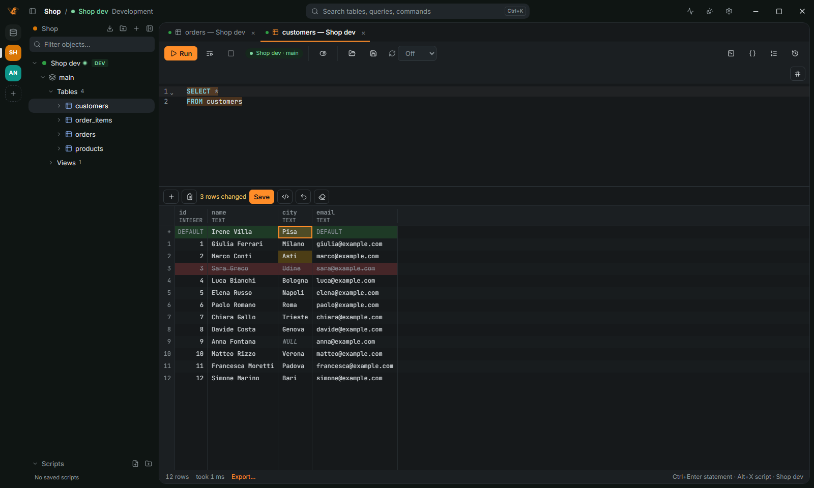

<!-- source: 19e81b2b8673 -->
[← Guia do usuário](README.md)

# Editar dados

## Alterar linhas na grade

1. Abra uma tabela pelo navegador, ou execute uma consulta que leia uma só tabela.
2. Dê um duplo clique em uma célula, pressione `F2`, ou simplesmente digite, para alterá-la.
   `Shift+Delete` define as células selecionadas como NULL.
3. `Insert` adiciona uma linha, `Ctrl+D` duplica a selecionada, `Delete` a exclui.
4. As alterações ficam destacadas até você salvar. Use **Visualizar SQL** para ler as instruções.
5. Pressione `Ctrl+S` (ou **Salvar alterações**) para salvar todas, ou nenhuma se uma falhar.
   `Ctrl+Z` desfaz as alterações ainda não salvas.

Cada salvamento deixa um script de desfazer que devolve as linhas ao que eram. No modo de commit
manual, as alterações entram na transação aberta.

## Quando a grade é somente leitura

Uma tabela precisa de uma chave primária, ou de uma chave única em colunas não nulas, ou de uma
chave virtual que você escolhe; caso contrário a grade diz por que não pode ser editada. Uma
conexão também pode proibir a edição de dados (página **Aparência e segurança** das suas
configurações): as linhas então só mudam por SQL.

## Editar documentos, chaves e linhas sem SQL

Resultados de Redis, Elasticsearch, Cassandra e MongoDB também são editados, com os comandos
próprios de cada um em vez de SQL: **Visualizar SQL** os mostra. No MongoDB, o resultado de um
`find` simples em uma coleção é editável por `_id`. Cada alteração é um `updateOne`, `insertOne` ou
`deleteOne`, escrito com o tipo BSON da coluna; um número alterado mantém o tipo numérico que o
documento guarda, quando esse tipo o comporta com exatidão. Editar `_id`, colunas de tipos mistos e
campos com um `.` no nome é recusado, com o motivo. Em um replica set, um salvamento é tudo ou
nada; em um servidor standalone, os comandos rodam um após o outro e o erro diz quantos foram
salvos. Veja [MongoDB](databases/mongodb.md#editar-documentos-na-grade).

## Editar várias células de uma vez

Selecione as células e use **Editar seleção** no menu da grade: um valor, NULL ou DEFAULT em cada
célula, localizar e substituir nas células de texto, ou uma sequência de números. `Ctrl+Alt+D`
preenche para baixo a partir da primeira linha (`⌃⇧D` no macOS). Só mudam as linhas carregadas na
grade, e o resultado são alterações pendentes que você visualiza, salva ou desfaz juntas.

Cole de uma planilha com `Ctrl+V` sobre as células, ou com `Ctrl+Shift+V` como novas linhas.

## Carregar um arquivo em uma célula

Pelo menu da grade, ou pelo botão `…` do editor de células: bytes vão para colunas binárias e texto
UTF-8 para colunas de texto. Arquivos acima de 50 MB pedem confirmação; acima de 200 MB são
recusados.

## Linhas propostas por um agente

Quando um agente chama `propose_edits`, a tabela abre no seu visualizador de dados com as linhas
propostas como alterações pendentes, com as mesmas cores das suas. Nada é gravado até você salvá-las;
descarte-as para recusar. Veja [Agentes](agents.md).

## Mais

Chaves estrangeiras, arrays, o editor de tabelas (colunas, chaves, índices) e dados falsos estão em
[FEATURES.md](../../../FEATURES.md#data-editor). Conexões de produção confirmam cada alteração antes:
veja [Segurança](safety.md).
