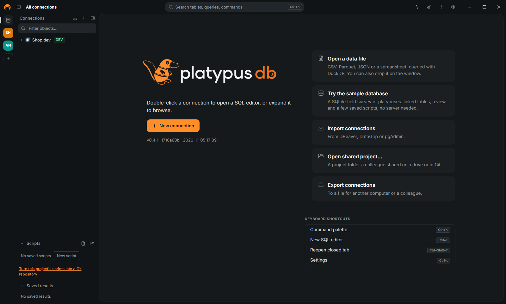

<!-- source: fd6d4b4d7dd6 -->
[← Guia do usuário](README.md)

# Primeiros passos

Instale o PlatypusDB, abra uma conexão e aprenda as poucas teclas que fazem a maior parte do
trabalho. Todos os recursos, área por área, estão em [FEATURES.md](../../../FEATURES.md).

## Instalar

Baixe o instalador do seu sistema na
[página de releases](https://github.com/platypus-labs/platypus-db/releases/latest): `.exe` ou `.msi`
para Windows, `.dmg` para macOS, `.AppImage`, `.deb` ou `.rpm` para Linux. O app se atualiza sozinho
(veja [Atualizações](troubleshooting.md#atualizações)).

**Cópia portátil**: coloque o executável em uma pasta, com uma pasta `data` vazia ao lado.
Conexões, configurações, histórico e scripts passam a ficar em `data`, e a pasta pode ir para
outro computador ou para um pen drive.

## Primeira conexão

1. Abra o PlatypusDB e clique em **Nova conexão**, ou cole uma URL de conexão (`postgres://…`,
   `mysql://…`, uma URL JDBC ou uma string ADO.NET).
2. Escolha o banco de dados na grade de logotipos. Se ele precisar de um driver que ainda não está
   instalado (Snowflake, BigQuery, Databricks e Trino, DuckDB, Oracle, IBM Db2), o app oferece
   baixá-lo na hora; **Cancelar** deixa o formulário como está.
3. Preencha o formulário e clique em **Testar conexão**, depois em **Salvar**.
4. Dê um duplo clique na conexão para abrir um editor SQL, ou expanda-a para navegar.

O formulário é explicado em [Conectar](connect.md); cada banco de dados tem sua própria página em
[Bancos de dados](databases/README.md).

Sem um banco de dados à mão? Clique em **Experimente o banco de dados de exemplo** na tela de
boas-vindas: um levantamento de campo de ornitorrincos em SQLite, com tabelas vinculadas, uma view
e alguns scripts salvos.

## Teclas para aprender primeiro

Toda ação, conexão e tabela fica a poucas letras de distância na paleta de comandos.

| Teclas | Ação |
|---|---|
| `Ctrl+K` | Paleta de comandos |
| `Ctrl+Enter` | Executar a instrução sob o cursor (ou a seleção) |
| `Alt+X` | Executar o script |
| `Ctrl+Space` | Autocompletar |
| `Ctrl+Shift+F` | Formatar o script (ou a seleção) |
| `Ctrl+Shift+E` | Explicar a instrução sob o cursor |
| `Ctrl+T` | Nova aba |

No macOS use `Cmd` no lugar de `Ctrl`. Todo atalho pode ser alterado em Configurações › Atalhos de
teclado; a lista completa está em [SHORTCUTS.md](../../../SHORTCUTS.md).

## Próximo passo

[Execute consultas](queries.md), [edite dados](edit-data.md), ou leia [Segurança](safety.md) antes
de se conectar à produção.
