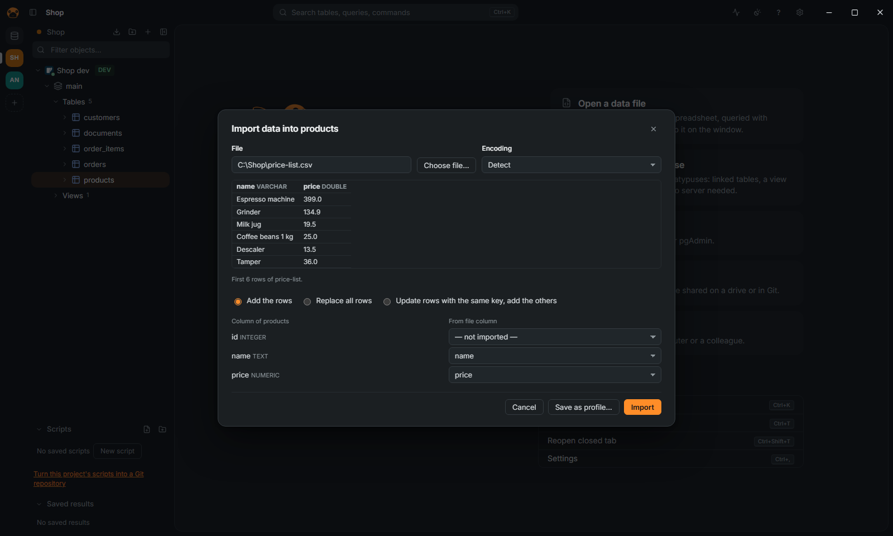

<!-- source: 925ae39e7303 -->
[← Guia do usuário](README.md)

# Importar e exportar

As ações abaixo estão no menu do botão direito do navegador e na paleta de comandos (`Ctrl+K`). A
lista completa de formatos e opções está em
[FEATURES.md](../../../FEATURES.md#import-export-and-transfer).

## Importar um arquivo em uma tabela

1. Clique com o botão direito na tabela, no navegador, depois em **Dados** › **Importar dados…**.
2. Escolha o arquivo: CSV, TSV, JSON, NDJSON, Parquet ou Excel.
3. Confira a visualização e o mapeamento das colunas.
4. Escolha **Adicionar as linhas**, **Substituir todas as linhas** ou **Atualizar as linhas com a
   mesma chave, adicionar as outras**, depois clique em **Importar**. A última exige uma chave
   primária na tabela e não é oferecida no ClickHouse.

**Importar dados…** é oferecido em tabelas, não em views. Para uma nova tabela, clique com o botão
direito no schema e escolha **Importar dados para uma nova tabela…**: os tipos são os que o DuckDB
infere do arquivo, e não há escolha de modo. **Colar CSV como nova tabela…** (no mesmo menu) importa
a área de transferência.

A importação não é oferecida em uma conexão somente leitura, em uma que proíbe a edição de dados,
nem em bancos de dados NoSQL.

## Exportar tabelas para um arquivo

1. Clique com o botão direito em uma tabela, ou selecione várias, depois em **Dados** › **Exportar
   dados…**. Para todas as tabelas de um schema, clique com o botão direito no schema e escolha
   **Exportar todas as tabelas…**.
2. Em **Formatar**, escolha o formato (CSV, JSON, NDJSON, Parquet, Excel, SQL `INSERT`, Markdown,
   HTML ou XML) e clique em **Exportar para pasta…**: mesmo para uma só tabela o app pede uma pasta, e escreve um
   arquivo por tabela, com o nome dela.
3. Se quiser, defina a **Compactação** (gzip ou zstd; não para Parquet e Excel, que já são
   compactados) e **Enviar também para…** um bucket (S3, GCS, R2 ou MinIO).

Quando você exporta o resultado de uma consulta (a exportação da grade de resultados), a caixa de
diálogo pede um só arquivo, e o envio também pode ir para uma URL assinada (S3 ou GCS).

As células CSV que uma planilha executaria como fórmula recebem um `'` no início, a menos que você
desative **Fórmulas como texto, para planilhas**. Uma conexão pode proibir exportações (página
**Aparência e segurança**); a ação então não é oferecida. Veja [Segurança](safety.md).

Para tirar o resultado de uma consulta, copie-o da grade como CSV, JSON, Markdown, HTML, SQL
`INSERT` ou uma lista `IN`.

## Copiar uma tabela ou um schema para outro banco de dados

Clique com o botão direito em uma tabela e escolha **Dados** › **Copiar para um banco de dados…**
(ele permite mapear as colunas), selecione várias tabelas de um schema e escolha **Dados** ›
**Copiar tabelas para um banco de dados…**, ou clique com o botão direito no schema e escolha
**Copiar esquema para um banco de dados…**. Os tipos são mapeados. O destino é uma conexão SQL que
não é somente leitura e permite a edição de dados. Copiar várias tabelas ou um schema é para origens
SQL; uma coleção do MongoDB ou um tipo de chave do Redis pode ser copiado para um banco de dados SQL.
Nenhuma dessas ações é oferecida quando a conexão proíbe exportações.

## Executar um arquivo SQL, ou despejar em um

Clique com o botão direito em uma conexão ou em um banco de dados e escolha **Executar arquivo SQL…**: ele executa um arquivo `.sql` (ou `.sql.gz`, `.sql.zst`) de qualquer tamanho, instrução por instrução,
com progresso e Parar, por padrão em uma transação que uma falha desfaz. **Despejar em arquivo SQL…**
(em um schema, ou em tabelas, em **Dados**) escreve o DDL de um schema ou de objetos escolhidos, e se quiser as linhas deles, em um só arquivo.

## Salvar uma transferência para depois

Toda caixa de diálogo de exportação, importação e cópia tem **Guardar como perfil…**. **Perfis de
transferência…** (paleta de comandos) executa, renomeia, exclui e agenda esses perfis. A chave
secreta de um bucket nunca é salva no arquivo do perfil.

## Consultar um arquivo de dados sem importá-lo

Solte um arquivo CSV, JSON, Parquet ou Excel na janela, ou clique em **Abrir um arquivo de dados** na
tela de boas-vindas: ele abre como um banco de dados (cada planilha do Excel é uma tabela). Na
primeira vez, o app oferece baixar a biblioteca do DuckDB.

## Importar conexões

Na tela de boas-vindas, **Importar conexões** lê o DBeaver, o DataGrip e o pgAdmin (e
`pg_service.conf`); conexões do Db2 do DBeaver e do DataGrip, e URLs `jdbc:db2:`, também são lidas.
**Exportar conexões** grava um arquivo `.platypusconn` para outro computador: veja
[Projetos e compartilhamento](projects-sharing.md).
