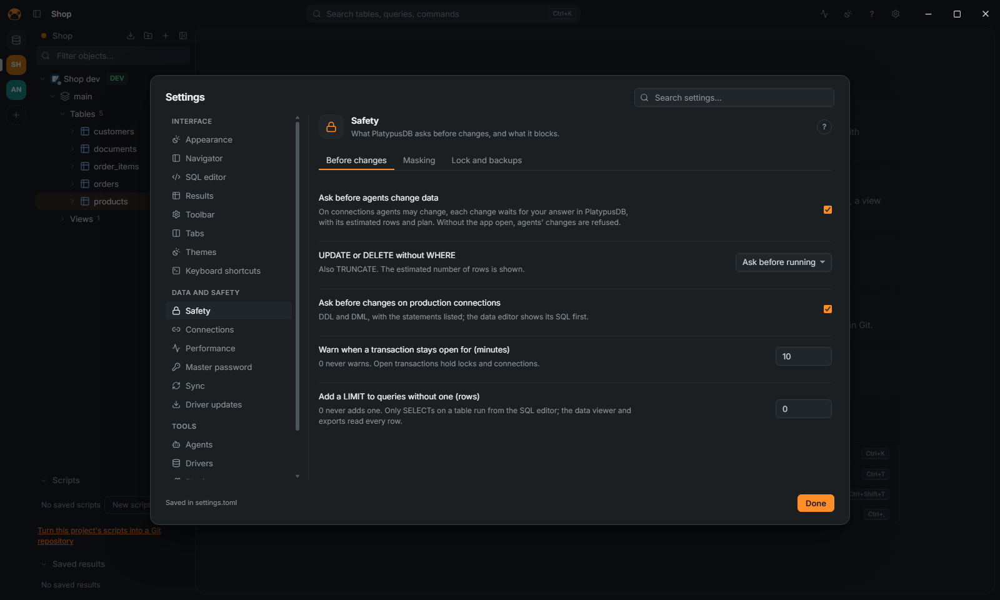

<!-- source: db93b8bc91b0 -->
[← Guia do usuário](README.md)

# Trabalhar com segurança: produção, somente leitura, confirmações, mascaramento

Tudo o que está aqui também está em [FEATURES.md](../../../FEATURES.md#transactions-and-safety).

## Marcar uma conexão como produção

1. Edite a conexão e abra a página **Aparência e segurança**.
2. Defina o ambiente como **Produção** (as outras opções são Desenvolvimento e Teste). A produção
   pergunta antes das alterações e começa em commit manual.
3. Se quiser, escolha uma cor, para distinguir a conexão com facilidade.

A partir daí, toda alteração nessa conexão é listada em uma caixa de diálogo intitulada
"Alterações em `<name>` (produção)", com as instruções, e só é executada depois que você confirma.
Configurações (`Ctrl+,`) › **Segurança** › **Perguntar antes de alterações em conexões de
produção** desativa isso para o app. Os agentes nunca passam de somente leitura em uma conexão de
produção.

## Tornar uma conexão somente leitura

1. Na mesma página, marque **Somente leitura (recusa alterações nos dados)**.
2. Uma instrução que pode modificar dados não é executada. O editor mostra "`<name>` é somente
   leitura e isto pode alterar dados." sem nenhuma forma de contornar. O mesmo vale para o Explain
   com analyze ("`<name>` é somente leitura e esta instrução pode alterar dados."), um arquivo incluído
   com `@include`, uma célula de notebook ("`<name>` é somente leitura: esta célula pode alterar
   dados."), o cliente de linha de comando e uma execução em várias conexões, que lista a conexão
   como ignorada ("Conexão somente leitura").
3. Não são oferecidos de forma alguma: **Importar dados…**, **Importar dados para uma nova
   tabela…**, **Colar CSV como nova tabela…**, **Gerar dados…**, **Executar arquivo SQL…**, a criação
   de objetos, o salvamento no designer de tabelas e a edição de linhas na grade. Os agentes
   continuam somente leitura.

O botão de cadeado de uma aba do editor torna somente leitura apenas essa aba, sem alterar a conexão
salva. Este é o único caso que pergunta: o editor mostra a mesma mensagem com um botão **Executar
mesmo assim**, e o cliente de linha de comando pergunta "Run anyway?".

A mesma página tem mais duas caixas: **Sem exportações** (seus dados não vão para nenhum arquivo,
outro banco de dados ou agente) e **Sem edição de dados** (as linhas mudam só por SQL, não na grade,
em importações nem em dados gerados).

## Confirmações

Configurações › **Segurança** › **Antes das alterações**:

- **UPDATE ou DELETE sem WHERE** (também `TRUNCATE`): **Perguntar antes de executar** (o padrão),
  **Nunca executar** ou **Executar sem perguntar**. A caixa de diálogo pergunta "Alterar todas as
  linhas?" e diz aproximadamente quantas linhas.
- **Avisar quando uma transação ficar aberta por (minutos)**: 10 por padrão, 0 nunca avisa.
- **Adicionar um LIMIT às consultas que não têm (linhas)**: 0 (o padrão) nunca adiciona.
- **Perguntar antes que os agentes alterem dados**: veja [Agentes](agents.md).

## Desfazer uma alteração

Ativada por padrão, a opção **Guardar as linhas que um UPDATE ou DELETE altera, para restaurá-las**
(Configurações › Segurança › **Bloqueio e cópias**) guarda as linhas de um `UPDATE` ou `DELETE` de
uma só tabela, até 10.000, executado pelo editor. Abra o **Registro de transações** na barra de
ferramentas do editor e clique em **Restaurar…**, ou execute **Snapshots antes de alterações…** na
paleta de comandos, para obter o script que as devolve.

## Mascarar dados sensíveis

1. Pressione `Ctrl+Alt+M` (ou execute **Mascarar dados sensíveis** na paleta de comandos): os
   valores das colunas sensíveis aparecem como pontos enquanto a tela é compartilhada. As cópias
   mantêm os valores reais.
2. Configurações › **Segurança** › **Mascaramento** define quais colunas são sensíveis, pelo nome
   (`*password*`, `*token*`, `*email*` e outros por padrão; `*` vale por quaisquer caracteres) e pelo
   tipo. Você também pode marcar uma coluna na aba da tabela dela.

Os agentes também leem as colunas sensíveis mascaradas, a menos que você marque **Mostrar aos
agentes os valores das colunas sensíveis** para essa conexão em Configurações › Agentes ›
**Segurança**. Um campo sensível dentro de um documento do MongoDB (`user.password`) também é
mascarado. Quando um agente pergunta no que você está trabalhando, uma coluna lida com outro nome
(`SELECT email AS contact`) também é mascarada; se a instrução a esconde atrás de uma subconsulta,
o resultado compartilhado inteiro é mascarado.

Uma regra ou uma marca removida fora do app (um agente com ferramentas de arquivo editando
`settings.toml` ou `catalog.db`) não chega aos agentes até você aceitar: o app pergunta, e
Configurações › Agentes › **Segurança** a lista, com uma forma de aceitar ou desfazer. Uma regra
adicionada fora do app vale na hora. Isso cobre edições desses arquivos e nada mais. Um agente que
pode executar comandos como o seu usuário pode ler o banco de dados por outros caminhos, ou o
chaveiro do sistema onde fica o selo: para manter os valores longe de um agente assim, execute-o
como outro usuário e dê à conexão um usuário de banco de dados sem acesso a essas colunas.

Uma resposta vale para o que a pergunta listava: se os arquivos mudarem de novo enquanto ela está
aberta, **Accept** não aceita nada e a lista é mostrada outra vez.

## Bloquear o app

Com uma senha mestra definida (veja [Conectar](connect.md#senha-mestra)), Configurações ›
**Segurança** › **Bloquear o app após estes minutos inativo** (0, o padrão, nunca bloqueia) bloqueia
o PlatypusDB e fecha as conexões de produção. **Bloquear PlatypusDB** na paleta de comandos o
bloqueia na hora. Digite a senha mestra para desbloquear: as conexões de produção se reconectam
quando são usadas.
