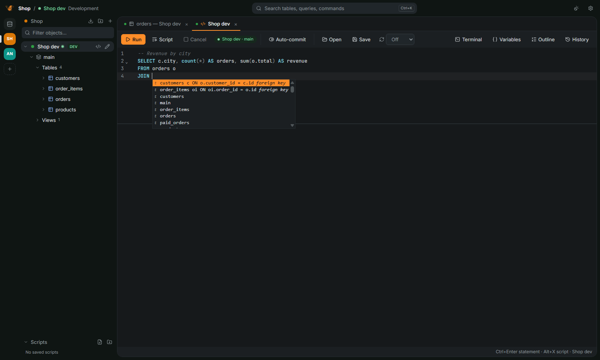
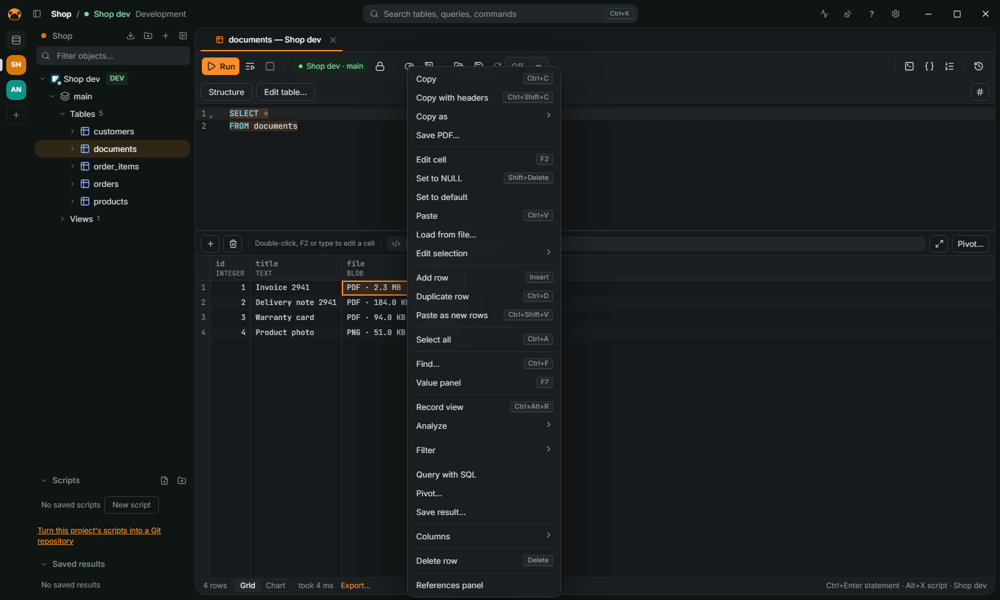

<!-- source: d4ffd9bf1ac2 -->
[← 用户指南](README.md)

# 运行查询并查看结果

## 运行语句

1. 双击连接（或表）打开 SQL 编辑器。
2. 输入语句。`Ctrl+Space` 补全关键字、表和列；输入 `JOIN ` 后会根据外键提示相关的表。
3. 按 `Ctrl+Enter` 运行光标所在的语句（或所选内容），按 `Alt+X` 运行整个脚本。`Ctrl+\` 在新的结果标签页中运行。
4. `Ctrl+.` 取消正在运行的语句。

语句以 `;` 结束，或以后面紧跟新语句起始词的空行结束。语句失败时，错误会在文本中标出，错误面板提供**转到错误**。`Ctrl+Shift+F` 格式化脚本；`Ctrl+S` 将其保存为 `.sql` 文件。

## 参数和变量

语句中的 `:id` 和 `?`，以及 `${name}` 变量，会在运行前通过对话框询问，并保存在“变量”面板中。`${name}` 的值会原样写入 SQL，因此带变量的语句会在填入值后重新检查（见[安全](safety.md)）。

## 查看结果

- 表格每次读取一页行。点击列标题排序：它会在编辑器中写入 `ORDER BY` 并重新运行；再点一次反向排序，第三次则恢复查询自身的排序。
- 在导航器中打开表即可浏览；在编辑器中输入 `WHERE` 可以过滤。
- `F7` 打开值面板：显示格式化的长文本、JSON 和 XML，以及二进制列中的十六进制和图像。
- 保存着文件的单元格（PDF、图像、ZIP 等，根据其字节识别）会显示类型和大小，例如 `PDF · 2.3 MB`。表格菜单提供**保存 PDF…**（或该文件的类型），选中一列中的多个单元格时还提供**将 N 个文件保存到文件夹…**。值面板有相同的按钮。
  保存着文件的文本单元格（`data:` URL、base64 或十六进制）在表格中没有标签，否则需要读取每个文本单元格才能判断：表格菜单和值面板会为你选中的单元格显示。
- `Ctrl+F` 在已加载的行中查找；`Ctrl+Shift+C` 连同标题一起复制所选内容。
- 结果可以从状态栏由表格切换为图表。

## 理解慢查询

对语句按 `Ctrl+Shift+E` 查看其计划。见 [FEATURES.md](../../../FEATURES.md#query-plans-and-performance)。

## 更多

已保存的脚本、代码片段、历史、vim 模式、在多个连接上运行脚本、查询构建器和数据分析见 [FEATURES.md](../../../FEATURES.md#sql-editor)。结果表格见 [FEATURES.md](../../../FEATURES.md#results-and-the-data-viewer)。
